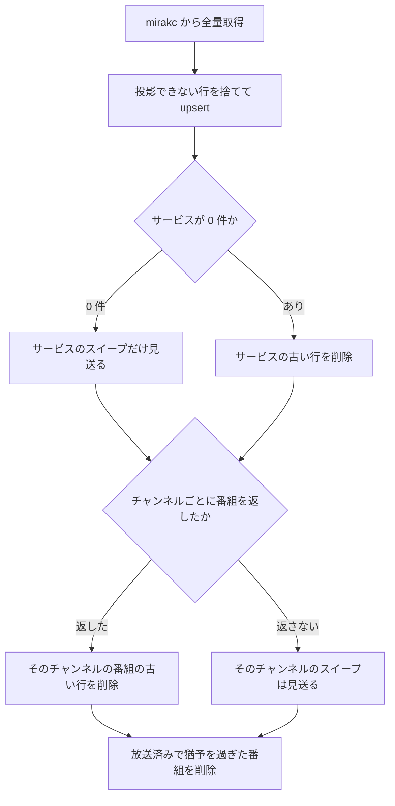

> [docs/schema.md](../schema.md)（索引）の分割本文。節番号は分割前のまま（§9 / §9.5）。

## 9. epg_services / epg_programs — EPG プロジェクション（使い捨てキャッシュ）

EPG プロジェクションは mirakc の番組表を写した使い捨てキャッシュで、権威は常に mirakc にある。api が mirakc に問い合わせずに済むよう、画面に描画するものを全部持つ。mirakc の運用状態は持たない。

レベルトリガーでいつでも全量再構築できるので、永続資産（予約・録画・メディア資産）とは寿命が違う。そのためスキーマ v1 から分離している。存在理由は、不変条件「api ロールは EPG を含むすべてのデータ読み取りを Postgres だけで完結させる」である。プロダクトが画面に描画するものを全部持つのは、この不変条件のためである（UI 完全形）。逆に、生の EIT/SI やチューナー状態といった mirakc の運用状態は入れない。

DDL の権威は `internal/db/migrations` である。

```sql
CREATE TABLE epg_services (
    site                  text    NOT NULL,
    network_id            integer NOT NULL,
    service_id            integer NOT NULL,
    type                  integer NOT NULL,
    logo_id               integer NOT NULL,
    remote_control_key_id integer NOT NULL,
    name                  text    NOT NULL,
    channel_type          text    NOT NULL CHECK (channel_type IN ('GR', 'BS', 'CS', 'SKY')),
    channel               text    NOT NULL,
    has_logo_data         boolean NOT NULL DEFAULT false,
    observed_at           timestamptz NOT NULL DEFAULT now(),
    PRIMARY KEY (site, network_id, service_id)
);

CREATE TABLE epg_programs (
    site        text    NOT NULL,
    program_id  bigint  NOT NULL,
    network_id  integer NOT NULL,
    service_id  integer NOT NULL,
    event_id    integer NOT NULL,
    start_at    timestamptz NOT NULL,
    duration_ms bigint  NOT NULL,
    end_at      timestamptz NOT NULL,   -- start_at + duration_ms（同期時にアプリが計算）
    is_free     boolean NOT NULL DEFAULT true,
    name        text    NOT NULL DEFAULT '',
    description text    NOT NULL DEFAULT '',
    genre_lv1   smallint[] GENERATED ALWAYS AS (genre_lv1_of(genres)) STORED,
    series_key  text GENERATED ALWAYS AS (series_key(name)) STORED,  -- シリーズ自動キー（data/series.md）
    extended    jsonb,   -- 拡張形式イベント（出演者等）
    genres      jsonb,   -- lv1 / lv2 / un1 / un2 の全量
    video       jsonb,   -- 映像属性
    audios      jsonb,   -- 音声属性
    observed_at timestamptz NOT NULL DEFAULT now(),
    PRIMARY KEY (site, program_id)
);
```

<details><summary>根拠</summary>

- DDL の権威: `internal/db/migrations`（`epg_services` / `epg_programs` テーブル定義）
- 永続資産: `reservations` / `recordings` / `media_assets`

</details>

### 列と索引の設計

列と索引の判断は 3 つある。キーと列の型、索引と autovacuum、ロゴの列である。

#### キーと列の型

主キーに site を含めるのは、地上波のチャンネル構成がサイトの地域ごとに異なるからである。クエリ軸は型付きカラムにし、詳細は jsonb に置く。サービス・時間範囲・ジャンル・無料かどうかが型付きである。

ジャンルの絞り込みには、第 1 階層だけを重複なく取り出した配列を GIN 索引で引く。録画の表と同じ関数で導出する。詳細は、ジャンルの全量を持つ jsonb 側にある。

終了時刻は生成列にしない。時刻に区間を足す式が STABLE（TimeZone 設定に依存）で、IMMUTABLE を要求する生成列に使えないからである。同期時にアプリが計算して書く。

<details><summary>根拠</summary>

- 主キーに含める列: `site`
- 詳細を持つ jsonb: `genres`
- 絞り込み用の配列: `genre_lv1`。録画の表と同じ関数 `genre_lv1_of` で導出する
- 生成列にしない列: `end_at`。生成列に使えない式: `timestamptz + interval`

</details>

#### 索引と autovacuum

pg_trgm の GIN 索引を、番組名と説明に張る。LIKE だけでなく正規表現マッチも加速するので、ruler のルール評価が同じ索引に乗る。

全量 upsert を繰り返して churn が大きいので、autovacuum は既定より積極的にする。

<details><summary>根拠</summary>

- 索引を張る列: `name` / `description`
- 正規表現マッチの演算子: `~`

</details>

#### ロゴの列

サービスのロゴ ID とロゴ有無の 2 列は、mirakc のサービス構造体をそのまま射影しているだけである。局ロゴの再取得と自前配信はドロップした（[データ層](../data.md)「サービスロゴ: ドロップ」）。ただし、この 2 列の削除は不要である。

<details><summary>根拠</summary>

- 射影している列: `has_logo_data` / `logo_id`
- mirakc の構造体: `Service`

</details>

### 同期と件数の上限

worker ロールの定期ジョブが、mirakc の番組表を全量取得して upsert する。差分同期はしない。同じパスで、mirakc から消えた行と、放送済みで猶予を過ぎた番組を削除するので、プロジェクションは永遠に太らない。

定期ジョブは既定で 10 分間隔で、専用キューで同時実行 1 とする。



<details><summary>根拠</summary>

- 定期ジョブ: River の `epg_sync`
- 取得する API: `GET /api/services` / `GET /api/programs`

</details>

#### 2 種類の削除

1 パスで 2 種類の削除をする。

| 削除 | 条件 | 意図 |
|---|---|---|
| stale スイープ | 最終観測が基準時刻より前 | mirakc から消えた行を落とす |
| ローリングウィンドウ | 終了が基準時刻の猶予前より前 | 放送済みの番組を刈り取る |

猶予は `retention_grace` で、既定は 24h である。stale スイープは、番組編成の変更とサービスの削除を拾う。

<details><summary>根拠</summary>

- stale スイープの条件: `observed_at < 基準時刻`
- ローリングウィンドウの条件: `end_at < 基準時刻 - retention_grace`

</details>

#### 基準時刻の取り方

基準時刻はアプリのクロックから取らず、DB の現在時刻から取る。クロックスキューで基準時刻が全行の最終観測より後になると、毎パスでプロジェクション全体を消して再投入する churn のトラブルになるからである。

<details><summary>根拠</summary>

- 基準時刻の取得: `SELECT now()`
- 比較される列: `observed_at`

</details>

#### スイープの単位

番組の古い行のスイープは、物理チャンネル単位に絞る。今回番組を返したチャンネルに属するサービスの行しか削除しないので、1 チャンネルだけ番組が返らなくても、その番組表を消さない。

mirakc の EPG 収集（`jobs.update-schedules`）は物理チャンネルごとに実行され、既定では 1 日 2 回・timeout 10 分である。1 回の収集では、1 回チューニングして、そのチャンネルのサービス ID だけを指定して EIT を集める。録画とのチューナー競合や timeout で、1 チャンネルだけ番組が返らないことがある。サイト単位でスイープすると、そのチャンネルの番組表だけが消える。

対象チャンネルのサービスは、番組 0 件のものも含める。マルチ編成が終わったサブサービスの古い行を消せるようにするためである。サービス単位に絞ると、その行が残ってしまう。

番組の表はチャンネル列を持たないので、スイープは network_id と service_id の組で対象を指す。クエリは network_id ごとに分けて呼ぶ。1 つの TS は 1 つの original_network_id を持つので、チャンネルより粗くならず、可変長の組を SQL に渡さずに済む。

<details><summary>根拠</summary>

- EIT 収集の実行: `collect-eits --sids=<そのチャンネルの SID>`
- 番組の表: `epg_programs`
- 対象を指す組: `(network_id, service_id)`。分けて呼ぶ単位: `network_id`

</details>

#### 空応答の扱い

mirakc が空を返したら、スイープを見送る。再起動直後は EPG を読み込み終えておらず、空リストを返しうる。そのままスイープすると番組表が丸ごと消え、次の同期までの数分間、UI が空になる。削除しなくても、次のパスが収束させる（レベルトリガー）。大量削除の前で立ち止まる規律は、reconciler のサーキットブレーカーと同じである。

#### 最終観測の列に索引を張らない理由

最終観測の列には、意図的に索引を張っていない。この列は毎パスで全行が更新されるので、索引があると HOT update が一切機能しなくなり、ブロートが悪化する。スイープの seq scan より、更新経路を HOT に保つ方が、churn の総量では有利である。

<details><summary>根拠</summary>

- 索引を張らない列: `observed_at`

</details>

#### 投影できない行

投影できない行は捨てて、同期は続行する。1 行で全体を落とさないためである。捨てる行は 3 種類ある。

- 開始時刻が無い番組。時間軸に置けない
- 名前が無い番組。サブサービスの影の行である（次節）
- チャンネル種別が GR・BS・CS・SKY 以外のサービス。CHECK 制約に載らない

<details><summary>根拠</summary>

- 開始時刻: `startAt`
- 名前: `name`
- チャンネル種別: `channel_type`

</details>

### サブサービス: 番組は絞る、サービスは絞らない

番組は名前のある行だけ投影し、サービスは全件投影する。影の行を落とすと番組が 62% 減る。サービスは、マルチ編成のサブサービスを隠せないので、絞らない。

地上波は 1 物理チャンネルが複数サービスに分かれる（`ＮＨＫ総合１/２`、`ＲＮＣ西日本テレビ１/２/３` 等）。マルチ編成でないとき、サブサービス側は同じ eventId で名前が null の影の行として返るので、1 番組が 2〜3 行に重複する。実測では 7139 件中 4459 件が影の行だった。

#### 番組の絞り込み

名前のある行だけ投影すると、7139 件が 2680 件になる（62% 減）。影の行を落としても録れなくなる番組はなく、マルチ編成の実番組は名前を持つので予約・録画できる。

これは、EPG 射影の唯一の実性能懸念である churn と autovacuum への追従に、直接効く。mirakc の録画はサービス単位に絞るため、影の行を予約しても、得られるものは同じ shared グループの親と同じか空になる。逆に、マルチ編成の実番組は名前を持つのでこのフィルタを通り、予約・録画できる。

EPGStation は `relatedItems` を見る `isMainProgram()` と名前のチェックの二段で、同じことをしている。だが実データ 7139 件で、「名前があって shared の main でない番組」が 0 件だった。名前の有無だけで同一の結果になるので、`relatedItems` の移植は不要である。

<details><summary>根拠</summary>

- 名前: `name`
- サービス単位の絞り込み: mirakc の `filter-program --sid --eid`
- EPGStation の二段の判定: `relatedItems` と `isMainProgram()`

</details>

#### サービスの扱い

サービスは全件投影する。19 行では churn が無視でき、マルチ編成を持つサブサービス（NHK 総合 2 の高校野球等）を隠せないからである。番組のない空列を隠すのは UI の関心事とし、「そのサービスに窓内の番組が 1 件でもあるか」で判定する。

<details><summary>根拠</summary>

- マルチ編成を持つサブサービスの例: `ＮＨＫ総合２`

</details>

#### 刈り取りで影響を受けないもの

予約・録画は、このテーブルに依存しない。予約の GC は番組の開始時刻と長さで判定する（§3）。録画した番組の情報は、録画の表に非正規化スナップショットされる（§5）。だから、刈り取りで永続資産がおかしくなることはない。

<details><summary>根拠</summary>

- 予約の GC の判定式: `program_start_at + program_duration_ms`
- スナップショットの置き場: `recordings`

</details>

## 9.5 tuner_sync — チューナー射影（使い捨てキャッシュ）

チューナー射影は mirakc のチューナー観測結果を写した使い捨てキャッシュで、権威は常に mirakc 側にある。容量超過の判定（[データ層](../data.md) §6.5）が使う。api は mirakc に問い合わせないので、チューナーの本数と対応種別を DB に射影しておく必要がある。

`epg_services` / `epg_programs` と同じ使い捨てプロジェクションで、レベルトリガーでいつでも全量再構築できる。DDL の権威は `internal/db/migrations` である。

存在理由は不変条件 1（api ロールは mirakc に問い合わせない）である。EPGStation のように起動時に `/api/tuners` を叩いて in-memory に持つ形は取れない。チューナーの対応種別が必須なので（GR 専用チューナーに BS は載らない）、本数を設定に手書きする案も成立しない。

```sql
CREATE TABLE tuner_sync (
    site          text    NOT NULL,
    tuner_index   integer NOT NULL,   -- mirakc のレスポンスの index
    name          text    NOT NULL,
    types         text[]  NOT NULL CHECK (types <@ ARRAY['GR','BS','CS','SKY']),
    is_available  boolean NOT NULL,
    is_fault      boolean NOT NULL,
    observed_at   timestamptz NOT NULL DEFAULT now(),
    PRIMARY KEY (site, tuner_index)
);
```

<details><summary>根拠</summary>

- DDL の権威: `internal/db/migrations`（`tuner_sync` テーブル定義）
- 観測元: mirakc の `GET /api/tuners`

</details>

### 列の設計

列の判断は 4 つある。投影しないもの、主キー、対応種別の制約、行が無いサイトの扱いである。

#### 投影しないもの

現在の利用者は容量から引かないので、利用者・使用中・コマンド・プロセスの情報は投影しない。現在の利用は一時的な占有であり、将来の区間の容量とは無関係だからである。「見えない消費者は数えない = 下界を主張する」性質とも一貫する。

mirakc のチューナー型にも、これらのフィールドを持たせない。フィールドがあると、投影する経路ができてしまう。

<details><summary>根拠</summary>

- 投影しない項目: `users` / `isFree` / `isUsing` / `command` / `pid`
- フィールドを持たせない型: `internal/mirakc.Tuner`

</details>

#### 主キーの選び方

主キーにはチューナーのインデックスを採り、名前は採らない。名前は運用者が付ける値なので、同名が 2 本あると upsert で 1 行にまとめられてしまう。そうなると、容量を過少に数えて、警告が過剰に出る方向へ恒久的にずれる。毎パス上書きされるので、自己修復もしない。

容量判定の設計は、既知の盲点がすべて「警告を見逃す」方向に偏っていることを性質として挙げている（[データ層](../data.md) §6.5）。同名が 1 行にまとまる動きは、その性質を崩す。インデックスは並び替えで振り直されるが、毎パス全量再構築するので、誤りは残らない。

<details><summary>根拠</summary>

- 採らない主キー: `(site, name)`
- 採る主キー: `(site, tuner_index)`。mirakc のレスポンスの index に対応する列: `tuner_index`
- 過少に数える容量: `cap(A)`

</details>

#### 対応種別の制約

対応種別の配列に、要素が 1 つ以上あるという CHECK は置かない。空配列のチューナーは、容量に数えられないだけで無害である。想定外の上流データで同期パス全体を失敗させる方が、損が大きい。

重複や順序の正規化もしない。容量の計算は集合の交差判定なので不要である。ルールのエンコードプロファイルのような、正規集合チェックは要らない。

<details><summary>根拠</summary>

- 置かない CHECK: `types` への `cardinality > 0`
- 容量の計算: `cap(A)`
- 正規集合チェックの例: `rules.encode_profiles`

</details>

#### 行が無いサイト

行が 1 行も無いサイトでは、容量判定は何も主張しない（[データ層](../data.md) §6.5「実装で決めたこと」）。「0 本」と「まだ同期していない」を、射影から区別できないからである。

## 9.6 transfer_backlog_snapshots — 置き場ごとの転送待ちの件数（使い捨てキャッシュ）

上限付きの置き場ごとに、encode reconcile が直近に数えた転送待ちの件数と、数え始めた時刻を持つ。件数は資産の行から数え直せるので、失っても次に数えるパスが作り直す。

行は「上限付きの置き場として 1 回は数えた」を意味し、数えていない置き場の行は作らない。上限を外した置き場の行は、次に数えるパスが消す。書き手は encode reconcile だけである（不変条件 12）。

止まっているかは列にしない。上限は設定の値で、設定を変えると同じ件数でも答えが変わるので、読む側が件数と今の上限から導く（不変条件 9）。時刻は数え始める直前に DB の時計から取って呼び出し側が渡し、保存済みより新しいときだけ書く。Pod ごとの時計のずれが比較に入らないようにするためである。並行するパスで、古い件数が新しい件数を戻さないためである。

失ったときは、行が無い置き場の系列が、次に数えるまで出ない。止まっていた置き場は、次に数えたパスで Warn がもう 1 回出る。前の状態が無いと、止まり始めと区別できないためである。

ScaledJob の `--once` では、プロセスのメモリが毎回空から始まる。そこで、変化の判定と scrape で読むゲージの値を、プロセスをまたいで DB に置く。列の形は migration が権威である。

<details><summary>根拠</summary>

- 失った後に作り直され、Warn がもう 1 回出て、系列が出ないこと: `TestEncodeReconcile_LostSnapshotIsRebuiltAndWarnsAgain`
- 古い時刻の件数で上書きしないこと: `TestRecordTransferBacklog_StaleCountDoesNotOverwrite`
- 並行する保存で変化を見るのが 1 つだけであること: `TestRecordTransferBacklog_ConcurrentCallsSeeTheChangeOnce`

</details>
