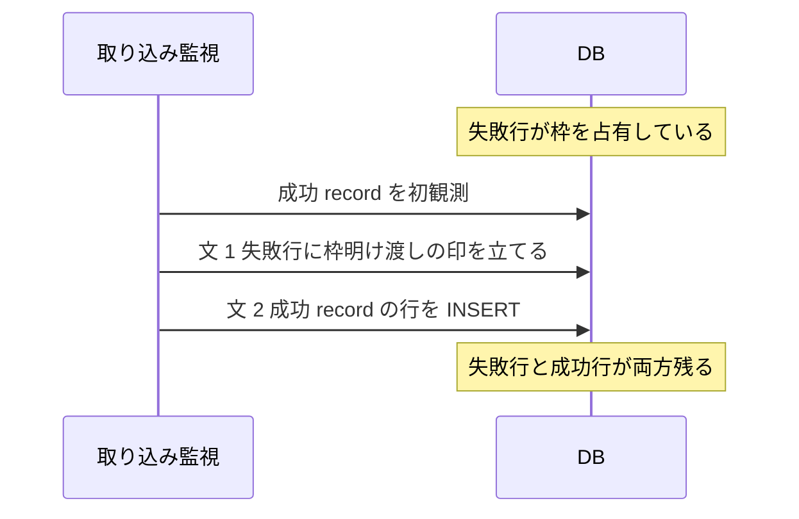
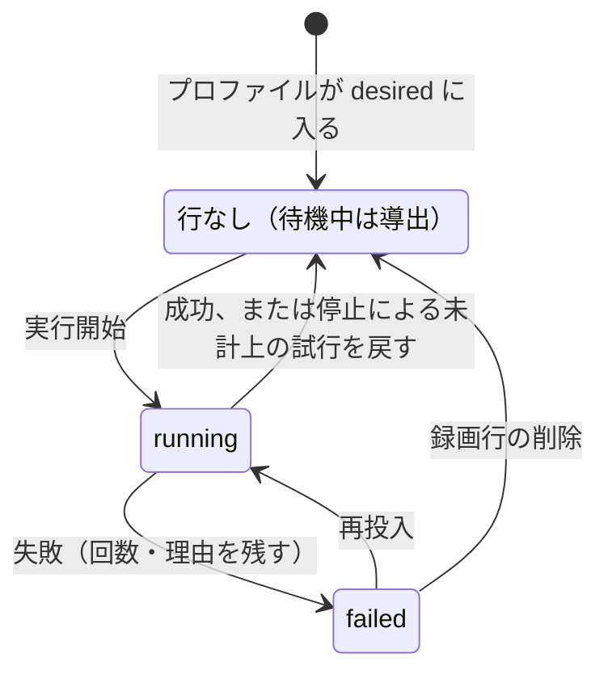

> [docs/schema.md](../schema.md)（索引）の分割本文。節番号は分割前のまま（§5 / §6）。

## 5. recordings — 録画履歴（永続資産）

録画履歴の表は、録画の試行の帰結だけを持ち、失敗した試行も行として残す。番組情報は録画時点の内容を非正規化して持つ。別の書き手が書く状態は、この表に列を足さず、録画を指す衛星表に置く。

失敗した試行も残すのは、録画品質の実測と再放送待ちの判断に使うからである。番組情報の非正規化により、EPG の表にも mirakc にも依存しない。

**この表に新しく列を足してよいのは、試行の帰結を観測する書き手が書く列だけである**（不変条件 13）。録画履歴は試行の観測だけを持つ脊椎で、別の状態機械が書く列は衛星表に置く。メディアアセット（下記 §6）も衛星表で、判定基準と境界は [invariants.md](../invariants.md) §13 にある。

原本の保持方針とエンコードプロファイルは、予約オプションの効力スナップショットなので、同じ基準で衛星表に切り出してある。ingest worker が凍結し、api が追記する（下記「recording_encode_policy — 原本保持ポリシーの凍結」参照）。「今すぐ完全削除してほしい」というユーザーの要求も、api が立てて api が取り消すので衛星表にある（下記「recording_purge_requests — 即時完全削除の要求（衛星表）」を参照）。

「隣に削除の列があるから」は、本体に置く根拠にならない。削除の列と枠明け渡しの列が本体にあるのは、部分一意索引の述語が参照するからである。既存のテナントであることを根拠にすると、間借りが次の間借りを正当化する。

```sql
CREATE TABLE recordings (
    id                bigint GENERATED ALWAYS AS IDENTITY PRIMARY KEY,
    rule_id           bigint,        -- トレーサビリティ。rules への FK（ON DELETE SET NULL）
    source            text   NOT NULL CHECK (source IN ('rule', 'manual', 'unattributed')),
    site              text   NOT NULL,  -- どのサイトで録画したか（履歴として snapshot）

    -- 番組情報スナップショット（ARIB/ISDB の概念であり mirakc 固有ではない）
    network_id        integer NOT NULL,
    service_id        integer NOT NULL,
    event_id          integer NOT NULL,
    service_name      text    NOT NULL,
    channel_type      text    NOT NULL CHECK (channel_type IN ('GR', 'BS', 'CS', 'SKY')),
    channel           text    NOT NULL,
    title             text    NOT NULL DEFAULT '',
    description       text,
    extended          jsonb,                     -- 拡張形式イベント（出演者等）
    genres            jsonb,                     -- [{lv1, lv2, un1, un2}]
    is_free           boolean NOT NULL DEFAULT true,
    program_start_at  timestamptz NOT NULL,
    program_duration_ms bigint NOT NULL,

    -- 録画実行の結果（mirakc の recording.status。詳細は下記「status の権威」）
    status            text NOT NULL CHECK (status IN ('recording', 'finished', 'canceled', 'failed')),
    started_at        timestamptz,               -- 実際の録画開始（record の startTime）
    ended_at          timestamptz,

    -- 品質イベントログ（recording.failed / record-broken の理由。§8 参照）
    -- mirakc の reason を jsonb のまま保持し、構造化カラムにはしない（不変条件 7）
    quality_events    jsonb NOT NULL DEFAULT '[]',

    -- 「本物の record が推論に必ず勝つ」ために追加。この行が同一 active-event の
    -- 枠を明け渡した不可逆な事実だけを持つ（§「同一イベントの重複防止」参照）。
    -- ユーザーの「ごみ箱送り」を表す deleted_at とは別列（不変条件 9: 2 つの
    -- 異なる「消える理由」を同じ列に混ぜない）。
    superseded_at     timestamptz,

    -- ごみ箱（録画単位の論理削除。原本 + 派生物 + サムネイルのグループごと）
    deleted_at        timestamptz,
    -- 即時物理削除の要求はここには無い（recording_purge_requests 衛星表。
    -- 下記「recording_purge_requests」節参照）。

    -- 「完全削除が完了した」不可逆な事実。削除 reconcile が
    -- パス末尾で、ごみ箱条件を満たしかつ物理削除待ちの media_assets が 1 行も
    -- 残っていない録画に一度だけ立てる。ごみ箱一覧（GET /api/recordings?trash=true）は
    -- この列も IS NULL であることを要求するので、purge が完了した録画は
    -- ごみ箱一覧から外れる（[storage.md](../storage.md) §7）
    purged_at         timestamptz,

    created_at        timestamptz NOT NULL DEFAULT now(),
    updated_at        timestamptz NOT NULL DEFAULT now()
);

CREATE INDEX ON recordings (program_start_at DESC, id DESC);  -- ライブラリ一覧（keyset）
CREATE INDEX ON recordings (network_id, service_id, program_start_at);  -- 視聴済みを放送イベント単位で束ねる
CREATE INDEX ON recordings (network_id, service_id, event_id);
CREATE INDEX ON recordings (rule_id) WHERE rule_id IS NOT NULL;  -- rules 削除・重複排除・ruleId 絞り込み
CREATE INDEX ON recordings (deleted_at) WHERE deleted_at IS NOT NULL;  -- ごみ箱ビュー
CREATE INDEX ON recordings (purged_at) WHERE purged_at IS NULL;  -- ごみ箱一覧の絞り込み
-- 履歴ベース重複排除は title の trgm 類似度で判定するが、GIN は張っていない。
-- gin_trgm_ops が加速するのは % / <% / LIKE / 正規表現で、similarity() の関数呼び出しには
-- 使われない（% の閾値は GUC pg_trgm.similarity_threshold 由来でルール単位の閾値と噛み合わない）。
```

品質イベントのログは、録画の失敗と record 破損の履歴を持つ。スクランブル件数はドロップ統計から導けるので、ここには重ねて記録しない。旧 catalog も読み込めるため、rescue はスクランブルの異常だけを除き、他のイベント順は保つ。

<details><summary>根拠</summary>

- 品質イベントのログ: `quality_events`（`recording.failed` / `recording.record-broken`）
- スクランブル件数の導出元: `drop_stats.scrambled`
- rescue が除くスクランブルの異常: `bcas_anomaly`
- 旧 catalog のイベント順を保つことの検証: `TestRescueLegacyQualityEvents`

</details>

### 行の作られ方

**録画履歴の行は、mirakc が報告した録画の試行だけを持ち、書き手は取り込み監視だけである。** 録画されなかった試行も行にする。番組終了まで schedule が一度も観測されなかったものは試行ではないので、行を作らず、欠測として別の表に書く。

取り込み監視が mirakc の record を初めて観測すると（SSE または全量の突き合わせ）、record の番組とサービスのペイロードからスナップショットして行を INSERT し、同期表の行から参照する。開始の失敗など、record が存在しない録画失敗は、状態が失敗の行を作り、品質イベントに理由を記録する。SSE を取りこぼしても、失敗した schedule が schedules API に残っている間は、定期の突き合わせが同じ行を再構成する。録画されなかった試行も履歴に残る。

records API に残る失敗状態・失敗理由付きの record についても、突き合わせが失敗理由を品質イベントに補完する。schedule が削除済みで record も無い録画失敗と record 破損は、mirakc API だけでは再構成できず、SSE でしか拾えない。

番組終了時点で schedule が一度も観測されなかった場合は、reconciler が後述の欠測の表に書き、ライブラリには失敗した録画として出さない。同じ放送イベントに mirakc 由来の失敗行が既にある状態で、後から成功 record が初観測されたときは、失敗行に枠を明け渡させてから、新しい行を INSERT する（下記「同一イベントの重複防止」の supersede 参照）。

出自は作成時点の値を一度だけ snapshot する。予約行も `record` 意図も無い録画は、出自を `unattributed` とし、後から予約や意図を推測して書き換えない。取り込みの完了は、メディアアセットの行の有無で表す（コミット = DB 行）。録画の状態の列には載せず、冗長な状態の列を持たない。

<details><summary>根拠</summary>

- 録画の行を参照する同期表: `record_sync`
- 失敗の履歴の理由の種別: `record-broken`
- 失敗した schedule からの再構成と失敗理由の補完: `record_sweep`
- record が存在しない録画失敗の例: `start-recording-failed`
- 失敗状態・失敗理由付きの record: `recording.status=failed` / `failedReason`
- 欠測の表: `never_scheduled_events`
- 失敗行が枠を明け渡す印: `superseded_at`
- 出自: `source`、`unattributed`、`record` 意図

</details>

### status の権威

**状態の権威は、mirakc が報告したレコードの状態である。** 値は 4 つで閉じ、取消は失敗とは別の独立した値で持つ。未知の値は失敗に丸め、生の値は同期表に残す。

Rokuban から見た録画の帰結は権威にならない。値は mirakc の records API が報告する状態をそのまま転記したものである。mirakc-core の状態が 4 バリアントの網羅的 enum であることは、ソースで確認済みである。record の無い行は状態を持たない。値の元は `GET /api/recording/records` の状態である。

取消（録画開始後にスケジュールが削除される等）は、失敗とは別の事実である。取消を失敗に丸めると録画一覧が「失敗した」と誤って示すので、独立した 4 値目として持つ。

これは不変条件 7「mirakc 固有の概念を永続テーブルに入れない」の違反ではない。既存の 3 値はもともと mirakc の語彙で、取消の追加はその踏襲である。不変条件 7 が禁じるのは、mirakc の内部 ID・タグ形式・スケジュール状態のような実装詳細に紐づく構造の持ち込みである。録画結果の語彙（成功・失敗・取消）は、ドメインの外部仕様として妥当な粒度と言える。

未知の値（mirakc が将来値を追加した場合）は、5 値目を足さずに失敗へ丸める。正規化は watcher が行い、生の値は同期表の状態（CHECK 無し）にそのまま残るので、観測は失われない。取消を失敗に丸めるのは分かっている 2 つの事実を潰すが、未知の値は「何が起きたか分からない」という状態そのものが事実である。そのため、粗い失敗への集約を許容する。次に mirakc が値を足したら、watcher の ERROR ログを起点にこの CHECK と `openapi.yaml` の enum を更新する。

schedule が一度も観測されなかった欠測を表す 5 値目（`never-scheduled` 等）は足さない。欠測は record の状態ではない。後述の専用表で表す。

<details><summary>根拠</summary>

- 状態の列: `status`
- 状態の 4 値: `recording` / `finished` / `canceled` / `failed`
- 状態の元: `GET /api/recording/records` の `recording.status`
- mirakc-core の網羅的 enum: `RecordingStatus`
- 内部 ID・タグ形式・スケジュール状態の例: `RecordingScheduleState`
- 未知の値の正規化: `internal/watcher.normalizeRecordingStatus`
- 生の値の残り先: `record_sync.status`
- 更新するもの: `internal/watcher`、`openapi.yaml`

</details>

### never_scheduled_events — schedule 欠測（放送地平を超えて残す観測）

**行の存在が、番組終了時点でそのイベントの schedule が一度も観測されなかったという主張である**（不変条件 10）。主キーは放送イベントで、本物の録画が後から来ても、寿命内なら消さず、録画と欠測の両方が残る。

寿命は、番組情報のスナップショットとは別である。書き手は reconciler だけで、衝突時は何もせず、最初の観測を記録する。INSERT の条件は「番組終了」「今パスで schedule 非観測」「同じ放送イベントに生きている録画行が無い」の積である。生きているの定義は、重複防止の部分一意索引と同じ「削除されておらず、枠を明け渡してもいない」である。

番組スナップショットへの FK は張らない。スナップショットは放送と猶予で GC されるが、欠測は EPG の放送地平を超えて残す観測だからである。通常この表の読者は予約行を経由し、予約行はスナップショットと一緒に放送と猶予で先に GC される。そのため、欠測行を `retention_grace + 30日` まで残しても、読者からは観測されない。

ruler は `retention_grace + 30日` で欠測行を刈る。スナップショットの CASCADE と同時に消すと、GC の後に同期除外が外れ、終了済みの予約が再び schedule 対象になる。ただし `program_id` の再利用で同じ放送イベントのキーから新番組が到達可能になる経路では、この前提は成り立たない（[reservations.md](reservations.md) §3.7 の未解決の窓）。

予約への FK も持たない。予約行は ruler が削除・再作成しうるので、読者は放送イベントのキーで引く（不変条件 9「identity」）。

本物の record が後から来ても、欠測行が寿命内なら消さない。録画と欠測の両方が残る。表示は本物の録画行があれば orphaned を消すが、同期除外は欠測行の存在だけを見て、終了済みの予約を対象に戻さない（[reservations.md](reservations.md) §3）。行の寿命を超えた後は、再露出ガードとしての役目を終えているので GC される。

mirakc 由来の失敗は録画履歴にだけ現れ、この表には入らない。したがって、録画途中の失敗からの再試行経路を妨げない。観測時刻は reconciler が欠測を書いた時刻である。同期除外と表示の判定軸は行の存在だけで、時刻は使わない。

<details><summary>根拠</summary>

- 主キー: `(site, network_id, service_id, event_id)`
- 唯一の書き手と書き込み方: `recordNeverScheduled`、`ON CONFLICT DO NOTHING`
- 生きているの定義と、同じ定義の索引: `recordings_unique_active_event`、`deleted_at IS NULL AND superseded_at IS NULL`
- FK を張らない相手: `program_snapshots`、`reservations`
- 寿命と刈る主体: `retention_grace + 30日`、`ruler`
- 再利用で前提が成り立たなくなる識別子: `program_id`
- 観測時刻: `observed_at`

</details>

### ごみ箱

録画の削除はごみ箱への論理削除で、ファイルには触れない。物理削除は削除の突き合わせループが、即時の完全削除の要求か猶予期間の経過を拾って、アセット単位で実行する。物理削除の後も、録画の行と記録は残る。

UI の削除は削除の印を立てるだけである。復元は印を消し、即時削除の要求行を消すだけである。「今すぐ完全削除」は即時要求の衛星表に行を入れるだけで、ファイルは消さない。録画が未削除なら削除の印も同時に立てる。

物理削除を起こすのは、即時要求の行がある場合と、削除から猶予期間（既定 30 日）が経った場合の 2 つである。物理削除の後も、録画の行とメディアアセットの tombstone は残る。ごみ箱を空にしても、録画履歴・ドロップ統計・重複排除は壊れない。

API は `DELETE /api/recordings/{id}` / `POST .../restore` / `POST .../purge` / `GET /api/recordings?trash=true` である。即時要求の表の形と書き手の判断は、下記「recording_purge_requests — 即時完全削除の要求（衛星表）」参照。

<details><summary>根拠</summary>

- 論理削除の印と復元で消すもの: `deleted_at`
- 猶予期間の判定: `deleted_at + 猶予期間（既定 30 日）`
- 即時要求の表と残る行: `recording_purge_requests`、`media_assets`

</details>

### recording_purge_requests — 即時完全削除の要求（衛星表）

**即時完全削除の要求は、衛星表に置く。** 録画履歴の列にはしない。行の存在が要求を表し、取り消しは DELETE で表す（不変条件 10 / 13）。要求を立てて取り消すのは API で、試行を観測する書き手ではないからである。

```sql
CREATE TABLE recording_purge_requests (
    recording_id bigint PRIMARY KEY REFERENCES recordings (id) ON DELETE CASCADE,
    requested_at timestamptz NOT NULL DEFAULT now()
);
```

理由は書き手にある。この要求を定常運用で立てるのも取り消すのも api ロールであり、録画履歴を書く取り込み監視と reconciler（試行の帰結の観測）ではない。rescue は別枠で、災害復旧で catalog ダンプから全表を書き戻すので、この表も他の表と同じように書く。

「削除の列が本体にあるから隣に置く」は根拠にならない。削除の列と枠明け渡しの列が本体に残っているのは、部分一意索引の述語がこの 2 列を参照するからである。述語は他表を参照できないので、即時要求はその述語に出ない（枠が明くのは 2 列だけ）。

完了後に要求行を掃除する経路は作らない。掃除役を足すと、削除 reconcile が 2 人目の書き手になる（不変条件 12）。「ユーザーが即時削除を要求した」は完了後も真なので、tombstone と一緒に残す。要求時刻は「いつ要求されたか」だけを持ち、判定には使わない。ここを現在時刻と比較し始めたら、実質 boolean を timestamptz で持っていた旧列に戻る。

復元（削除の印を消し、要求行を DELETE する）は、トランザクション内の 2 文で書く。1 文のデータ変更 CTE にはしない。CTE は全アームが 1 つのスナップショットを共有する。行ロックで UPDATE アームが待たされている間に commit された要求行は、DELETE アームから見えない。その結果、「復元は成功したのに要求行だけ残る」が観測される。残った要求行はその場では何も起こさないが、次の普通の論理削除で猶予をバイパスする。2 文なら、DELETE が UPDATE の後に新しいスナップショットを取るので、要求行が見える。

この表に行を入れる経路は、対象の録画行を先にロックする（個別 purge は UPDATE アームがそれを兼ねている）。復元を 2 文に割っただけでは、窓は閉じない。DELETE が 0 行のとき、ロックは何も残らない（READ COMMITTED に述語ロックは無い）。そこへロックせずに INSERT する経路を足すと、復元の DELETE 後・COMMIT 前に commit された要求行が残り、猶予バイパスが再発する。例は一括 purge を `INSERT ... SELECT` で書く場合である。

<details><summary>根拠</summary>

- 本体に残る 2 列と、それを参照する索引: `deleted_at` / `superseded_at`、`recordings_unique_active_event`
- 完了の印: `purged_at`
- 要求時刻（判定に使わない）: `requested_at`、現在時刻との比較 `<= now()`、比較に使うと戻る旧列 `recordings.purge_after`
- 録画行のロック: `recordings`
- ロックせずに書く経路の例: `INSERT ... SELECT`

</details>

### encoded_asset_removal_requests — 外したエンコード版の要求（衛星表）

**行の存在が、ユーザーがこのエンコード結果を外したという主張である**（不変条件 10。即時完全削除の要求と同じ形）。残すと決めた一覧は別の表が持ち、判定は 2 つを組み合わせた view が行う。

```sql
CREATE TABLE encoded_asset_removal_requests (
    recording_id bigint NOT NULL REFERENCES recordings (id) ON DELETE CASCADE,
    profile      text NOT NULL,
    requested_at timestamptz NOT NULL DEFAULT now(),
    PRIMARY KEY (recording_id, profile)
);
```

書き手は api と削除 reconcile である。api は `DELETE /api/recordings/{id}/encoded/{profile}` と事後追加で書く。削除 reconcile はエンコード結果の削除確定と同じ文で行を消し、事後追加は同じプロファイルを足し直す文で行を消す。残すと決めたプロファイルの一覧（desired）は、別の表が持つ。判定は 2 つを組み合わせた view が持つ（[storage/retention.md](../storage/retention.md) §7）。

<details><summary>根拠</summary>

- 2 つを組み合わせた view: `removed_encoded_assets`
- エンコード結果の削除確定の状態: `deleted`

</details>

### 同一イベントの重複防止

**録画試行の履歴は複数行を許すが、生きている録画は 1 放送イベントにつき 1 つに限る。** ごみ箱に入れた行と、枠を明け渡した行は生きているとみなさないので、録り直しもできる。

```sql
CREATE UNIQUE INDEX recordings_unique_active_event
    ON recordings (site, network_id, service_id, event_id, program_start_at)
    WHERE deleted_at IS NULL AND superseded_at IS NULL;
```

放送局が付けるイベント ID は、同一サービス内で永続的には一意でない。ARIB TR-B14 第四編 8.2.1 が保証するのはイベント終了から 24 時間なので、永続表では開始時刻を組にして放送イベントを識別する。部分一意索引の述語は、削除されておらず、枠を明け渡してもいない行である。ごみ箱に入れた後で録り直すことも、後述の supersede で枠を明け渡した後で本物の record が録り直すこともできる。

この制約があるため、取り込み監視が同一 record を並行処理すると、片方が制約違反で失敗する。record の処理は、同期表の行を先に確保して直列化することでこれを避けている（[録画エンジン](../recording.md) §3.3「record 処理は並行実行しても壊れない」）。

衝突時の動作を指定する INSERT のクエリは、この索引と述語を一字一句一致させる必要がある。ずれると、Postgres が「there is no unique or exclusion constraint matching the ON CONFLICT specification」で落ちる。

<details><summary>根拠</summary>

- 放送イベントの識別に使う組: `(site, network_id, service_id, event_id, program_start_at)`
- 述語（削除されておらず枠を明け渡していない）: `deleted_at IS NULL AND superseded_at IS NULL`
- 並行処理の直列化: `processRecord`、`record_sync`
- 述語を一致させる INSERT: `ON CONFLICT`、`CreateFailedRecording` / `UpsertInPlaceRecording`

</details>

#### `superseded_at`: failed 行が後続 record に枠を譲る

失敗した行が枠を占有したまま残っているところへ、同じ放送イベントの成功 record が後から来たら、成功 record が無条件で枠を得る。取り込み監視は、成功 record の行を作る前に、別の文で失敗行に枠を明け渡した印を立てる。失敗行には削除の印を立てず、履歴として両方残る。



`need-rescheduling` 等で状態が失敗の行が枠を占有したまま残る。そこへ mirakc が同じ放送イベントを後で録り直し、成功 record を報告することがある（delayed broadcast、mirakc 側の手動再録画等）。この成功 record は無条件で枠を得られなければならない。欠測の表は別表なので supersede の対象にならない。寿命内に本物の record が来ても、欠測行は残り、録画履歴には試行行だけが増える。

取り込み監視は、成功 record の行を作る直前に、枠を明け渡させる SQL を呼ぶ。同じ放送イベント（開始時刻を含む）に生きている失敗行があれば、枠を明け渡した印に現在時刻を立てる。生きているとは、削除の印も枠明け渡しの印も無いことである。

発火条件を索引と同じ 5 列に揃えたのは、失敗行が新しい record をブロックする条件が、もともと開始時刻の一致そのものだからである。この一致自体は機能的な穴を開けない。一方、4 列のままだと、`event_id` の再来時に無関係な過去の失敗行へ印を立ててしまう。

ただし繰り下げ・延長で、mirakc が失敗行と成功 record に渡す開始時刻がずれる場合は、この一致により supersede が起きない。その場合、失敗行と成功行の両方が生きたまま残るが、どちらも履歴として真なので害は無い。`need-rescheduling` 等では、失敗行は schedule 由来、成功 record は record 由来の開始時刻を持つ。

枠の明け渡しと成功 record の INSERT は、意図的に別々の SQL 文にしてある。1 つの `WITH` 句にまとめると、Postgres は「`WITH` 内のデータ変更文は主クエリと同時並行に実行され順序不定」と定めているので、UPDATE が INSERT より先に確定する保証が無い。実機のテストで、実際に一意制約違反を起こすことを確認した。

対象は状態が失敗の行だけである。録画中・録画済み・取消の生きている行と衝突する INSERT は、本当の重複 record（要調査の異常）なので、素の一意制約違反のまま従来どおりエラーにする。

メディアアセットを持つ失敗行（途中まで録れて失敗した行）でも扱いは同じである。印を立てるだけで、メディアアセットの録画 ID は書き換えない。ファイルの所有者は、枠を明け渡した旧行のままである。物理削除は削除 reconcile が削除の印を見て判断するので、枠を明け渡しただけでは何も物理的に消えない。

冪等性は、同期表の行ロックで保つ。同一 record の 2 回目以降は、行の作成自体を呼ばないので、印が二重に進んだり、行が重複したりしない（[録画エンジン](../recording.md) §3.3）。枠を明け渡した行には削除の印を立てない（ユーザーが消したわけではない）。そのため、録画一覧には失敗した旧行と成功した新行の両方が履歴として残り続ける。

<details><summary>根拠</summary>

- 失敗行が枠を占有する例: `need-rescheduling`
- 呼び出し元: `createRecording`（`internal/watcher/watcher.go`）、呼び出す関数: `CreateRecording`、`SupersedeFailedRecording`
- 枠を明け渡させる SQL の置き場: `internal/db/queries/recordings.sql`
- 枠を明け渡す更新: `superseded_at = now()`
- 放送イベントの 5 列に含まれる開始時刻: `program_start_at`
- 発火条件の 4 列に含まれない列: `event_id`
- 別々の SQL 文にする理由: `WITH`
- 対象にする状態: `status='failed'`、対象外の状態は `'recording'` / `'finished'` / `'canceled'`
- 録画 ID を書き換えない: `media_assets.recording_id`
- 物理削除の判断元: `recordings.deleted_at`
- 冪等性の根拠: `processRecord`、`record_sync` の `(site, record_id)` 行ロック、`createRecording`

</details>

### recording_encode_policy — 原本保持ポリシーの凍結（衛星表）

原本の保持方針とエンコードプロファイルは、録画を指す衛星表に持ち、行の存在が「凍結済み」を表す。取り込み worker が原本をコミットするトランザクションの中で凍結し、API は追記方向にだけ書く。録画履歴の本体には置かない。

この 2 つは予約オプションの効力スナップショットである。

```sql
CREATE TABLE recording_encode_policy (
    recording_id    bigint PRIMARY KEY REFERENCES recordings (id) ON DELETE CASCADE,
    keep_original   text   NOT NULL CHECK (keep_original IN ('always', 'until_encoded')),
    encode_profiles text[] NOT NULL,
    cm_detect       boolean NOT NULL DEFAULT false,
    CHECK (keep_original <> 'until_encoded' OR cardinality(encode_profiles) > 0),
    created_at      timestamptz NOT NULL DEFAULT now(),
    updated_at      timestamptz NOT NULL DEFAULT now()
);
```

**行の存在そのものが「凍結済み」を意味する**（不変条件 10）。凍結前はこの録画に対応する行が無い。列の既定値では、「まだ凍結されていない」と「空として凍結された」を区別できなかった。これは録画履歴の本体にあった旧列の問題そのものである。凍結後の行は、空のプロファイルであっても必ず INSERT される。

書き手は脊椎（取り込み監視と reconciler）ではない。ingest worker が、原本のメディアアセットをコミットするトランザクションの中で凍結する。api（`POST /api/recordings/{id}/encode-profiles`）は追記方向にだけ書き換える。詳細は [storage.md](../storage.md) §6「原本 TS の保持ポリシー」参照。

録画 ID は脊椎の主キーへの FK で、録画履歴と同時に生まれて同時に死ぬ（不変条件 12）。「エンコード完了まで原本を残す」で空のプロファイルを選ぶ組み合わせは、CHECK が表現不可能にする。

既存録画への backfill は、原本のメディアアセットの有無で「凍結済みか」を判定して行を作る。列の値そのものは判定に使わない（不変条件 9）。

CM 検出の要求は、取り込み時のデプロイ設定または録画単位の API が宣言した値である。保持ポリシーと同じく録画ごとに凍結し、worker はこの値と active original の両方を満たす行だけを処理する。

<details><summary>根拠</summary>

- 保持方針とプロファイル: `keep_original` / `encode_profiles`、衛星表 `recording_encode_policy`
- 旧列の既定値: `keep_original NOT NULL DEFAULT 'always'`
- 空のプロファイルで凍結した行: `encode_profiles = '{}'`
- 凍結する関数: `internal/worker/ingest.go` の `resolveAndSnapshotEncodePolicy`
- 脊椎の主キー: `recordings.id`
- 空のプロファイルを禁じる CHECK の対象: `until_encoded`
- backfill の判定: 原本のメディアアセット `kind = 'original'`
- CM 検出の要求: `cm_detect`

</details>

### recording_cm_detections / recording_cm_attempts — CM 区間と試行状態

CM 検出の結果は、検出処理全体の完了を 1 行で表し、処理に失敗している間は結果行を作らない。直近の試行状態は別の表に持ち、最大 3 回の試行後に失敗とする。

結果の区間は、原本の先頭を 0 としたミリ秒の multirange である。空の multirange は、広告区間が無かったという結果である。

試行の状態は、処理中・再投入待ち・失敗の 3 つである。再投入待ちは、失敗後または停止時の中断後に再投入を待つ状態で、失敗は最大 3 回の試行後も失敗した状態である。新しいロゴや枠で再び対象になった失敗行は、試行回数を 1 に戻して再開する。停止時の中断は回数に入れず、以前の失敗回数を保つ。

失敗工程は、worker が観測した工程である。検出前の準備から結果の保存までの工程に加え、停止・映像サイズの不一致・ロゴの不一致・採用待ちがある。採用待ちは、枠があり、候補の採用を待つため検出しなかったことを表す。

CM worker は実尺に基づくタイムアウトを返し、停止・異常終了後の実行中のジョブは River の JobRescuer が回収する。次の worker 開始時に処理中の行が残っていれば、前のプロセス死を数え、上限に達した行を失敗にする。試行回数は、結果保存時のフェンシング値でもある。結果と試行行の削除は、同一トランザクションで確定する。

<details><summary>根拠</summary>

- 結果の行と区間: `recording_cm_detections`、`cm_ranges`（`int8multirange`）
- 試行状態の表: `recording_cm_attempts`
- 試行の 3 状態: `running`（処理中）、`retrying`（再投入待ち）、`failed`（失敗）
- 失敗工程の列と値: `stage`、`setup` / `probe` / `area` / `logo` / `chapter` / `join` / `parse` / `save`、ほかに `stopped` / `resolution` / `match` / `adopt`
- 実尺に基づくタイムアウト: `Timeout()`
- フェンシング値: `attempt_count`

</details>

### recording_chapter_ownership / recording_chapter_spans — ユーザーのチャプター（衛星表）

**自動の検出結果は毎パス作り直せる導出値、ユーザーの修正は二度と再取得できない事実である**（不変条件 9）。1 つの表に置くと再検出が修正を上書きするので 2 表に割り、所有の行がある録画では自動の検出結果を読まない。

```sql
CREATE EXTENSION IF NOT EXISTS btree_gist;  -- bigint の = を GiST に載せるため

CREATE TABLE recording_chapter_ownership (   -- 行があること = ユーザーが所有（= 確認済み）
    recording_id bigint PRIMARY KEY REFERENCES recordings (id) ON DELETE CASCADE,
    adopted_at   timestamptz NOT NULL DEFAULT now()
);
CREATE TABLE recording_chapter_spans (
    recording_id bigint NOT NULL REFERENCES recording_chapter_ownership (recording_id) ON DELETE CASCADE,
    span         int8range NOT NULL CHECK (NOT isempty(span)),   -- 原本の先頭フレームを 0 とする ms
    label        text,
    cut          boolean NOT NULL,
    CHECK (label IS NOT NULL OR cut),
    EXCLUDE USING gist (recording_id WITH =, span WITH &&)
);
```

区間の表に主キーは無い。区間の同一性は区間そのものである。自動チャプターの id のような、再検出で動くキーを宛先にしない（不変条件 9 の identity）。API はタイムライン全体を置き換える。

本編は行を持たない。区間の隙間が本編である。API も本編の区間を返さず、クライアントが再生中の動画の長さで閉じる。DB が持つ長さは EPG 上の番組長だけで、ファイルの実際の長さを api は知らない（原本は録画後に削除されうるし、EIT 追従で延長もされる）。そのため、「ラベルも無くカットでもない行」は意味を持たないので、CHECK で表現不可能にする（不変条件 10）。

出自と意図を 1 つの列に載せない。かつての案は、CM の種別に両方を持たせており、手で直した CM 境界が「取り込み直す」で上書きされた。取り込み直しの操作は作らず、やり直しは「自動に戻す」（所有の行を DELETE）だけである。自動層をユーザー層へ写す道は、PUT がタイムライン全体を置き換える 1 本だけである。最初の PUT が所有の行を作り、以後その録画では自動層を読まない。

PUT は、下書きの基にした層の版を必須で受け取る。版は列に持たず、毎回導出する。所有済みなら、所有の時刻とユーザー層の内容のハッシュにする。所有の時刻だけだと 2 回目以降の PUT で変わらず、2 端末の後勝ちで前の編集が消える。所有前なら、検出の終端の有無と検出時刻にする。

行ロックが直列化するのは、サーバー内の判定だけである。クライアントが検出中の空の層から作った下書きを、検出 commit の後に再 PUT する道は塞げない。そこで、ロックの後で版を比べて塞ぐ。所有済みでも比べる。所有済みの録画は、再検出中でも PUT できる（自動層を読まないので、検出状態は無関係）。ごみ箱の録画は、PUT / DELETE とも 404 にする。

<details><summary>根拠</summary>

- 所有の表と区間の表: `recording_chapter_ownership`、`recording_chapter_spans`
- 自動の検出結果: `recording_cm_detections`
- 所有の時刻と検出時刻: `adopted_at`、`detected_at`
- 本編を閉じる長さ: `<video>.duration`
- 旧案の種別の値: `kind='cm'`
- 区間の判定に使う列: `cut`

</details>

### cm_logos — 放送局ごとの学習済みロゴ

**ロゴと枠の単位は局で、映像サイズでは割らない。** 学習済みロゴは作成時の映像サイズを持ち、検出前に録画の映像サイズと比べて、違えばロゴを使わずに失敗として残す。

局ロゴは、ネットワークとサービスの組で一意に保持する。LGD は次回以降の検出に使うバイナリで、PNG preview は任意の表示用データである。学習元の列は、最初にロゴを学習した録画を指し、録画削除後も局ロゴは残る。管理画面から削除すると、次の検出で再学習される。ロゴが失敗した録画より後に学習された場合、その失敗は再投入可能になる。

同じ service_id のまま映像フォーマットを切り替える運用は、地上波・BS の運用規定が認めている（ARIB TR-B14 第七編 8.2.2、TR-B15 第三編 7.2.3）。実際に NHK 総合はマルチ編成の間、主サービスごと 480i になる。それでも割らないのは、測った範囲で主サービスの映像サイズが混ざったのは、CM の無い NHK だけだったからである。

局 × 映像サイズにすると、API の宛先と検出対象の導出の両方に映像サイズが要る。録画の側は coded size を持っていない。映像サイズの違う録画にはロゴも枠も使わず、失敗として残す。使われなくなった映像サイズのロゴを自動で捨てる案は採らない。手で作ったロゴという作り直せない事実を消し、年に数回しか使わない映像サイズほど先に失われるからである。

学習済みロゴは作成時の coded size を持ち、検出前に録画の coded size と比べる。違えば logoframe を実行せず、映像サイズの不一致として止める。さらに logoframe の一致率を読み、閾値未満ならロゴの不一致として止める。自動学習は、枠の無い局だけで行う。

録画の映像サイズは、原本の最初の映像ストリームの coded size とする。番組の境目をまたいで途中で映像サイズが変わる録画では、変化後の区間の検出結果を保証しない。

<details><summary>根拠</summary>

- ロゴの一意性の組: `(network_id, service_id)`
- 学習元の列: `learned_from`

</details>

### cm_logo_areas — 局ごとの手動ロゴ枠

CM 検出器が自動でロゴを見つけられない局だけ、ユーザーが映像上で枠を指定する。行の存在が設定を表す。枠は新しいロゴを解析する意図で、候補を作り、採用するまで旧いロゴを残す。

自動推定の値は、この表へ書かない。

座標は、SAR を適用する前の記録上の画素である。符号化の幅と高さは、その座標系の映像サイズを表す。

```sql
CREATE TABLE cm_logo_areas (
    network_id   integer NOT NULL,
    service_id   integer NOT NULL,
    x            integer NOT NULL,
    y            integer NOT NULL,
    w            integer NOT NULL,
    h            integer NOT NULL,
    coded_width  integer NOT NULL,
    coded_height integer NOT NULL,
    updated_at   timestamptz NOT NULL DEFAULT now(),
    PRIMARY KEY (network_id, service_id),
    CHECK (coded_width > 0 AND coded_height > 0
       AND x >= 0 AND y >= 0 AND w > 0 AND h > 0
       AND x + w <= coded_width AND y + h <= coded_height)
);
```

枠は「この枠で新しいロゴを解析する」という意図である。保存時に録画 ID を指定して候補解析を依頼し、旧い学習済みロゴは候補を採用するまで残す。候補は解析 worker だけが、解析中から失敗または準備完了へ書き、局ごとに 1 行を持つ。

採用 API は、準備完了と解析時点の更新時刻が一致することを確かめる。その後、候補のロゴ・preview・coded size を学習済みロゴの表へ移し、必要なら active original のある録画の検出結果だけを消して再検出する。候補の破棄は、行を消す操作である。外部形式との互換性維持コストを増やすため、`.lgd` の取り込み・書き出し API は作らない。

枠も局に 1 つで、映像サイズごとには持たない（判断は §cm_logos）。検出時の原本の映像サイズと、枠の座標系が違うときは、候補を枠の失敗として残す。枠を削除すると、候補と採用待ちの試行を消して、自動探索へ戻る。

検出ジョブは、実行中に枠が保存されても、古い枠で学習したロゴを書き戻さない。学習結果の INSERT は、ロゴ不在と、枠の更新時刻がジョブの読んだ値のままであることを、同じ文で再評価する。枠の保存とは、局ごとの advisory lock で直列化する。ジョブ開始時にロゴを持っていたなら、学習結果は保存しない。

失敗しても、試行表の試行時刻はジョブ開始時刻のまま残す。再候補にする基準は、採用で作られる学習時刻だけで、試行時刻が学習時刻より前かどうかで比べる。終了時刻で上書きすると、採用の前に始まって後に失敗した録画が、試行時刻が学習時刻より後になり、新しいロゴで再投入されなくなる。

候補の解析は全編を走査するので、画面は待たずに解析中を表示する。候補を採用するまで旧いロゴでの通常検出は継続し、枠だけでは検出を再投入しない。枠あり・ロゴなしの局の録画は desired から外さず、検出ジョブが採用待ちの失敗の試行を書いて止める。

解析ジョブが死んで解析中のまま残った候補は、対応する未完了の River ジョブが無いことを見て、reconcile が停止の失敗にする。採用時に作られる学習時刻が、失敗録画を再び desired にする。

<details><summary>根拠</summary>

- 枠の表と座標系の列: `cm_logo_areas`、`coded_width`、`coded_height`
- 録画 ID: `recording_id`
- 旧い学習済みロゴ: `cm_logos`
- 候補の表と状態: `cm_logo_candidates`、`running`（解析中）→ `failed` / `ready`（準備完了）
- 一致を確かめる時刻: `updated_at`
- 作らない API の形式: `.lgd`
- 枠の失敗工程: `area`、採用待ちと停止: `adopt`、`stopped`
- 試行表の時刻: `recording_cm_attempts.attempted_at`
- 学習時刻: `learned_at`
- 再候補の比較: `attempted_at < learned_at`、終了時刻で上書きしたときの逆転: `attempted_at > learned_at`

</details>

### recording_ingest_progress — 転送の途中経過（衛星表）

**行の存在が転送中を意味し、原本のメディアアセットを登録するトランザクションか録画行の削除で消える**（不変条件 10）。書き込みバイト数は単調に増えず、一時ファイルに書けている量の観測である。書き手は ingest worker だけで、原本の取り込みが「どこまで書けたか」を持つ。

```sql
CREATE TABLE recording_ingest_progress (
    recording_id   bigint      PRIMARY KEY REFERENCES recordings (id) ON DELETE CASCADE,
    written_bytes  bigint      NOT NULL CHECK (written_bytes >= 0),
    expected_bytes bigint      CHECK (expected_bytes IS NULL OR expected_bytes >= 0),
    observed_at    timestamptz NOT NULL DEFAULT now()
);
```

転送していないことを表す行は作らない。消えるのは 2 経路だけである。1 つは、原本のメディアアセットを INSERT するトランザクションである（コミット = DB 行なので、原本行が生まれる瞬間に進捗行が消え、「原本があるのに取り込み中」が読者から見えない）。もう 1 つは、録画行の削除（CASCADE）である。

書き手は脊椎（取り込み監視と reconciler）ではないので、本体の列にしない（不変条件 13。原本保持ポリシーと同じ判断）。同期表にも載せない。あちらは mirakc 側の観測で書き手は取り込み監視、こちらは Rokuban 側のファイルに何バイト書けたかで、1 表 2 書き手になる（不変条件 12）。

書き込みバイト数は、単調に増えない。ジョブ内リトライ（Range 再開）とプロセス死後の temp replay では、値が積み上がる。サイズや SHA-256 の不一致、record の cancel / fail で temp を捨てると、次の試行は 0 から始まる（[recording/ingest.md](../recording/ingest.md) §5.3 の層 2）。これは、いま temp に書けているバイト数の観測である。累積の転送実績ではない。

期待バイト数は、同期表の長さのコピーで、転送開始時に読む。mirakc が長さを返さなければ NULL のままにする。でっち上げた分母を置かない。ジョブが失敗して River のバックオフ待ちに入ると、行は観測時刻が古いまま残る。これは意図した挙動で、`river_job` を API 契約に露出させない代わりに、停滞を読ませる唯一の材料になる（[recording/ingest.md](../recording/ingest.md) §5.6）。

<details><summary>根拠</summary>

- 書き手の実装: `internal/worker/ingest_progress.go`
- 転送中を表す行: `recording_ingest_progress`
- 録画行の削除で消える仕組み: `ON DELETE CASCADE`、`recordings`
- 書き込みバイト数: `written_bytes`
- 期待バイト数のコピー元: `expected_bytes`、`record_sync.content_length`
- 観測時刻: `observed_at`
- 露出させない内部表: `river_job`

</details>

### recording_encode_attempts — encode ジョブの直近の試行状態（衛星表）

**行の存在が、実行中か失敗かのどちらかの主張を意味する**（不変条件 10）。待機中は行を作らず、desired にあって行が無いことから導出する。失敗理由は運用者が直接読むもので、API は配らない。

残すと決めたプロファイルと実在するエンコード結果の差だけでは、「まだ来ていない」としか言えず、実行中と失敗後の再試行待ちを区別できない。この表はその区別だけを持つ。書き手は encode worker だけである。

```sql
CREATE TABLE recording_encode_attempts (
    recording_id bigint      NOT NULL REFERENCES recordings (id) ON DELETE CASCADE,
    profile      text        NOT NULL,
    state        text        NOT NULL CHECK (state IN ('running', 'failed')),
    error        text,
    attempt_count integer     NOT NULL DEFAULT 0 CHECK (attempt_count >= 0),
    attempted_at timestamptz NOT NULL DEFAULT now(),
    PRIMARY KEY (recording_id, profile)
);
```



待機中（queued）を表す行は作らない。queued は API 側で「desired にあって行が無い」として導出する。承認待ちの状態は、所有の行から導出する（カットするプロファイルで、所有の行が無い）。この表には持たない。待機中（ジョブが来る）とは別の主張で、投入側も実際に候補から外している（[storage/retention.md](../storage/retention.md) §7）。行が無いことと「来ない」ことは別なので、待機中と混ぜない。

書き手は脊椎（取り込み監視と reconciler）ではないので、本体の列にしない（不変条件 13。転送の途中経過と同じ判断）。主キーが録画 ID とプロファイルの複合なのは、1 録画に複数のプロファイルを事後追加できるからである。

行が消えるのは、成功時、停止による未計上の試行を戻す時、または録画行の削除（CASCADE）である。失敗は回数・理由を残す。成功公開後に古い試行が遅れて戻っても、自分の attempt token が一致しなければ、この行を消せない。

API は River の内部表を読まない。encode のプロセス死回収は River の JobRescuer が担い、アプリ側は River の試行回数を参照しない。試行回数は、失敗とプロセス死を含むドメイン試行数で、公開時には fencing token として現在の試行を照合する。プロファイル設定から消えた名前は、定期投入の対象から外す。入力ファイルの破損など録画単位の恒久失敗は、desired が残る限り 15 分ごとに再投入される。

エラー・試行時刻・試行回数の読み手は、運用者の SELECT である（[runbook/troubleshooting.md](../runbook/troubleshooting.md)「エンコードが失敗している」）。API はこれらを配らず、ジョブ状態の型はプロファイルと状態だけを配る。失敗理由は ffmpeg の内部情報で、クライアントに配る契約に載せると、切り詰め方や書式が API 互換の対象になる。停止で ctx が cancel された試行は数えず、締切超過は失敗として数える。

<details><summary>根拠</summary>

- 残すと決めたプロファイル: `recording_encode_policy.encode_profiles`
- 書き手: `EncodeWorker`（`internal/worker/encode.go`）
- 試行の列: `error` / `attempted_at` / `attempt_count`
- 複合の主キー: `(recording_id, profile)`
- 承認待ちの導出: `awaiting_review`、`cut: true`、`recording_chapter_ownership`
- 待機中の導出: `queued`
- 読まない内部表: `river_job`
- プロファイル設定から消えた名前を外す: `known_profiles`
- 恒久失敗の再投入: `internal/worker/encode_reconcile.go`
- ジョブ状態の型: `EncodeJobStatus`（`profile` / `state` だけを配る）

</details>

### recording_playback_positions / recording_watched — 世帯共有の視聴状態

視聴状態は世帯で共有する。再開位置は録画行ごとに、視聴済みは選んだ録画行ごとに持ち、どちらも API が書くので、衛星表に置く。録画履歴の本体には置かない。

```sql
CREATE TABLE recording_playback_positions (
    recording_id bigint PRIMARY KEY REFERENCES recordings (id),
    position_ms bigint NOT NULL CHECK (position_ms >= 2000),
    updated_at timestamptz NOT NULL DEFAULT now()
);

CREATE INDEX ON recording_playback_positions (updated_at DESC, recording_id DESC);

CREATE TABLE recording_watched (
    recording_id bigint PRIMARY KEY REFERENCES recordings (id),
    watched_at timestamptz NOT NULL DEFAULT now()
);
```

再開位置は録画行ごとに更新し、視聴済みは選んだ録画行に印を付ける。視聴済みを読むときは、同じ放送イベント（ネットワーク・サービス・開始時刻）の全行を束ねる。そのため、ごみ箱や supersede 済みの行に残った印も有効である。再開位置は一時状態なので catalog に含めず、視聴済みの印は復旧可能な世帯の事実として export / rescue に含める。

<details><summary>根拠</summary>

- 同じ放送イベントを束ねる組: `(network_id, service_id, program_start_at)`

</details>

## 6. media_assets — メディアアセット（永続資産）

**メディアアセットの行の存在が「公開済み」の定義である**（ストレージ契約ルール 3）。録画に紐づくファイルの記録で、物理削除の後も行は消さずに残す。

```sql
CREATE TABLE media_assets (
    id           bigint GENERATED ALWAYS AS IDENTITY PRIMARY KEY,
    recording_id bigint NOT NULL REFERENCES recordings (id),
    kind         text   NOT NULL CHECK (kind IN ('original', 'encoded', 'thumbnail', 'seek_tiles')),
    profile      text,                -- kind = 'encoded' のみ: エンコードプロファイル名
    CHECK ((kind = 'encoded') = (profile IS NOT NULL)),
    rel_path     text   NOT NULL,     -- ストレージルートからの相対パス（不変条件: 絶対パス禁止）
    size_bytes   bigint NOT NULL,

    -- 物理削除プロトコル: active → deleting → deleted（冪等。どこで落ちても reconcile が拾い直す）
    state        text NOT NULL DEFAULT 'active'
                      CHECK (state IN ('active', 'deleting', 'deleted')),
    deleted_at   timestamptz,         -- 物理削除の完了時刻（tombstone）

    created_at   timestamptz NOT NULL DEFAULT now(),
    updated_at   timestamptz NOT NULL DEFAULT now(),

    -- 1 録画につき original / thumbnail / seek_tiles は 1 つ、encoded はプロファイルごとに 1 つ
    UNIQUE NULLS NOT DISTINCT (recording_id, kind, profile)
);

CREATE INDEX ON media_assets (recording_id);
CREATE INDEX ON media_assets (kind, state);
-- 生きているアセットのパス衝突を防ぐ（tombstone のパスは再利用可）
CREATE UNIQUE INDEX ON media_assets (rel_path) WHERE state <> 'deleted';
```

行を INSERT するのは worker（ingest / encode / thumbnail ジョブ）だけで、衝突時は冪等に書く。削除済みへ遷移した後も行は消さない（tombstone）。ドロップ統計と元サイズは、原本削除後も UI で見られる。

物理削除に至る 4 ソースは、すべて 1 本の削除 reconcile ループに集約し、一括削除サーキットブレーカーをループ全体に 1 つかける。4 ソースは、ごみ箱の猶予超過、原本の保持を派生物の完備までとした録画の派生物完備、ユーザーが外したエンコード結果、孤児回収である。

実体ファイルの不在は、メディアアセットを指す衛星表が持つ。行の存在が、直前の走査で active なのに実体ファイルを観測できなかったという主張で、「観測できた」を表す行は作らない（不変条件 10）。書き手は削除 reconcile で、記録を書く worker ではないので、本体の列にしない（不変条件 13）。パスと種別は複製せず、読み出しで JOIN する（不変条件 9）。この表を根拠にメディアアセットを自動で消す経路は無い。判定基準と 2 つの安全弁（エイジング / 全損シグネチャ）は、[storage/retention.md](../storage/retention.md) §7「孤児回収の逆」が権威である。

<details><summary>根拠</summary>

- 削除済みの tombstone の列: `state`、`deleted_at`
- ドロップ統計: `drop_stats`
- 原本の保持を派生物の完備までとした設定: `until_encoded`
- 実体ファイルの不在を持つ衛星表: `missing_media_assets`（`media_asset_id` を PK かつ FK に取り、`ON DELETE CASCADE`）
- 複製しない列: `rel_path` / `kind`
- 走査時の状態: `state = 'active'`

</details>

### media_asset_cuts — カット版が実際に適用した区間

**カット版が実際に適用した区間は、チャプターが後から直せるので現在のチャプターから再計算できず、二度と再取得できない事実である**（不変条件 9）。行が無いことは、カット版ではないことを表す。

チャプターはユーザーが後から直せるので、現在のタイムラインから再計算すると、そのファイルがどう作られたかを復元できない。この表があることで、現在のタイムラインと突き合わせて「編集前の内容です」を判定できる。

```sql
CREATE TABLE media_asset_cuts (
    media_asset_id bigint PRIMARY KEY REFERENCES media_assets (id) ON DELETE CASCADE,
    keep_ranges    int8multirange NOT NULL CHECK (NOT isempty(keep_ranges))
);
```

主キーがメディアアセットの ID なのは、行の寿命が派生物の行と同時だからである（不変条件 12）。録画の行と同時に生まれて同時に死ぬのは、メディアアセットの側である。書き手も encode worker の 1 人で、同じトランザクションでパスと一緒に書くので、本体の列にしない（不変条件 13）。

残す区間は、原本の最初の映像フレームを 0 とするミリ秒の半開区間である（チャプターの区間と同じ単位）。境界はフレーム境界へ量子化済みである。空はカット版を作れないことを意味するので、CHECK で表現不可能にする（不変条件 10）。

値は JLSE のフレーム番号（最初の映像フレームが 0）から作る。ただし当てる側は、入力の最早 start_time を 0 とする秒として使う。カット版の切り出しとプレイヤーの現在時刻がそうである。放送 TS は音声が映像より先に始まるので、2 つの原点はその開始差だけずれる（大きさは未測定）。

行の不在は「カット版ではない」を表す（カットしないエンコード結果。不変条件 10）。API はこの不在を、エンコード結果の cut の偽に写す。「cut = false」を表す列をメディアアセットに足すと、2 つの主張が片方だけ古くなる。

<details><summary>根拠</summary>

- カットするプロファイル: `cut: true`
- 主キー: `media_asset_id`
- 同時に書くパス: `rel_path`、書き手 `EncodeWorker`
- 残す区間: `keep_ranges`、同じ単位の表 `recording_chapter_spans`
- カット版の切り出し: `internal/ffargs/cut.go`、プレイヤーの時刻: `currentTime`
- API への写し方: `encodedAssets[].cut`
- 足さない列: `cut = false`

</details>

### media_asset_thumbnail_seeks — サムネイルの抽出位置

**サムネイルの抽出位置は、そのファイルを実際に切り出した位置という事実である**（不変条件 9）。画像から取り直せず、書き手は thumbnail worker だけなので、衛星表に置く。位置が不明なものは、行が無いことで表す。

サムネイルの JPEG の内容から抽出時刻は取り直せない。書き手が thumbnail worker だけなので、本体の列にせず、同じトランザクションでアセットを INSERT / UPDATE する衛星表に置く（不変条件 12 / 13）。

```sql
CREATE TABLE media_asset_thumbnail_seeks (
    media_asset_id bigint PRIMARY KEY REFERENCES media_assets (id) ON DELETE CASCADE,
    seek_ms        bigint NOT NULL CHECK (seek_ms >= 0)
);
```

抽出位置は、チャプターの区間やカット版の残す区間と同じ、原本の時間軸のミリ秒である。サムネイルを作るたび、必ず 1 行書く。行の不在は、この表より前に作られ位置が不明なサムネイルだけを意味する。不明は行の不在で表し、NULL の列は使わない（不変条件 10）。

主キーと FK がメディアアセットを指すのは、行の寿命がサムネイルのアセットと同時だからである。カタログ export / rescue では運ばない。失われた位置は、チャプターがある録画なら、次の reconcile pass で選び直せる。

<details><summary>根拠</summary>

- 抽出位置の列: `seek_ms`
- 同じ時間軸の列: `recording_chapter_spans` / `media_asset_cuts.keep_ranges`

</details>
