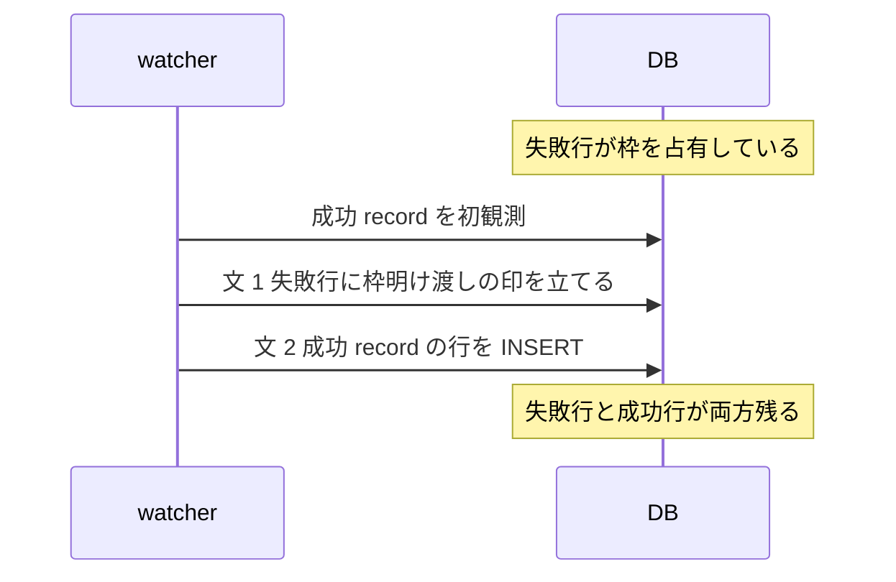

> [docs/schema.md](../../schema.md)（索引）の分割本文。節番号は分割前のまま（§5 の前半）。索引から辿る。

## 5. recordings — 録画履歴（永続資産）

録画履歴の表は、録画の試行の帰結だけを持ち、失敗した試行も行として残す。番組情報は録画時点の内容を非正規化して持つ。別の書き手が書く状態は、この表に列を足さず、録画を指す衛星表に置く。

失敗した試行も残すのは、録画品質の実測と再放送待ちの判断に使うからである。番組情報の非正規化により、EPG の表にも mirakc にも依存しない。

**この表に新しく列を足してよいのは、試行の帰結を観測する書き手が書く列だけである**（不変条件 13）。録画履歴は試行の観測だけを持つ脊椎で、別の状態機械が書く列は衛星表に置く。メディアアセット（下記 §6）も衛星表で、判定基準と境界は [invariants.md](../../invariants.md) §13 にある。

原本の保持方針とエンコードプロファイルは、予約オプションの効力スナップショットなので、同じ基準で衛星表に切り出してある。ingest worker が凍結し、api が追記する（下記「recording_encode_policy — 原本保持ポリシーの凍結」参照）。「今すぐ完全削除してほしい」というユーザーの要求も、api が立てて api が取り消すので衛星表にある（下記「recording_purge_requests — 即時完全削除の要求（衛星表）」を参照）。

「隣に削除の列があるから」は、本体に置く根拠にならない。削除の列と枠明け渡しの列が本体にあるのは、部分一意索引の述語が参照するからである。既存のテナントであることを根拠にすると、間借りが次の間借りを正当化する。

```sql
CREATE TABLE recordings (
    id                bigint GENERATED ALWAYS AS IDENTITY PRIMARY KEY,
    rule_id           bigint,        -- トレーサビリティ。rules への FK（ON DELETE SET NULL）
    source            text   NOT NULL CHECK (source IN ('rule', 'manual', 'unattributed')),
    site              text   NOT NULL,  -- どのサイトで録画したか（履歴として snapshot）

    -- 番組情報スナップショット（ARIB/ISDB の概念であり mirakc 固有ではない）
    network_id        integer NOT NULL,
    service_id        integer NOT NULL,
    event_id          integer NOT NULL,
    service_name      text    NOT NULL,
    channel_type      text    NOT NULL CHECK (channel_type IN ('GR', 'BS', 'CS', 'SKY')),
    channel           text    NOT NULL,
    title             text    NOT NULL DEFAULT '',
    description       text,
    extended          jsonb,                     -- 拡張形式イベント（出演者等）
    genres            jsonb,                     -- [{lv1, lv2, un1, un2}]
    is_free           boolean NOT NULL DEFAULT true,
    program_start_at  timestamptz NOT NULL,
    program_duration_ms bigint NOT NULL,

    -- 録画実行の結果（mirakc の recording.status。詳細は下記「status の権威」）
    status            text NOT NULL CHECK (status IN ('recording', 'finished', 'canceled', 'failed')),
    started_at        timestamptz,               -- 実際の録画開始（record の startTime）
    ended_at          timestamptz,

    -- 品質イベントログ（recording.failed / record-broken の理由。§8 参照）
    -- mirakc の reason を jsonb のまま保持し、構造化カラムにはしない（不変条件 7）
    quality_events    jsonb NOT NULL DEFAULT '[]',

    -- 「本物の record が推論に必ず勝つ」ために追加。この行が同一 active-event の
    -- 枠を明け渡した不可逆な事実だけを持つ（§「同一イベントの重複防止」参照）。
    -- ユーザーの「ごみ箱送り」を表す deleted_at とは別列（不変条件 9: 2 つの
    -- 異なる「消える理由」を同じ列に混ぜない）。
    superseded_at     timestamptz,

    -- ごみ箱（録画単位の論理削除。原本 + 派生物 + サムネイルのグループごと）
    deleted_at        timestamptz,
    -- 即時物理削除の要求はここには無い（recording_purge_requests 衛星表。
    -- 下記「recording_purge_requests」節参照）。

    -- 「完全削除が完了した」不可逆な事実。削除 reconcile が
    -- パス末尾で、ごみ箱条件を満たしかつ物理削除待ちの media_assets が 1 行も
    -- 残っていない録画に一度だけ立てる。ごみ箱一覧（GET /api/recordings?trash=true）は
    -- この列も IS NULL であることを要求するので、purge が完了した録画は
    -- ごみ箱一覧から外れる（[storage.md](../../storage.md) §7）
    purged_at         timestamptz,

    created_at        timestamptz NOT NULL DEFAULT now(),
    updated_at        timestamptz NOT NULL DEFAULT now()
);

CREATE INDEX ON recordings (program_start_at DESC, id DESC);  -- ライブラリ一覧（keyset）
CREATE INDEX ON recordings (network_id, service_id, program_start_at);  -- 視聴済みを放送イベント単位で束ねる
CREATE INDEX ON recordings (network_id, service_id, event_id);
CREATE INDEX ON recordings (rule_id) WHERE rule_id IS NOT NULL;  -- rules 削除・重複排除・ruleId 絞り込み
CREATE INDEX ON recordings (deleted_at) WHERE deleted_at IS NOT NULL;  -- ごみ箱ビュー
CREATE INDEX ON recordings (purged_at) WHERE purged_at IS NULL;  -- ごみ箱一覧の絞り込み
-- 履歴ベース重複排除は title の trgm 類似度で判定するが、GIN は張っていない。
-- gin_trgm_ops が加速するのは % / <% / LIKE / 正規表現で、similarity() の関数呼び出しには
-- 使われない（% の閾値は GUC pg_trgm.similarity_threshold 由来でルール単位の閾値と噛み合わない）。
```

品質イベントのログは、録画の失敗と record 破損の履歴を持つ。スクランブル件数はドロップ統計から導けるので、ここには重ねて記録しない。旧 catalog も読み込めるため、rescue はスクランブルの異常だけを除き、他のイベント順は保つ。

<details><summary>根拠</summary>

- 品質イベントのログ: `quality_events`（`recording.failed` / `recording.record-broken`）
- スクランブル件数の導出元: `drop_stats.scrambled`
- rescue が除くスクランブルの異常: `bcas_anomaly`
- 旧 catalog のイベント順を保つことの検証: `TestRescueLegacyQualityEvents`

</details>

### 行の作られ方

**録画履歴の行は、mirakc が報告した録画の試行だけを持ち、書き手は watcher だけである。** 録画されなかった試行も行にする。番組終了まで schedule が一度も観測されなかったものは試行ではないので、行を作らず、欠測として別の表に書く。

watcher が mirakc の record を初めて観測すると（SSE または全量の突き合わせ）、record の番組とサービスのペイロードからスナップショットして行を INSERT し、同期表の行から参照する。開始の失敗など、record が存在しない録画失敗は、状態が失敗の行を作り、品質イベントに理由を記録する。SSE を取りこぼしても、失敗した schedule が schedules API に残っている間は、定期の突き合わせが同じ行を再構成する。録画されなかった試行も履歴に残る。

records API に残る失敗状態・失敗理由付きの record についても、突き合わせが失敗理由を品質イベントに補完する。schedule が削除済みで record も無い録画失敗と record 破損は、mirakc API だけでは再構成できず、SSE でしか拾えない。

番組終了時点で schedule が一度も観測されなかった場合は、reconciler が後述の欠測の表に書き、ライブラリには失敗した録画として出さない。同じ放送イベントに mirakc 由来の失敗行が既にある状態で、後から成功 record が初観測されたときは、失敗行に枠を明け渡させてから、新しい行を INSERT する（下記「同一イベントの重複防止」の supersede 参照）。

出自は作成時点の値を一度だけ snapshot する。予約行も `record` 意図も無い録画は、出自を `unattributed` とし、後から予約や意図を推測して書き換えない。取り込みの完了は、メディアアセットの行の有無で表す（コミット = DB 行）。録画の状態の列には載せず、冗長な状態の列を持たない。

<details><summary>根拠</summary>

- 録画の行を参照する同期表: `record_sync`
- 失敗の履歴の理由の種別: `record-broken`
- 失敗した schedule からの再構成と失敗理由の補完: `record_sweep`
- record が存在しない録画失敗の例: `start-recording-failed`
- 失敗状態・失敗理由付きの record: `recording.status=failed` / `failedReason`
- 欠測の表: `never_scheduled_events`
- 失敗行が枠を明け渡す印: `superseded_at`
- 出自: `source`、`unattributed`、`record` 意図

</details>

### status の権威

**状態の権威は、mirakc が報告したレコードの状態である。** 値は 4 つで閉じ、取消は失敗とは別の独立した値で持つ。未知の値は失敗に丸め、生の値は同期表に残す。

Rokuban から見た録画の帰結は権威にならない。値は mirakc の records API が報告する状態をそのまま転記したものである。mirakc-core の状態が 4 バリアントの網羅的 enum であることは、ソースで確認済みである。record の無い行は状態を持たない。値の元は `GET /api/recording/records` の状態である。

取消（録画開始後にスケジュールが削除される等）は、失敗とは別の事実である。取消を失敗に丸めると録画一覧が「失敗した」と誤って示すので、独立した 4 値目として持つ。

これは不変条件 7「mirakc 固有の概念を永続テーブルに入れない」の違反ではない。既存の 3 値はもともと mirakc の語彙で、取消の追加はその踏襲である。不変条件 7 が禁じるのは、mirakc の内部 ID・タグ形式・スケジュール状態のような実装詳細に紐づく構造の持ち込みである。録画結果の語彙（成功・失敗・取消）は、ドメインの外部仕様として妥当な粒度と言える。

未知の値（mirakc が将来値を追加した場合）は、5 値目を足さずに失敗へ丸める。正規化は watcher が行い、生の値は同期表の状態（CHECK 無し）にそのまま残るので、観測は失われない。取消を失敗に丸めるのは分かっている 2 つの事実を区別できなくするが、未知の値は「何が起きたか分からない」という状態そのものが事実である。そのため、粗い失敗への集約を許容する。次に mirakc が値を足したら、watcher の ERROR ログを起点にこの CHECK と `openapi.yaml` の enum を更新する。

schedule が一度も観測されなかった欠測を表す 5 値目（`never-scheduled` 等）は足さない。欠測は record の状態ではない。後述の専用表で表す。

<details><summary>根拠</summary>

- 状態の列: `status`
- 状態の 4 値: `recording` / `finished` / `canceled` / `failed`
- 状態の元: `GET /api/recording/records` の `recording.status`
- mirakc-core の網羅的 enum: `RecordingStatus`
- 内部 ID・タグ形式・スケジュール状態の例: `RecordingScheduleState`
- 未知の値の正規化: `internal/watcher.normalizeRecordingStatus`
- 生の値の残り先: `record_sync.status`
- 更新するもの: `internal/watcher`、`openapi.yaml`

</details>

### never_scheduled_events — schedule 欠測（放送地平を超えて残す観測）

**行の存在が、番組終了時点でそのイベントの schedule が一度も観測されなかったという主張である**（不変条件 10）。主キーは放送イベントで、本物の録画が後から来ても、寿命内なら消さず、録画と欠測の両方が残る。

寿命は、番組情報のスナップショットとは別である。書き手は reconciler だけで、衝突時は何もせず、最初の観測を記録する。INSERT の条件は「番組終了」「今パスで schedule 非観測」「同じ放送イベントに生きている録画行が無い」の積である。生きているの定義は、重複防止の部分一意索引と同じ「削除されておらず、枠を明け渡してもいない」である。

番組スナップショットへの FK は張らない。スナップショットは放送と猶予で GC されるが、欠測は EPG の放送地平を超えて残す観測だからである。通常この表の読者は予約行を経由し、予約行はスナップショットと一緒に放送と猶予で先に GC される。そのため、欠測行を `retention_grace + 30日` まで残しても、読者からは観測されない。ただし `program_id` の再利用で同じ放送イベントのキーから新番組が到達可能になる経路では、この前提は成り立たない（[reservations.md](../reservations.md) §3.7 の未解決の窓）。

ruler は `retention_grace + 30日` で欠測行を刈る。スナップショットの CASCADE と同時に消すと、GC の後に同期除外が外れ、終了済みの予約が再び schedule 対象になる。

予約への FK も持たない。予約行は ruler が削除・再作成しうるので、読者は放送イベントのキーで引く（不変条件 9「identity」）。

本物の record が後から来ても、欠測行が寿命内なら消さない。録画と欠測の両方が残る。表示は本物の録画行があれば orphaned を消すが、同期除外は欠測行の存在だけを見て、終了済みの予約を対象に戻さない（[reservations.md](../reservations.md) §3）。行の寿命を超えた後は、再露出ガードとしての役目を終えているので GC される。

mirakc 由来の失敗は録画履歴にだけ現れ、この表には入らない。したがって、録画途中の失敗からの再試行経路を妨げない。観測時刻は reconciler が欠測を書いた時刻である。同期除外と表示の判定軸は行の存在だけで、時刻は使わない。

<details><summary>根拠</summary>

- 主キー: `(site, network_id, service_id, event_id)`
- 唯一の書き手と書き込み方: `recordNeverScheduled`、`ON CONFLICT DO NOTHING`
- 生きているの定義と、同じ定義の索引: `recordings_unique_active_event`、`deleted_at IS NULL AND superseded_at IS NULL`
- FK を張らない相手: `program_snapshots`、`reservations`
- 寿命と刈る主体: `retention_grace + 30日`、`ruler`
- 再利用で前提が成り立たなくなる識別子: `program_id`
- 観測時刻: `observed_at`

</details>

### ごみ箱

録画の削除はごみ箱への論理削除で、ファイルには触れない。物理削除は削除の突き合わせループが、即時の完全削除の要求か猶予期間の経過を拾って、アセット単位で実行する。物理削除の後も、録画の行と記録は残る。

UI の削除は削除の印を立てるだけである。復元は印を消し、即時削除の要求行を消すだけである。「今すぐ完全削除」は即時要求の衛星表に行を入れるだけで、ファイルは消さない。録画が未削除なら削除の印も同時に立てる。

物理削除を起こすのは、即時要求の行がある場合と、削除から猶予期間（既定 30 日）が経った場合の 2 つである。物理削除の後も、録画の行とメディアアセットの tombstone は残る。ごみ箱を空にしても、録画履歴・ドロップ統計・重複排除は影響を受けない。

API は `DELETE /api/recordings/{id}` / `POST .../restore` / `POST .../purge` / `GET /api/recordings?trash=true` である。即時要求の表の形と書き手の判断は、下記「recording_purge_requests — 即時完全削除の要求（衛星表）」参照。

<details><summary>根拠</summary>

- 論理削除の印と復元で消すもの: `deleted_at`
- 猶予期間の判定: `deleted_at + 猶予期間（既定 30 日）`
- 即時要求の表と残る行: `recording_purge_requests`、`media_assets`

</details>

### recording_purge_requests — 即時完全削除の要求（衛星表）

**即時完全削除の要求は、衛星表に置く。** 録画履歴の列にはしない。行の存在が要求を表し、取り消しは DELETE で表す（不変条件 10 / 13）。要求を立てて取り消すのは API で、試行を観測する書き手ではないからである。

```sql
CREATE TABLE recording_purge_requests (
    recording_id bigint PRIMARY KEY REFERENCES recordings (id) ON DELETE CASCADE,
    requested_at timestamptz NOT NULL DEFAULT now()
);
```

理由は書き手にある。この要求を定常運用で立てるのも取り消すのも api ロールであり、録画履歴を書く watcher と reconciler（試行の帰結の観測）ではない。rescue は別枠で、災害復旧で catalog ダンプから全表を書き戻すので、この表も他の表と同じように書く。

「削除の列が本体にあるから隣に置く」は根拠にならない。削除の列と枠明け渡しの列が本体に残っているのは、部分一意索引の述語がこの 2 列を参照するからである。述語は他表を参照できないので、即時要求はその述語に出ない（枠が明くのは 2 列だけ）。

完了後に要求行を掃除する経路は作らない。掃除役を足すと、削除 reconcile が 2 人目の書き手になる（不変条件 12）。「ユーザーが即時削除を要求した」は完了後も真なので、tombstone と一緒に残す。要求時刻は「いつ要求されたか」だけを持ち、判定には使わない。ここを現在時刻と比較し始めたら、実質 boolean を timestamptz で持っていた旧列に戻る。

復元（削除の印を消し、要求行を DELETE する）は、トランザクション内の 2 文で書く。1 文のデータ変更 CTE にはしない。CTE は全アームが 1 つのスナップショットを共有する。行ロックで UPDATE アームが待たされている間に commit された要求行は、DELETE アームから見えない。その結果、「復元は成功したのに要求行だけ残る」が観測される。残った要求行はその場では何も起こさないが、次の普通の論理削除で猶予をバイパスする。2 文なら、DELETE が UPDATE の後に新しいスナップショットを取るので、要求行が見える。

この表に行を入れる経路は、対象の録画行を先にロックする（個別 purge は UPDATE アームがそれを兼ねている）。復元を 2 文に割っただけでは、窓は閉じない。DELETE が 0 行のとき、ロックは何も残らない（READ COMMITTED に述語ロックは無い）。そこへロックせずに INSERT する経路を足すと、復元の DELETE 後・COMMIT 前に commit された要求行が残り、猶予バイパスが再発する。例は一括 purge を `INSERT ... SELECT` で書く場合である。

<details><summary>根拠</summary>

- 本体に残る 2 列と、それを参照する索引: `deleted_at` / `superseded_at`、`recordings_unique_active_event`
- 完了の印: `purged_at`
- 要求時刻（判定に使わない）: `requested_at`、現在時刻との比較 `<= now()`、比較に使うと戻る旧列 `recordings.purge_after`
- 録画行のロック: `recordings`
- ロックせずに書く経路の例: `INSERT ... SELECT`

</details>

### encoded_asset_removal_requests — 外したエンコード版の要求（衛星表）

**行の存在が、ユーザーがこのエンコード結果を外したという主張である**（不変条件 10。即時完全削除の要求と同じ形）。残すと決めた一覧は別の表が持ち、判定は 2 つを組み合わせた view が行う。

```sql
CREATE TABLE encoded_asset_removal_requests (
    recording_id bigint NOT NULL REFERENCES recordings (id) ON DELETE CASCADE,
    profile      text NOT NULL,
    requested_at timestamptz NOT NULL DEFAULT now(),
    PRIMARY KEY (recording_id, profile)
);
```

書き手は api と削除 reconcile である。api は `DELETE /api/recordings/{id}/encoded/{profile}` と事後追加で書く。削除 reconcile はエンコード結果の削除確定と同じ文で行を消し、事後追加は同じプロファイルを足し直す文で行を消す。残すと決めたプロファイルの一覧（desired）は、別の表が持つ。判定は 2 つを組み合わせた view が持つ（[storage/retention.md](../../storage/retention.md) §7）。

<details><summary>根拠</summary>

- 残すと決めたプロファイルの一覧: `recording_encode_policy.encode_profiles`
- 2 つを組み合わせた view: `removed_encoded_assets`
- エンコード結果の削除確定の状態: `deleted`

</details>

### 同一イベントの重複防止

**録画試行の履歴は複数行を許すが、生きている録画は 1 放送イベントにつき 1 つに限る。** ごみ箱に入れた行と、枠を明け渡した行は生きているとみなさないので、録り直しもできる。

```sql
CREATE UNIQUE INDEX recordings_unique_active_event
    ON recordings (site, network_id, service_id, event_id, program_start_at)
    WHERE deleted_at IS NULL AND superseded_at IS NULL;
```

放送局が付けるイベント ID は、同一サービス内で永続的には一意でない。ARIB TR-B14 第四編 8.2.1 が保証するのはイベント終了から 24 時間なので、永続表では開始時刻を組にして放送イベントを識別する。部分一意索引の述語は、削除されておらず、枠を明け渡してもいない行である。ごみ箱に入れた後で録り直すことも、後述の supersede で枠を明け渡した後で本物の record が録り直すこともできる。

この制約があるため、watcher が同一 record を並行処理すると、片方が制約違反で失敗する。record の処理は、同期表の行を先に確保して直列化することでこれを避けている（[録画エンジン](../../recording.md) §3.3「record 処理は並行実行しても問題が起きない」）。

衝突時の動作を指定する INSERT のクエリは、この索引と述語を一字一句一致させる必要がある。ずれると、Postgres が「there is no unique or exclusion constraint matching the ON CONFLICT specification」で落ちる。

<details><summary>根拠</summary>

- 放送イベントの識別に使う組: `(site, network_id, service_id, event_id, program_start_at)`
- 述語（削除されておらず枠を明け渡していない）: `deleted_at IS NULL AND superseded_at IS NULL`
- 並行処理の直列化: `processRecord`、`record_sync`
- 述語を一致させる INSERT: `ON CONFLICT`、`CreateFailedRecording` / `UpsertInPlaceRecording`

</details>

#### `superseded_at`: failed 行が後続 record に枠を譲る

失敗した行が枠を占有したまま残っているところへ、同じ放送イベントの成功 record が後から来たら、成功 record が無条件で枠を得る。watcher は、成功 record の行を作る前に、別の文で失敗行に枠を明け渡した印を立てる。失敗行には削除の印を立てず、履歴として両方残る。



`need-rescheduling` 等で状態が失敗の行が枠を占有したまま残る。そこへ mirakc が同じ放送イベントを後で録り直し、成功 record を報告することがある（delayed broadcast、mirakc 側の手動再録画等）。この成功 record は無条件で枠を得られなければならない。欠測の表は別表なので supersede の対象にならない。寿命内に本物の record が来ても、欠測行は残り、録画履歴には試行行だけが増える。

watcher は、成功 record の行を作る直前に、枠を明け渡させる SQL を呼ぶ。同じ放送イベント（開始時刻を含む）に生きている失敗行があれば、枠を明け渡した印に現在時刻を立てる。生きているとは、削除の印も枠明け渡しの印も無いことである。

発火条件を索引と同じ 5 列に揃えたのは、失敗行が新しい record をブロックする条件が、もともと開始時刻の一致そのものだからである。この一致自体は機能的な穴を開けない。一方、4 列のままだと、`event_id` の再来時に無関係な過去の失敗行へ印を立ててしまう。

ただし繰り下げ・延長で、mirakc が失敗行と成功 record に渡す開始時刻がずれる場合は、この一致により supersede が起きない。その場合、失敗行と成功行の両方が生きたまま残るが、どちらも履歴として真なので害は無い。`need-rescheduling` 等では、失敗行は schedule 由来、成功 record は record 由来の開始時刻を持つ。

枠の明け渡しと成功 record の INSERT は、意図的に別々の SQL 文にしてある。1 つの `WITH` 句にまとめると、Postgres は「`WITH` 内のデータ変更文は主クエリと同時並行に実行され順序不定」と定めているので、UPDATE が INSERT より先に確定する保証が無い。実機のテストで、実際に一意制約違反を起こすことを確認した。

対象は状態が失敗の行だけである。録画中・録画済み・取消の生きている行と衝突する INSERT は、本当の重複 record（要調査の異常）なので、素の一意制約違反のまま従来どおりエラーにする。

メディアアセットを持つ失敗行（途中まで録れて失敗した行）でも扱いは同じである。印を立てるだけで、メディアアセットの録画 ID は書き換えない。ファイルの所有者は、枠を明け渡した旧行のままである。物理削除は削除 reconcile が削除の印を見て判断するので、枠を明け渡しただけでは何も物理的に消えない。

冪等性は、同期表の行ロックで保つ。同一 record の 2 回目以降は、行の作成自体を呼ばないので、印が二重に進んだり、行が重複したりしない（[録画エンジン](../../recording.md) §3.3）。枠を明け渡した行には削除の印を立てない（ユーザーが消したわけではない）。そのため、録画一覧には失敗した旧行と成功した新行の両方が履歴として残り続ける。

<details><summary>根拠</summary>

- 失敗行が枠を占有する例: `need-rescheduling`
- 呼び出し元: `createRecording`（`internal/watcher/watcher.go`）、呼び出す関数: `CreateRecording`、`SupersedeFailedRecording`
- 枠を明け渡させる SQL の置き場: `internal/db/queries/recordings.sql`
- 枠を明け渡す更新: `superseded_at = now()`
- 放送イベントの 5 列に含まれる開始時刻: `program_start_at`
- 4 列に足して 5 列にした列: `program_start_at`
- 4 列のままだと再来する識別子: `event_id`
- 別々の SQL 文にする理由: `WITH`
- 対象にする状態: `status='failed'`、対象外の状態は `'recording'` / `'finished'` / `'canceled'`
- 録画 ID を書き換えない: `media_assets.recording_id`
- 物理削除の判断元: `recordings.deleted_at`
- 冪等性の根拠: `processRecord`、`record_sync` の `(site, record_id)` 行ロック、`createRecording`

</details>
