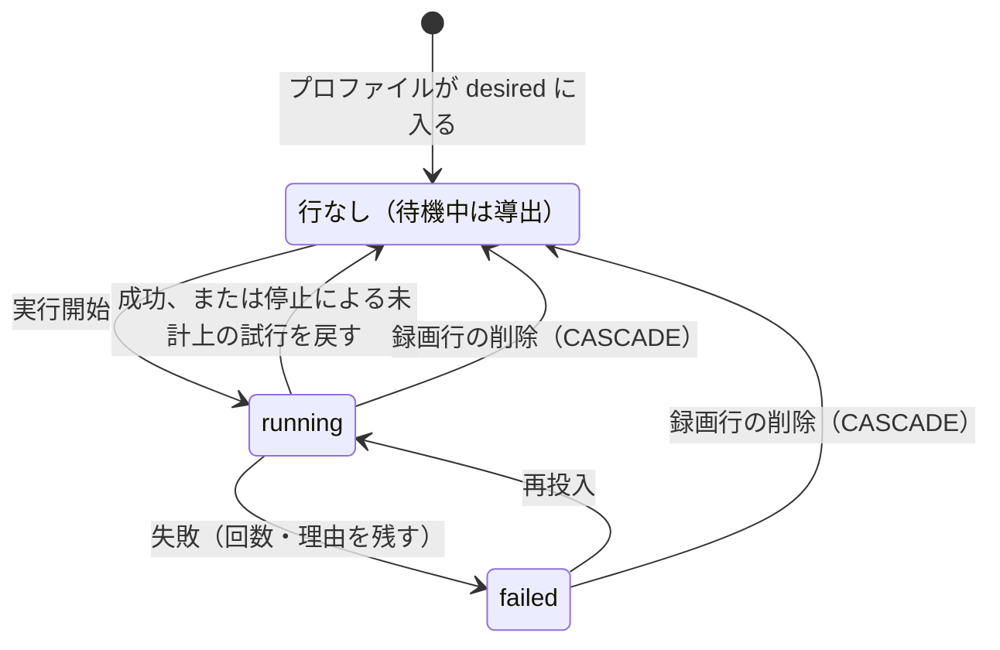

> [docs/schema.md](../../schema.md)（索引）の分割本文。節番号は分割前のまま（§5 の後半）。索引から辿る。

### recording_encode_policy — 原本保持ポリシーの凍結（衛星表）

原本の保持方針とエンコードプロファイルは、録画を指す衛星表に持ち、行の存在が「凍結済み」を表す。取り込み worker が原本をコミットするトランザクションの中で凍結し、API は追記方向にだけ書く。録画履歴の本体には置かない。

この 2 つは予約オプションの効力スナップショットである。

```sql
CREATE TABLE recording_encode_policy (
    recording_id    bigint PRIMARY KEY REFERENCES recordings (id) ON DELETE CASCADE,
    keep_original   text   NOT NULL CHECK (keep_original IN ('always', 'until_encoded')),
    encode_profiles text[] NOT NULL,
    cm_detect       boolean NOT NULL DEFAULT false,
    cm_detect_generation bigint NOT NULL DEFAULT 0, -- 切り替えごとに +1
    CHECK (keep_original <> 'until_encoded' OR cardinality(encode_profiles) > 0),
    created_at      timestamptz NOT NULL DEFAULT now(),
    updated_at      timestamptz NOT NULL DEFAULT now()
);
```

**行の存在そのものが「凍結済み」を意味する**（不変条件 10）。凍結前はこの録画に対応する行が無い。列の既定値では、「まだ凍結されていない」と「空として凍結された」を区別できなかった。これは録画履歴の本体にあった旧列の問題そのものである。凍結後の行は、空のプロファイルであっても必ず INSERT される。

書き手は脊椎（watcher と reconciler）ではない。ingest worker が、原本のメディアアセットをコミットするトランザクションの中で凍結する。api（`POST /api/recordings/{id}/encode-profiles`）は追記方向にだけ書き換える。詳細は [storage.md](../../storage.md) §6「原本 TS の保持ポリシー」参照。

録画 ID は脊椎の主キーへの FK で、録画履歴と同時に生まれて同時に死ぬ（不変条件 12）。「エンコード完了まで原本を残す」で空のプロファイルを選ぶ組み合わせは、CHECK が表現不可能にする。

既存録画への backfill は、原本のメディアアセットの有無で「凍結済みか」を判定して行を作る。列の値そのものは判定に使わない（不変条件 9）。

CM 検出の要求は、取り込み時のデプロイ設定または録画単位の API が宣言した値である。保持ポリシーと同じく録画ごとに凍結し、worker はこの値と active original の両方を満たす行だけを処理する。

<details><summary>根拠</summary>

- 保持方針とプロファイル: `keep_original` / `encode_profiles`、衛星表 `recording_encode_policy`
- 旧列の既定値: `keep_original NOT NULL DEFAULT 'always'`
- 空のプロファイルで凍結した行: `encode_profiles = '{}'`
- 凍結する関数: `internal/worker/ingest.go` の `resolveAndSnapshotEncodePolicy`
- 脊椎の主キー: `recordings.id`
- 空のプロファイルを禁じる CHECK の対象: `until_encoded`
- backfill の判定: 原本のメディアアセット `kind = 'original'`
- CM 検出の要求: `cm_detect`

</details>

### recording_cm_detections / recording_cm_attempts — CM 区間と試行状態

CM 検出の結果は、検出処理全体の完了を 1 行で表し、処理に失敗している間は結果行を作らない。直近の試行状態は別の表に持ち、最大 3 回の試行後に失敗とする。

結果の区間は、原本の先頭を 0 としたミリ秒の multirange である。空の multirange は、広告区間が無かったという結果である。

試行の状態は、処理中・再投入待ち・失敗の 3 つである。再投入待ちは、失敗後または停止時の中断後に再投入を待つ状態で、失敗は最大 3 回の試行後も失敗した状態である。新しいロゴや枠で再び対象になった失敗行は、試行回数を 1 に戻して再開する。停止時の中断は回数に入れず、以前の失敗回数を保つ。

失敗工程は、worker が観測した工程である。検出前の準備から結果の保存までの工程に加え、停止・映像サイズの不一致・ロゴの不一致・採用待ちがある。採用待ちは、枠があり、候補の採用を待つため検出しなかったことを表す。

CM worker は実尺に基づくタイムアウトを返し、停止・異常終了後の実行中のジョブは River の JobRescuer が回収する。次の worker 開始時に処理中の行が残っていれば、前のプロセス死を数え、上限に達した行を失敗にする。試行回数と `policy_generation` は、結果保存時のフェンシング値でもある。結果と試行行の削除は、同一トランザクションで確定する。

`policy_generation` は、試行行を作った（または作り直した）時点の方針の `cm_detect_generation` である。方針が有効でこの世代が一致する行だけが現在の試行で、読み手は `current_cm_attempts` 越しに読む。理由は [data/jobs.md](../../data/jobs.md) の「CM 検出の試行回数」にある。

<details><summary>根拠</summary>

- 結果の行と区間: `recording_cm_detections`、`cm_ranges`（`int8multirange`）
- 試行状態の表: `recording_cm_attempts`
- 試行の 3 状態: `running`（処理中）、`retrying`（再投入待ち）、`failed`（失敗）
- 失敗工程の列と値: `stage`、`setup` / `probe` / `area` / `logo` / `chapter` / `join` / `parse` / `save`、ほかに `stopped` / `resolution` / `match` / `adopt`
- 実尺に基づくタイムアウト: `Timeout()`
- フェンシング値: `attempt_count`、`policy_generation`
- 現在の試行: `current_cm_attempts`、`recording_encode_policy.cm_detect_generation`

</details>

### recording_chapter_ownership / recording_chapter_spans — ユーザーのチャプター（衛星表）

**自動の検出結果は毎パス作り直せる導出値、ユーザーの修正は二度と再取得できない事実である**（不変条件 9）。1 つの表に置くと再検出が修正を上書きするので 2 表に割り、所有の行がある録画では自動の検出結果を読まない。

```sql
CREATE EXTENSION IF NOT EXISTS btree_gist;  -- bigint の = を GiST に載せるため

CREATE TABLE recording_chapter_ownership (   -- 行があること = ユーザーが所有（= 確認済み）
    recording_id bigint PRIMARY KEY REFERENCES recordings (id) ON DELETE CASCADE,
    adopted_at   timestamptz NOT NULL DEFAULT now()
);
CREATE TABLE recording_chapter_spans (
    recording_id bigint NOT NULL REFERENCES recording_chapter_ownership (recording_id) ON DELETE CASCADE,
    span         int8range NOT NULL CHECK (NOT isempty(span)),   -- 原本の先頭フレームを 0 とする ms
    label        text,
    cut          boolean NOT NULL,
    CHECK (label IS NOT NULL OR cut),
    EXCLUDE USING gist (recording_id WITH =, span WITH &&)
);
```

区間の表に主キーは無い。区間の同一性は区間そのものである。自動チャプターの id のような、再検出で動くキーを宛先にしない（不変条件 9 の identity）。API はタイムライン全体を置き換える。

本編は行を持たない。区間の隙間が本編である。API も本編の区間を返さず、クライアントが再生中の動画の長さで閉じる。DB が持つ長さは EPG 上の番組長だけで、ファイルの実際の長さを api は知らない（原本は録画後に削除されうるし、EIT 追従で延長もされる）。そのため、「ラベルも無くカットでもない行」は意味を持たないので、CHECK で表現不可能にする（不変条件 10）。

出自と意図を 1 つの列に載せない。かつての案は、CM の種別に両方を持たせており、手で直した CM 境界が「取り込み直す」で上書きされた。取り込み直しの操作は作らず、やり直しは「自動に戻す」（所有の行を DELETE）だけである。自動層をユーザー層へ写す道は、PUT がタイムライン全体を置き換える 1 本だけである。最初の PUT が所有の行を作り、以後その録画では自動層を読まない。

PUT は、下書きの基にした層の版を必須で受け取る。版は列に持たず、毎回導出する。所有済みなら、所有の時刻とユーザー層の内容のハッシュにする。所有の時刻だけだと 2 回目以降の PUT で変わらず、2 端末の後勝ちで前の編集が消える。所有前なら、検出の終端の有無と検出時刻にする。

行ロックが直列化するのは、サーバー内の判定だけである。クライアントが検出中の空の層から作った下書きを、検出 commit の後に再 PUT する道は塞げない。そこで、ロックの後で版を比べて塞ぐ。所有済みでも比べる。所有済みの録画は、再検出中でも PUT できる（自動層を読まないので、検出状態は無関係）。ごみ箱の録画は、PUT / DELETE とも 404 にする。

<details><summary>根拠</summary>

- 所有の表と区間の表: `recording_chapter_ownership`、`recording_chapter_spans`
- 自動の検出結果: `recording_cm_detections`
- 所有の時刻と検出時刻: `adopted_at`、`detected_at`
- 本編を閉じる長さ: `<video>.duration`
- 旧案の種別の値: `kind='cm'`
- 区間の判定に使う列: `cut`

</details>

### cm_logos — 放送局ごとの学習済みロゴ

**ロゴと枠の単位は局で、映像サイズでは割らない。** 学習済みロゴは作成時の映像サイズを持ち、検出前に録画の映像サイズと比べて、違えばロゴを使わずに失敗として残す。

局ロゴは、ネットワークとサービスの組で一意に保持する。LGD は次回以降の検出に使うバイナリで、PNG preview は任意の表示用データである。学習元の列は、最初にロゴを学習した録画を指し、録画削除後も局ロゴは残る。管理画面から削除すると、次の検出で再学習される。ロゴが失敗した録画より後に学習された場合、その失敗は再投入可能になる。

同じ service_id のまま映像フォーマットを切り替える運用は、地上波・BS の運用規定が認めている（ARIB TR-B14 第七編 8.2.2、TR-B15 第三編 7.2.3）。実際に NHK 総合はマルチ編成の間、主サービスごと 480i になる。それでも割らないのは、測った範囲で主サービスの映像サイズが混ざったのは、CM の無い NHK だけだったからである。

局 × 映像サイズにすると、API の宛先と検出対象の導出の両方に映像サイズが要る。録画の側は coded size を持っていない。映像サイズの違う録画にはロゴも枠も使わず、失敗として残す。使われなくなった映像サイズのロゴを自動で捨てる案は採らない。手で作ったロゴという作り直せない事実を消し、年に数回しか使わない映像サイズほど先に失われるからである。

学習済みロゴは作成時の coded size を持ち、検出前に録画の coded size と比べる。違えば logoframe を実行せず、映像サイズの不一致として止める。さらに logoframe の一致率を読み、閾値未満ならロゴの不一致として止める。自動学習は、枠の無い局だけで行う。

録画の映像サイズは、原本の最初の映像ストリームの coded size とする。番組の境目をまたいで途中で映像サイズが変わる録画では、変化後の区間の検出結果を保証しない。

<details><summary>根拠</summary>

- ロゴの一意性の組: `(network_id, service_id)`
- 学習元の列: `learned_from`
- 映像サイズの不一致: `resolution`
- ロゴの不一致: `match`

</details>

### cm_logo_areas — 局ごとの手動ロゴ枠

CM 検出器が自動でロゴを見つけられない局だけ、ユーザーが映像上で枠を指定する。行の存在が設定を表す。枠は新しいロゴを解析する意図で、候補を作り、採用するまで旧いロゴを残す。

自動推定の値は、この表へ書かない。

座標は、SAR を適用する前の記録上の画素である。符号化の幅と高さは、その座標系の映像サイズを表す。

```sql
CREATE TABLE cm_logo_areas (
    network_id   integer NOT NULL,
    service_id   integer NOT NULL,
    x            integer NOT NULL,
    y            integer NOT NULL,
    w            integer NOT NULL,
    h            integer NOT NULL,
    coded_width  integer NOT NULL,
    coded_height integer NOT NULL,
    updated_at   timestamptz NOT NULL DEFAULT now(),
    PRIMARY KEY (network_id, service_id),
    CHECK (coded_width > 0 AND coded_height > 0
       AND x >= 0 AND y >= 0 AND w > 0 AND h > 0
       AND x + w <= coded_width AND y + h <= coded_height)
);
```

枠は「この枠で新しいロゴを解析する」という意図である。保存時に録画 ID を指定して候補解析を依頼し、旧い学習済みロゴは候補を採用するまで残す。候補は解析 worker だけが、解析中から失敗または準備完了へ書き、局ごとに 1 行を持つ。

採用 API は、準備完了と解析時点の更新時刻が一致することを確かめる。その後、候補のロゴ・preview・coded size を学習済みロゴの表へ移し、必要なら active original のある録画の検出結果だけを消して再検出する。候補の破棄は、行を消す操作である。外部形式との互換性維持コストを増やすため、`.lgd` の取り込み・書き出し API は作らない。

枠も局に 1 つで、映像サイズごとには持たない（判断は §cm_logos）。検出時の原本の映像サイズと、枠の座標系が違うときは、候補を枠の失敗として残す。枠を削除すると、候補と採用待ちの試行を消して、自動探索へ戻る。

検出ジョブは、実行中に枠が保存されても、古い枠で学習したロゴを書き戻さない。学習結果の INSERT は、ロゴ不在と、枠の更新時刻がジョブの読んだ値のままであることを、同じ文で再評価する。枠の保存とは、局ごとの advisory lock で直列化する。ジョブ開始時にロゴを持っていたなら、学習結果は保存しない。

失敗しても、試行表の試行時刻はジョブ開始時刻のまま残す。再候補にする基準は、採用で作られる学習時刻だけで、試行時刻が学習時刻より前かどうかで比べる。終了時刻で上書きすると、採用の前に始まって後に失敗した録画が、試行時刻が学習時刻より後になり、新しいロゴで再投入されなくなる。

候補の解析は全編を走査するので、画面は待たずに解析中を表示する。候補を採用するまで旧いロゴでの通常検出は継続し、枠だけでは検出を再投入しない。枠あり・ロゴなしの局の録画は desired から外さず、検出ジョブが採用待ちの失敗の試行を書いて止める。

解析ジョブが死んで解析中のまま残った候補は、対応する未完了の River ジョブが無いことを見て、reconcile が停止の失敗にする。採用時に作られる学習時刻が、失敗録画を再び desired にする。

<details><summary>根拠</summary>

- 枠の表と座標系の列: `cm_logo_areas`、`coded_width`、`coded_height`
- 録画 ID: `recording_id`
- 旧い学習済みロゴ: `cm_logos`
- 候補の表と状態: `cm_logo_candidates`、`running`（解析中）→ `failed` / `ready`（準備完了）
- 一致を確かめる時刻: `updated_at`
- 作らない API の形式: `.lgd`
- 枠の失敗工程: `area`、採用待ちと停止: `adopt`、`stopped`
- 試行表の時刻: `recording_cm_attempts.attempted_at`
- 学習時刻: `learned_at`
- 再候補の比較: `attempted_at < learned_at`、終了時刻で上書きしたときの逆転: `attempted_at > learned_at`

</details>

### recording_ingest_progress — 転送の途中経過（衛星表）

**行の存在が、ingest がまだ commit していない temp を持っていることを意味する**（不変条件 10）。転送中に加え、SHA-256 待ちで snooze している間も行は残る。書き込みバイト数は単調に増えず、一時ファイルに書けている量の観測である。書き手は ingest worker だけで、原本の取り込みが「どこまで書けたか」を持つ。

```sql
CREATE TABLE recording_ingest_progress (
    recording_id   bigint      PRIMARY KEY REFERENCES recordings (id) ON DELETE CASCADE,
    written_bytes  bigint      NOT NULL CHECK (written_bytes >= 0),
    expected_bytes bigint      CHECK (expected_bytes IS NULL OR expected_bytes >= 0),
    temp_rel_path  text        NOT NULL,
    temp_store     text        NOT NULL DEFAULT '',
    temp_generation bigint     NOT NULL CHECK (temp_generation > 0),
    observed_at    timestamptz NOT NULL DEFAULT now()
);
```

`temp_rel_path` は media root からの相対パスで、`temp_store` は一時ファイルがある置き場を示す。`temp_store` が空の行は移行前の行で、`storage adopt <store-name>` が埋める。`temp_store` が空の行が残る間、worker は起動を拒む。

`temp_generation` は `ingest_temp_generation_seq` から採番する。世代が要るのは、作り直した temp は前と違うバイト列でありうるので、前の temp から作ったセグメントを同じ再生 URL で配らないためである。世代が変わるのは「この試行で temp を作った」ときと「進捗行が無い」ときの 2 つだけで、replay や SHA-256 待ちをまたいでも同じ値を使う。原本の行は commit のときにこの世代を進捗行から写すので、進捗行が無いと commit できない。

進捗行の出入りと `temp_generation` の変化は `recordings` トピックへ通知し、`written_bytes` の更新では通知しない。

転送していない（temp を持っていない）ことを表す行は作らない。行が消えるのは次の場合だけである。

- 原本のメディアアセットを INSERT するトランザクション（コミット = DB 行なので、原本行が生まれる瞬間に進捗行が消え、「原本があるのに取り込み中」が読者から見えない）
- 録画行の削除（FK の CASCADE）
- temp を捨てるとき（record の cancel / fail、サイズ・ハッシュ不一致など）
- 別経路の登録などで原本が既にコミット済みと分かったとき（取り残された行の掃除）
- temp が無い状態から作り直す前（古い世代を、作り直した temp へ引き継がないため）

書き手は脊椎（watcher と reconciler）ではないので、本体の列にしない（不変条件 13。原本保持ポリシーと同じ判断）。同期表にも載せない。あちらは mirakc 側の観測で書き手は watcher、こちらは Rokuban 側のファイルに何バイト書けたかで、1 表 2 書き手になる（不変条件 12）。

書き込みバイト数は、単調に増えない。ジョブ内リトライ（Range 再開）とプロセス死後の temp replay では、値が積み上がる。サイズや SHA-256 の不一致、record の cancel / fail で temp を捨てると、次の試行は 0 から始まる（[recording/ingest-retry.md](../../recording/ingest-retry.md) §5.3 の層 2）。これは、いま temp に書けているバイト数の観測である。累積の転送実績ではない。

期待バイト数は、同期表の長さのコピーで、転送開始時に読む。mirakc が長さを返さなければ NULL のままにする。でっち上げた分母を置かない。ジョブが失敗して River のバックオフ待ちに入ると、行は観測時刻が古いまま残る。これは意図した挙動で、`river_job` を API 契約に露出させない代わりに、停滞を読ませる唯一の材料になる（[recording/ingest-followup.md](../../recording/ingest-followup.md) §5.6）。

<details><summary>根拠</summary>

- 書き手の実装: `internal/worker/ingest_progress.go`
- 転送中を表す行: `recording_ingest_progress`
- 録画行の削除で消える仕組み: `ON DELETE CASCADE`、`recordings`
- 書き込みバイト数: `written_bytes`
- 期待バイト数のコピー元: `expected_bytes`、`record_sync.content_length`
- 観測時刻: `observed_at`
- temp の相対パスと世代: `temp_rel_path` / `temp_generation`
- 世代採番: `ingest_temp_generation_seq`
- 露出させない内部表: `river_job`

</details>

### recording_encode_attempts — encode ジョブの直近の試行状態（衛星表）

**行の存在が、実行中か失敗かのどちらかの主張を意味する**（不変条件 10）。待機中は行を作らず、desired にあって行が無いことから導出する。失敗理由は運用者が直接読むもので、API は配らない。

残すと決めたプロファイルと実在するエンコード結果の差だけでは、「まだ来ていない」としか言えず、実行中と失敗後の再試行待ちを区別できない。この表はその区別だけを持つ。書き手は encode worker だけである。

```sql
CREATE TABLE recording_encode_attempts (
    recording_id bigint      NOT NULL REFERENCES recordings (id) ON DELETE CASCADE,
    profile      text        NOT NULL,
    state        text        NOT NULL CHECK (state IN ('running', 'failed')),
    error        text,
    attempt_count integer     NOT NULL DEFAULT 0 CHECK (attempt_count >= 0),
    attempted_at timestamptz NOT NULL DEFAULT now(),
    PRIMARY KEY (recording_id, profile)
);
```



待機中（queued）を表す行は作らない。queued は API 側で「desired にあって行が無い」として導出する。承認待ちの状態は、所有の行から導出する（カットするプロファイルで、所有の行が無い）。この表には持たない。待機中（ジョブが来る）とは別の主張で、投入側も実際に候補から外している（[storage/retention.md](../../storage/retention.md) §7）。行が無いことと「来ない」ことは別なので、待機中と混ぜない。

書き手は脊椎（watcher と reconciler）ではないので、本体の列にしない（不変条件 13。転送の途中経過と同じ判断）。主キーが録画 ID とプロファイルの複合なのは、1 録画に複数のプロファイルを事後追加できるからである。

行が消えるのは、成功時、停止による未計上の試行を戻す時、または録画行の削除（CASCADE）である。失敗は回数・理由を残す。成功公開後に古い試行が遅れて戻っても、自分の attempt token が一致しなければ、この行を消せない。

API は River の内部表を読まない。encode のプロセス死回収は River の JobRescuer が担い、アプリ側は River の試行回数を参照しない。試行回数は、失敗とプロセス死を含むドメイン試行数で、公開時には fencing token として現在の試行を照合する。プロファイル設定から消えた名前は、定期投入の対象から外す。入力ファイルの破損など録画単位の恒久失敗は、desired が残る限り 15 分ごとに再投入される。

エラー・試行時刻・試行回数の読み手は、運用者の SELECT である（[runbook/troubleshooting.md](../../runbook/troubleshooting.md)「エンコードが失敗している」）。API はこれらを配らず、ジョブ状態の型はプロファイルと状態だけを配る。失敗理由は ffmpeg の内部情報で、クライアントに配る契約に載せると、切り詰め方や書式が API 互換の対象になる。停止で ctx が cancel された試行は数えず、締切超過は失敗として数える。

<details><summary>根拠</summary>

- 残すと決めたプロファイル: `recording_encode_policy.encode_profiles`
- 書き手: `EncodeWorker`（`internal/worker/encode.go`）
- 試行の列: `error` / `attempted_at` / `attempt_count`
- 複合の主キー: `(recording_id, profile)`
- 承認待ちの導出: `awaiting_review`、`cut: true`、`recording_chapter_ownership`
- 待機中の導出: `queued`
- 読まない内部表: `river_job`
- プロファイル設定から消えた名前を外す: `known_profiles`
- 恒久失敗の再投入: `internal/worker/encode_reconcile.go`
- ジョブ状態の型: `EncodeJobStatus`（`profile` / `state` だけを配る）

</details>

### recording_playback_positions / recording_watched — 世帯共有の視聴状態

視聴状態は世帯で共有する。再開位置は録画行ごとに、視聴済みは選んだ録画行ごとに持ち、どちらも API が書くので、衛星表に置く。録画履歴の本体には置かない。

```sql
CREATE TABLE recording_playback_positions (
    recording_id bigint PRIMARY KEY REFERENCES recordings (id),
    position_ms bigint NOT NULL CHECK (position_ms >= 2000),
    updated_at timestamptz NOT NULL DEFAULT now()
);

CREATE INDEX ON recording_playback_positions (updated_at DESC, recording_id DESC);

CREATE TABLE recording_watched (
    recording_id bigint PRIMARY KEY REFERENCES recordings (id),
    watched_at timestamptz NOT NULL DEFAULT now()
);
```

再開位置は録画行ごとに更新し、視聴済みは選んだ録画行に印を付ける。視聴済みを読むときは、同じ放送イベント（ネットワーク・サービス・開始時刻）の全行を束ねる。そのため、ごみ箱や supersede 済みの行に残った印も有効である。再開位置は一時状態なので catalog に含めず、視聴済みの印は復旧可能な世帯の事実として export / rescue に含める。

<details><summary>根拠</summary>

- 同じ放送イベントを束ねる組: `(network_id, service_id, program_start_at)`

</details>
