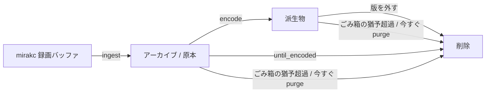

# メディアストレージ（索引）

録画原本・エンコード成果物・サムネイルの保存契約と、保持・削除・復旧を扱う。原本は強い POSIX ファイルシステムに置き、派生物は置き場のインターフェースを通して読み書きし、その実装は FS か S3 API である。FUSE S3 は使わない。

| 節 | 内容 | ファイル |
|---|---|---|
| §1〜5 §5.1 §5.2 | 原本と派生物の置き場 / FUSE 越し S3 の制約 / ストレージ契約（4 つのルール） / クラウド側のマウント選択肢 / 2 階層（録画バッファとアーカイブ・サイジング指針）/ rel_path の名前空間 / サムネイル / シークプレビュー用タイル | [storage/contract.md](storage/contract.md) |
| §3 の一部 | FS 置き場間の転送 | [storage/transfer.md](storage/transfer.md) |
| §3 の一部 | 派生物の公開（encode）と公開時の再確認 | [storage/publish.md](storage/publish.md) |
| §6 §7 | 原本 TS の保持ポリシー（encode policy の凍結とその例外の権威はここ）/ 削除エンジン（削除可否の述語 / ごみ箱 / 孤児の報告と回収） | [storage/retention.md](storage/retention.md) |
| §7 の一部 | 削除述語の性能測定 | [storage/retention/predicate-performance.md](storage/retention/predicate-performance.md) |
| §7 の一部 | 孤児回収の逆方向の実体無し検出（置き場の目印・エイジング・全損シグネチャ・走査が見ないパス） | [storage/missing-assets.md](storage/missing-assets.md) |
| §7 の一部 | カット版と CM 検出の扱い（作り直し要求の寿命・until_encoded の原本を守る条件） | [storage/cut-cm.md](storage/cut-cm.md) |
| §8 | catalog エクスポートと rescue（災害復旧） | [storage/rescue.md](storage/rescue.md) |

読む順の目安は次の通り。

- ingest / エンコード / サムネイルの出力先を触る → §3（ストレージ契約）と §5
- 実体無し検出・置き場の目印を触る → §7 の一部（storage/missing-assets.md）
- 原本削除・ごみ箱・cleanup を触る → §6 §7（前提として §3 のルール 3「公開 = DB 登録」）
- FS 置き場間の転送を触る → §3 の一部（storage/transfer.md）
- 派生物の公開（encode）を触る → §3 の一部（storage/publish.md）
- 災害復旧 / import を触る → §8

**本文は `docs/storage/` に分割してある。節番号は分割前のまま**なので、コードコメントや他 doc の「storage.md §6」等はこの表で該当ファイルを引ける。

> 関連ドキュメント: [recording.md](recording.md)（ingest パイプライン）/ [data.md](data.md)（データ層）/ [schema.md](schema.md)（`media_assets` / `recording_encode_policy` の DDL）/ [operations.md](operations.md)（運用）
