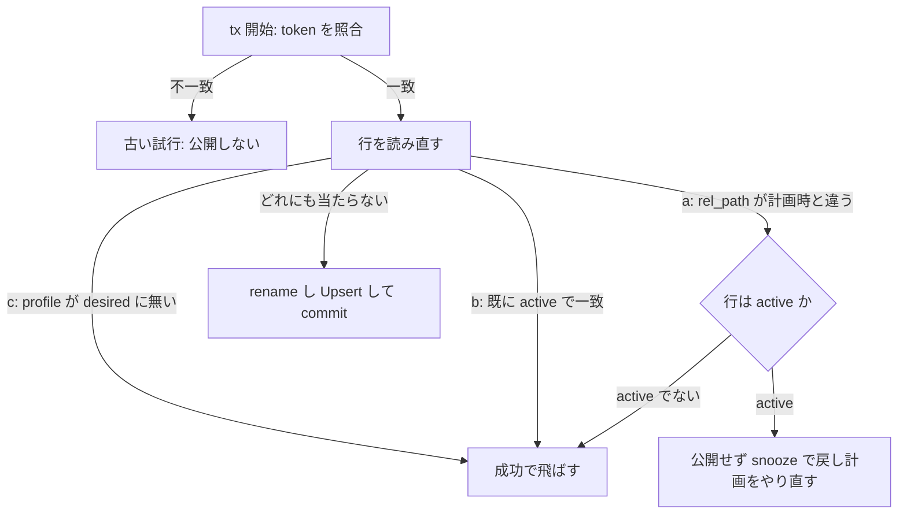

> [storage.md](../storage.md) §1〜5 の一部。索引から辿る

## 1. 方針: S3 SDK を持たない

アプリのコードに S3 SDK やオブジェクトストレージの抽象化を持ち込まない。ローカルディスクとクラウドストレージの差は、OS / CSI / FUSE のレイヤーで吸収する。将来ネイティブ S3 API が必要になっても、DB の相対パス = キーなので、その時点で薄い抽象を後付けする余地は残る。

## 2. FUSE 越し S3 の制約

FUSE 越しの S3 は、原本の取り込み先には使わない。atomic rename、ランダムライト、fsync やロックの意味論のどれも、原本を公開する根拠として信頼できないからである。

S3 マウント（k8s-csi-s3 の geesefs/s3fs、AWS Mountpoint 等）では、次の 3 点を `storage.media_dir` の原本 root の契約として信頼できない。

- 同一 FS 内の atomic rename がない。コピー + 削除になり、数十 GB の録画で実コピーが走る。Mountpoint は rename 自体に非対応である
- ランダムライトができないか遅い。特に ffmpeg は MP4 出力時にヘッダ（moov atom）を書き戻すためシークするので、S3 マウント上への直接エンコード出力は正しく書けないか激遅になる
- ファイル `fsync`、`Close` のエラー報告、親ディレクトリ `fsync`、ファイルロックの意味論が、原本を公開する根拠として信頼できない

したがって FUSE S3 は原本の ingest 先には使わない。派生物を置く領域としての利用可能性と、原本 root の契約を混同しない（実機検証の対象範囲もこの区別に従う）。

## 3. ストレージ契約（4 つのルール）

原本の保存先は、fsync と atomic rename を信頼できる通常の POSIX FS に限る。書き込みは常にシーケンシャルにし、作業はローカルで行って完成品を一度だけ置く。公開点は DB の commit で、DB には相対パスだけを保存する。

`storage.media_dir` は、ファイル `fsync`、`Close`、同一 FS 内の atomic rename、rename 後の親ディレクトリ `fsync` を信頼できる通常の POSIX FS に限る。ローカル FS / JuiceFS / 条件を満たす NFS は対象内で、FUSE S3 は原本 ingest の対象外である。次のルールは、原本 root とローカル `scratch_dir` の組み合わせに適用する。

1. 書き込みは常にシーケンシャルにする。初回は一発書き、プロセス再起動後は同じ temp の EOF へ追記する。ランダムライトはしない
2. 「作業はローカル、置くのは一回」とする。ffmpeg の出力は必ずワーカーのローカルスクラッチ（k8s では emptyDir）に書き、完成したファイルをストレージへストリームコピーして fsync する。MP4 のシーク問題と書きかけファイル問題が同時に消える
3. **公開点は DB commit** とする。DB transaction 内の INSERT は一意性を予約するが、他セッションから見える公開ではない。rename と親ディレクトリ `fsync` が成功してから transaction を commit し、commit が成功した時点で `media_assets` 行と canonical file の組を公開する
4. DB には相対パスのみ保存する。ルートは設定で与える。DB にロック・xattr・パーミッションの状態は保存しない。temp の同時実行排他は、対象 FS 上の協調的な POSIX `flock` に依存する

### scratch と temp の置き場所

ffmpeg の出力はワーカーのローカルスクラッチへ書く。取り込みの一時ファイルと派生物の staging file は、最終的に置くのと同じ root・同じディレクトリに作る。別の FS をまたぐ rename は失敗し、コピーへの劣化を許すことになるので、scratch からの rename は確定操作には使わない。

scratch から rename すると `EXDEV` になり、コピーへの劣化を許すことになる。

scratch directory 名は Worker の復旧単位から決める。encode は `(recording_id, profile, attempt_count)`、CM detect は `(recording_id, attempt_count)` を使う。CM logo candidate は `(recording_id, attempted_at)` を使う。thumbnail と seek tiles は recording ID を接頭辞にして毎回 `MkdirTemp` で作る。

CM detect と CM logo candidate はプロセス死の残骸を回収しない。CM 検出は死後の次の開始で `attempt_count` が進み同じ名前に戻らず、ロゴ候補は `MkdirTemp` だからである。中身は原本への symlink と小さいファイルだけなので、残っても実害は小さいとして許容する。

ingest は同じ root・同じディレクトリの record 固有 temp へ書く。temp 名は `.rokuban-ingest-{site}-{record_id}` と決め、プロセス再起動後も同じファイルを開く。encode の staged 出力も同じディレクトリに置く。

予約 basename は、mirakc の contentPath には使わない。次の 4 つの prefix で始まる名前である。

`.rokuban-ingest-` は ingest temp、`.rokuban-rel-path-lock-` は旧形式 lock file、`.rokuban-encode-` は encode staging file を表す。`.rokuban-media-asset-` は thumbnail / seek tiles staging file を表す。

rel_path lock は media root の `.rokuban-locks/` に置く。この directory 名も予約し、DB の `rel_path` として受け入れない。

ingest は canonical path を転送中に触らない。HEAD の長さと、存在する場合は `content.sha256` を照合してから、temp を `fsync` して `Close` する。次に DB transaction 内で original 行を INSERT して rel_path を予約し、temp を canonical へ atomic rename して親ディレクトリを `fsync` する。

<details><summary>根拠</summary>

- `.rokuban-locks/` を `rel_path` として受け入れないこと: `mediapath.Resolve`

</details>

### 公開順序と失敗時の扱い

公開点は DB commit であり、rename と親ディレクトリの fsync の成功が先に来る。rename の後で fsync か commit が失敗したら transaction を rollback し、canonical file は orphan として記録・報告する。名前だけでは公開済みか判定できないので、自動で消さない。

mirakc record は削除しない。中身の不一致または record の cancel / fail が分かった場合だけ temp を消し、それ以外の失敗では次の試行へ残す。

**この順序を反転させない**。DB commit 後に rename すると、行が指す実体の欠落を作る。

ingest のコピー完了には、fsync と Close のエラー確認まで含める。転送中の fsync は、4 分の区切りで checkpoint を保存する直前と転送完了後に限り、バッファごとには行わない。区切りで fsync してから checkpoint を書くのは、電源断でサイズだけ進んだ temp と checkpoint を突き合わせないためである。

区切りごとの fsync のコストは NFS / JuiceFS で未測定である。S3 系 FUSE は原本 ingest 先から外れているため、途中 fsync で fd に書けなくなる実装は対象外である。Linux では遅延した書き込みエラー（ENOSPC / I/O エラー）は `Close` では報告されず `fsync` でしか上がらない。rename 後の親ディレクトリ `fsync` は新しい directory entry の永続化を確定する。いずれかが失敗したら DB 登録と record 削除をせず再試行する。

ingest temp / checkpoint の回収は同じ `flock` に参加し、ロック取得後に inode と mtime を再確認する。staging は公開前を示す予約名で、一意な CreateTemp パスから canonical へ rename すると元のパスは消える。そのため回収時に lock は取らず、unlink 直前に mtime を再確認する。

canonical orphan は aging 後に報告するだけで unlink しない。通常の canonical 公開と削除は `rel_path` filesystem lock を DB commit まで保持し、通常削除との競合を防ぐ。

### rel_path lock file の寿命

パスごとの lock file は、通常終了のときに削除してから解放するので、何度処理しても残らない。異常終了で残った lock file は、次の lock 取得時の掃除が回収する。

rel_path lock は `.rokuban-locks/<prefix><sha256(rel_path)>.lock` に置く。canonical file と同じ directory entry ではないため、canonical の rename / unlink で lock 対象が置き換わらない。通常終了時は per-rel_path lock を保持したまま gate を排他し、lock file を unlink してから flock と fd を解放する。したがって複数回の ingest / encode / delete の後も per-rel_path file は残らない。`.gate.lock` は lock directory の調停に使う固定 file として残る。

取得側は gate を共有して lock file を開き、`LOCK_NB` で試す。busy ならその fd を閉じて gate を解放してから待ち、再度 path を開く。release と GC は gate を排他するため、unlink と同時に古い inode を待つ fd は作られない。これが「A が unlink、B が古い inode を取得、C が新 inode を取得」という二重 lock を防ぐ規則である。active lock は残して次回に回す。lock 取得や cleanup に失敗したときは、ファイル操作を進めずにエラーを返す。

この GC は lock file の directory entry だけを扱い、メディアファイルは扱わない。

プロセスが異常終了すると kernel が gate と per-rel_path flock を解放する。unlink 前なら lock file の directory entry は残るが、次の lock 取得時の GC が gate 排他下で stale file を回収する。GC 中に active owner がいる file は flock が取れず削除されない。複数プロセスは同じ media root とこの gate protocol を使う必要がある。POSIX `flock` の前提はこの文書のルール 4 と同じで、JuiceFS / NFS 越しの実効性は未検証。

lock directory は mode `0777`、gate / per-rel_path file は `0666` で作り、通常どおり umask を適用する。異なる uid の worker を同じ media root で動かす場合は、共有 group / ACL が directory の作成・削除と lock file の read-write を許すことを先に確認する。

#### 旧形式の lock file と更新時の並走

旧形式の lock file は、移行時に自動削除しない。旧 worker が新しい排他の手順に参加しないため、消すと旧プロセスの待機側が古い inode を握る可能性がある。旧 worker と新 worker が並走している間は、消す操作も実行しない。

旧形式とは、canonical と同じ directory の `.rokuban-rel-path-lock-*.lock` である。

新形式も同じ接頭辞を `.rokuban-locks/` の下で使う。そのため接頭辞だけで消す `find -name '.rokuban-rel-path-lock-*' -delete` は、稼働中の新形式 lock まで消す。旧形式だけを消すときは `.rokuban-locks/` を除外する。`-delete` は `-prune` と併用できない（`-depth` を暗黙に有効にする）ので `-exec rm` を使う。

```bash
find "$MEDIA_ROOT" -type d -name .rokuban-locks -prune -o \
  -type f -name '.rokuban-rel-path-lock-*.lock' -exec rm -- {} +
```

旧 worker と新 worker が同じ media root に並走している間は、この削除も実行しない。

k8s の `worker-scaledjobs.yaml` は全 ScaledJob が `rollout.strategy: gradual` なので、更新中は旧イメージの実行中 Job が完走するまで新しい Job と並走する。並走の原因はこの設定であり、ScaledJob 一般の性質ではない。この窓では旧 worker が新 worker の gate を知らないまま、同じ rel_path を別の inode で lock しうる。

並走を避けるには、更新前に media を mount する ScaledJob の新規起動を止め、`kubectl get jobs` で旧 Job が全て終わったことを確認してから新しいイメージを適用する。新規起動を止める具体的な操作（KEDA の pause 等）と、その間に積む queue の扱いは未検証。

止められない場合は、この並走窓で同じ rel_path を触る ingest / encode / 削除が二重に lock を取りうるリスクを受け入れる。旧形式の残置 file は、全旧 worker の停止後に上のコマンドで消す。

### 派生物の公開（encode）は既存の canonical を上書きする

エンコード出力は既にある行のパスへ公開する。そのため canonical を直接開かず、同じディレクトリの staging file へ書く。公開は lock の中で、判定、rename、親ディレクトリの fsync、DB 登録、commit の順に行う。古い試行は、試行回数の照合と行の再確認で公開できない。

encode の出力は原本と違って既にある行の `rel_path` を指す（プロファイルごとに 1 つ。カット版は世代番号で新しいパスになる）。締切後に River が同じ job ID を再試行した時、古い Work が ctx cancellation に従わなければ、同じ `(recording, profile)` の試行が一時的に並走しうる。そのため次の対策を置く。

- scratch は `(recording_id, profile, attempt_count)` ごとに作る。profile 名は固定長 SHA-256 digest にして basename の長さを抑える。長い profile 名でも作成できる。
- 掃除は同じ `(recording_id, profile)` の残骸だけを対象にする。各試行は自分の scratch directory に flock を持ち続け、掃除は lock が取れた（死んだ）directory だけを消す。
- 並走中の試行は残り、他の scope の encode が走っていても死んだ残骸は消える。
- 作成直後で lock 前の directory は、作成と掃除を短い排他区間で直列化して守る。
- 各試行は開始時に増えた attempt count を fencing token として公開時に照合する。古い token の試行は canonical を公開できない。
- ctx cancellation に従わない古い ffmpeg は CPU を使い続けうるため、k8s liveness がプロセスごと停止させる。
- staging は canonical と同じディレクトリの staging file（`.rokuban-encode-`）へ、rel_path lock の外でストリームコピー + `fsync` する。
- 公開は lock（filesystem lock → tx）の中で、**判定 → rename（サイドカー → 本体）→ 親ディレクトリ `fsync` → `media_assets` の Upsert → commit** の順に行う。canonical を `O_TRUNC` で直接開くと、読者が切り詰められた内容を観測しうる。通常削除も同じ filesystem lock を取る。そのため公開と commit の間で lock を離すと、commit 前の行と消えた実体が組み合わせになりうる（ルール 3 と同じ理由）。canonical orphan は報告だけを行う。
- 通常削除は同じ filesystem lock を取る。RWX 越しに `flock` が効くかは未検証（ルール 4 と同じ前提）。
- 置き忘れた staging file は孤児候補になる。`.rokuban-locks/` と catalog directory と旧形式 lock filename は走査から除外する。
- mtime 猶予（既定 7 日）と孤児エイジング（既定 14 日）の後、canonical 名でない孤児を lock なしで消す。mtime は unlink 直前に再確認する。canonical 名の orphan は削除せず、確認を促す Warn と `rokuban_orphan_files_unresolved` に出す。
- rel_path lock file は Close または次回 GC で消える。拡張子が無い staging file は catalog 無し rescue の対象にはならず、原本へ昇格しない。

<details><summary>根拠</summary>

- 長い profile 名を扱う scratch directory: `TestNewEncodeScratchDirSupportsLongProfileNames`
- scratch cleanup の同じ record/profile 範囲: `TestRemoveStaleEncodeScratchScopesByRecordingAndProfile`
- 同じ scope の実行中 attempt を残す: `TestRemoveStaleEncodeScratchKeepsLiveAttemptOfSameScope`
- encode worker cleanup が active attempt を skip する: `TestEncodeWorker_ConcurrentScratchCleanupSkipsActiveAttempts`
- 別 scope の実行中 encode がいても stale scratch を掃除する: `TestRemoveStaleEncodeScratchIgnoresLiveEncodeOfOtherScope`
- scratch cleanup が作成 gate を待つ: `TestRemoveStaleEncodeScratchWaitsForScratchCreationGate`
- 新しい scratch directory の作成が gate を待つ: `TestNewEncodeScratchDirWaitsForScratchCreationGate`
- remove と publish の同じ filesystem lock: `deleteMediaAsset`
- staged file の walk と削除: `walkMediaFiles`、`deleteOrphanFile`

</details>

#### 公開時の tx 内の再確認

公開時の tx の中では、まず試行回数が自分の token と一致することを確かめ、続けて行を読み直す。計画時とパスが違う、既に同じ試行の内容で active になっている、または profile が desired に無いときは公開しない。ただし計画が古いだけで行が active のままなら、成功で飛ばさず、いったん戻して計画をやり直す。



この確認は、最初に `recording_encode_attempts.attempt_count` がこの試行の token と一致することを確かめ、続けて行を読み直して行う。次のどれかなら公開しない。

- (a) `rel_path` が計画時と違う
- (b) 既に active で（カット版は凍結区間も）この試行と一致する
- (c) profile が desired に無い

(b) が無いと、先発の commit の後に後発が rename で上書きする。後発の commit が失敗すると、ファイルは後発の中身で行は先発のサイズになる。(a) が無いと、行が先の世代へ進んだ後に古い計画の実行が行を巻き戻す。

(b) は成功で飛ばす。(a) は自分の計画が古いことを意味し、他の誰かが済ませたことを意味する (b) とは別である。行が active のまま (a) だけが立つ（カット版で区間が違う）ときは、成功で飛ばすと新しいチャプター編集が気づかないうちに消える。公開せずに River の snooze で戻し、現在の keep で計画をやり直す。snooze は attempt を消費せず、失敗通知も出さない。行が active でない（ごみ箱など）ときは成功で飛ばす。

(c) は成功で飛ばす。ユーザーが外した版（[retention.md](retention.md) §6「凍結の 3 つ目の例外」）を、外す前に積まれた実行中・再試行待ちのジョブが公開して復活させるのを止める。ジョブの cancel では塞げない。desired は `FOR SHARE` で読み、版を外す tx の policy 行ロックと直列化する。


### 字幕サイドカー

字幕を有効にしたエンコードは、エンコード済みファイルの隣に同じ basename の字幕サイドカーを置く。

サイドカーの拡張子は `.vtt` で、字幕は `media_assets.kind` を増やさず、`/file?profile=X&track=subtitles` で encoded アセットから解決する。ARIB 外字・ルビは libaribcaption のテキスト化により Unicode 私用領域または近似字へ落ちるため、画像字幕と同じ見た目を保証しない。

### thumbnail / seek tiles の公開

サムネイルとシークタイルは、完成したファイルを staging にコピーして fsync し、lock と transaction の中で rename して commit する。同じ録画のジョブが重なっても、先行が公開済みか原本が消えていれば、後続は公開を飛ばして成功扱いにする。

thumbnail と seek tiles の ffmpeg 出力先は recording ID を接頭辞にして `MkdirTemp` で作る scratch directory とする。毎回 suffix が異なるため、同じ recording の実行が重なっても scratch file を共有しない。

完成後は canonical と同じ directory の `.rokuban-media-asset-` staged file にコピーして file `fsync` する。次に rel_path filesystem lock → transaction の順に取る。

transaction 内で active な派生行と原本の生存を再確認する。派生行がまだ無く原本も active なら media asset row を予約し、staged file を canonical へ rename して親 directory を `fsync` した後に commit する。

先行 job がすでに active row を commit していた場合や、ffmpeg 実行中に録画が削除され原本が active でなくなった場合、後続 job は公開を飛ばして成功扱いにする。

staged file は予約名付きの orphan 候補として mtime 猶予と aging の後に回収する。回収時に lock は取らず mtime を再確認する。拡張子によらず catalog 無し rescue から除外する。canonical を `O_TRUNC` で直接開かないため、処理中に配信・削除側が途中の画像を観測する窓を作らない。

<details><summary>根拠</summary>

- 同じ recording の並行実行で scratch directory を共有しないこと: `TestNewWorkerScratchDirIsUniqueForSameRecording`

</details>

### catalog 世代の公開

catalog の世代は、最後に書く manifest が完成の判定点である。rename や DB 行は使わない。不完全な世代は 7 日間保持し、より新しい完成世代があるときだけ prune する。

catalog export は `catalog/` の新しい世代 directory を `Mkdir` で原子的に予約する。同じ `ExportedAt` を持つ並列 export は `-02` 以降の別 directory を取得する。世代内では `catalog.json` を一度書いて file `fsync` し、sha256 とサイズを持つ `manifest.json` を最後に書いて `fsync` する。

別 export の prune が書き込み途中の世代を消さないよう、不完全世代は保持する。catalog directory 以外へは触れない。

### カット版・サムネイルの置き換え（「置くのは一回」の 2 つの例外）

カット版とサムネイルを作り直すときは、同じパスへ上書きせず、世代番号を入れた新しいパスへ置く。行は消さずに 1 つの transaction で更新し、旧パスの unlink は commit の後にする。

カット版（`encode.profiles[].cut`）は、チャプターを直した後に同じ出力を作り直す。同じパスへ上書きしない。ルール 2 の「置くのは一回」に反し、生きている行の `rel_path` 部分一意索引とも衝突するからである。

- パスに世代番号を入れる（`…_{profile}.g{n}.{container}`。1 世代目から付ける）。n は旧 `rel_path` から +1 で導出する
- 新しいファイルを置く → 1 つの tx で `media_assets` の `rel_path` / `size_bytes` を UPDATE し、`media_asset_cuts` を差し替える → commit 後に旧パスを unlink する
- **unlink を commit の前にしない**。commit が失敗すると、生きている行が指すファイルを失う（ルール 3 の「DB commit が公開点」と同じ向き）。旧ファイルの unlink に失敗した場合は canonical orphan として報告し、手動調査まで残す
- 行は消さずに UPDATE する。消して作り直すと `rel_path` の部分一意索引から一瞬外れ、その隙間に別の行が同じパスを取れる

CM 検出の後にサムネイルを選び直す場合も、同じパスへ上書きしない。

- 初回の `thumbnails/{recording_id}.jpg` は世代なしのままにし、差し替えは `thumbnails/{recording_id}.g{n}.jpg`（最初の差し替えは `.g1`）へ置く
- 新しい JPEG を置く → 1 つの tx で同じ `media_assets` 行の `rel_path` / `size_bytes` を UPDATE し、`media_asset_thumbnail_seeks` を差し替える。commit 後に旧パスを unlink する
- 行は消さずに UPDATE する。行 id と配信対象を保ったまま世代を進める。unlink は commit 前にしない。失敗した旧ファイルは canonical orphan として報告し、手動調査まで残す

ポイントはルール 3。DB commit を公開点にしつつ、公開前のファイル操作は強い FS 契約で確定させる。起動時 probe はこの操作列が実行できることだけを確認し、FS の種類や atomic rename の実装品質をパス文字列から推測しない。

## 4. クラウド側のマウント選択肢

クラウドで原本を置く先は、ローカル FS が第一候補で、JuiceFS と条件を満たす NFS も対象にする。S3 系の FUSE は原本の取り込み先に使わない。JuiceFS のメタデータストアに Postgres を使うなら、Rokuban とは別のインスタンスにする（推奨）。

| 選択肢 | 特徴 |
|---|---|
| ローカル FS | file fsync / Close / atomic rename / 親 directory fsync を通常の POSIX 意味論で満たす。第一候補 |
| JuiceFS（対象内） | メタデータを DB に、データを S3 に置く FS。atomic rename を含む POSIX 意味論を信頼できる構成で使う。メタデータストアに PostgreSQL を使う場合は別インスタンスを推奨 |
| NFS（対象内） | export は `sync`、client mount は `hard` を推奨。`.nfsXXXX` の silly rename が canonical orphan として報告される場合は、file を閉じた後に状態を確認する。自動削除はしない |
| k8s-csi-s3（geesefs / s3fs）・AWS Mountpoint | 原本 ingest 先には使わない。実機検証の範囲は派生物専用の領域に限る |

**注意**: JuiceFS のメタデータストアに Rokuban と同じ Postgres インスタンスを使うと、DB 障害がストレージ障害に連鎖し「DB が詰まっても仕事は失われない」の前提を成り立たなくする。使うなら別インスタンスを明記すること。

## 5. 2 階層: 録画バッファとアーカイブ

「mirakc が直接書くストレージは高速に、録画後の保存先はアーカイブ用途で低速に」という分離は、ingest の設計（[録画エンジン](../recording.md) 参照）が既に実現している。新機能は不要で、「録画後のファイル移動」= ingest そのもの。Rokuban の原本 ingest root は上の強い FS 契約を満たす必要があり、FUSE S3 は派生物専用の別領域でのみ検討する。

### 2 階層の対応関係

録画バッファは mirakc が書くエッジの高速なディスクで、アーカイブは Rokuban のメディアストレージで低速でもよい。mirakc に最終保存先を直接書かせないのは、録画がやり直せないリアルタイム処理で、遅いストレージのストールが放送の欠損に直結するからである。

| 階層 | 実体 | 要件 | 寿命 |
|---|---|---|---|
| 録画バッファ | mirakc `recording.basedir`（エッジのローカルディスク） | 高速・低レイテンシ（I/O 飽和 = ドロップ直結） | ingest コミット後に record 削除（リングバッファ） |
| アーカイブ | Rokuban のメディアストレージ（ローカル FS / 条件付き NFS / JuiceFS） | 低速可（書き込みはリトライ可能な転送のみ。ただし原本 root の強い FS 契約は必要） | 保持ポリシーに従う |

録画はシステム内で唯一のリアルタイム・リトライ不能な操作である。monolith モードでも basedir を NVMe、メディアストレージを HDD/NAS に置くだけで同じ分離が機能する（設定レベルの話でコードは変わらない）。

### 録画バッファのサイジング指針

録画バッファの容量は、取り込みが詰まったときの滞留分で決まる。同時録画数は支配項にならない。速度で怖いのは、他の I/O との競合によるレイテンシのスパイクで、絶対帯域は問題にならない。

回線断・クラウド側障害時は未 ingest の record が溜まり続ける。推奨値は「N 日分の全録画を保持できる容量」（地デジ約 7 GB/時で見積り）とし、既定の「未 ingest record 総量メトリクス + エッジディスク残量アラート」と対にする。**ただしそのメトリクスは回線断の滞留を数えない**（`record_sync` は watcher の観測でしか増えないため。[運用](../operations.md) §4「N 日は容量だけでは決まらない」）。同節のとおり、N の上限を決めるのは `epg.retention_grace` で、容量では決まらない。

書き込みは 1 録画あたり約 2 MB/s（地デジ 17 Mbps）で、同時 8 本でも 16 MB/s に過ぎない。ingest pull のサイト単位 1〜2 本キャップは、レイテンシスパイクを避けるための決定でもある。

### アーカイブの速度要件

アーカイブに求める速度は、平均スループットが 1 日の録画総量を 24 時間で割った値以上であること。瞬間的な変動は録画バッファが吸収するので、リアルタイム性は一切要求されない。エンコードの読み出しもバッチなので遅くてよい。

唯一レイテンシが人間に見えるのは**再生時のシーク**（S3 + FUSE の range read）である。原本削除ポリシーと組み合わせた「視聴は H.265 派生物、原本は消すか S3 の奥」という運用が前提なら、実用上問題にならない見込みである。

### 保留: アセット種別ごとのストレージルート分離

派生物（視聴用）だけ速いストレージに置きたくなった場合、originals / derivatives で 2 つのストレージルートを持つ小さな拡張で対応できる。現時点では単一ルートで始め、シークの体感が問題になったら足す（YAGNI）。

### 残量の観測

ストレージの残量は、ファイルシステムを持つ worker が定期的に観測して射影し、API から読めるようにする。対象はアーカイブとローカルのスクラッチだけで、mirakc の録画バッファは対象外である。

`storage.media_dir`（アーカイブ）と `storage.scratch_dir`（ローカルスクラッチ）の容量は、worker が定期的に statfs 相当で観測して `storage_sync` に射影する。`GET /api/storage` で読める。api ロールはファイルシステムに依存しない（不変条件 1）。そのため観測は、ファイルシステムを持つ worker の仕事に限る。mirakc の recording.basedir（録画バッファ、上記「2 階層」表のエッジ側）は対象外である。Rokuban 自身が直接読み書きする 2 つのローカルパスだけを見る。

`tuner_sync`（[docs/data.md](../data.md) §6.5）と同じ「使い捨てプロジェクション」の形を採る。正しい状態は常にファイルシステム側にあり、毎パス全量を作り直せる観測値である。そのため全行 upsert で常に最新観測だけを保持する（過去の観測を積むログにはしない。不変条件 9）。`observed_at` の鮮度が「観測ループが止まっている」ことを示す唯一の手がかりになる（警告が出ないことは保証ではない。docs/data.md §6.5 の同じ姿勢である）。

### rel_path の名前空間

原本の相対パスは、取り込みが先頭に固定の予約ディレクトリとサイト名を前置する。site 名だけを先頭にすると、既存行の先頭成分と偶然一致して衝突するからである。

アーカイブ（`media_assets`）は `site` 列を持たず単一だが、原本の `rel_path` は mirakc の contentPath 由来でサイトスコープの名前である。2 サイトが同じ contentPath で録ると、同じ実ファイルを取り合う。DB は `rel_path` の一意索引で片方の commit を落とすが、実ファイルは先に書いた方が上書きされて失われる。そのため原本は `sites/{site}/` を前置する。

#### 予約ディレクトリと前置の規則

トップレベルの予約ディレクトリは 3 つで、原本の名前空間はその 1 つの下にサイト名を置く。前置するのは取り込みだけで、contentPath のテンプレートの内容には依存しない。site 名を先頭にすると、既存行の先頭成分と偶然一致して衝突し、実ファイルが上書きされる。

トップレベルの予約ディレクトリは `catalog/` / `thumbnails/` / `sites/` の 3 つである。`catalog/` は削除 reconcile の孤児回収と rescue スキャンが SkipDir する。`thumbnails/` はサムネイルの名前空間（§5.1）で、`sites/` は site スコープの原本の名前空間になる。

**前置の 1 段目を site 名そのもの（`{site}/...`）にする当初案は採らない。** 1 段目は固定の `sites/` にする。当初案は、前置前に ingest 済みの既存行の先頭成分と site 名が偶然一致すると衝突する。

例えば `filename_template` が `"tokyo/..."` のような静的接頭辞を書き、site 名も `tokyo` だと、新規 ingest の rel_path が既存行と同じになる。一意索引が効く前に実ファイルが上書きされる。site 名の構文 `^[a-z0-9]([_-]?[a-z0-9])*$` は日付ディレクトリ名や `anime` のような静的な語も許すため、理論上だけの懸念ではない。

固定の `sites/` を 1 段目に挟むと、新規 ingest の rel_path は必ず `sites/` から始まる。それ以前の既存行が `sites/` から始まっていない限り、構造的に衝突しない。

前置するのは ingest であって、contentPath テンプレートではない。ingest は原本 `rel_path` の唯一の書き手である。ここで前置すれば、reconciler が生成する contentPath やユーザーの `filename_template` の内容に関わらず名前空間が保たれる。

前置は空の相対パスを通す前に弾く。contentPath / Content.Path がどちらも空だと、前置前の相対パスは `.`（カレントディレクトリ）になる。前置後は `sites/{site}/.` の `.` が `Join` / `Clean` で消え、`sites/{site}` という一見正当なパスになり、`mediapath.Resolve` の脱出検知を通ってしまう。すると一時ファイル作成が `{media_dir}/sites/{site}` を通常ファイルとして作り、その後その site 配下の ingest が `MkdirAll` で not a directory になり失敗し続ける。ingest は前置前に相対パスが `.` であることを明示的に検査して弾く。

サムネイルは `thumbnails/{recording_id}.jpg` のまま（§5.1）。原本の contentPath に依存しないので `sites/` 前置の影響を受けない（構造的に衝突しない）。派生物は原本の dir を引き継ぐので自動的に前置される（[retention.md](retention.md) §6 参照）。原本が `sites/tokyo/20240101/....m2ts` なら、派生物は `sites/tokyo/20240101/...._h264.mp4` になる。

原本と encoded の全行は `sites/{site}/` 前置済みである。前置なしの行は worker の起動時検査で拒否する。

#### リンクの禁止と root の symlink

メディアディレクトリの配下には、録画の実体を指すリンクを作らない。メディアディレクトリ自身が symlink であることは許す。孤児回収と rescue が root を解決してから走査するからである。

`media_dir` 配下に、録画の実体を指すリンクを作らない（symlink / hard link）。孤児回収は symlink かどうかを見ずに DB の行と突き合わせる。未知の canonical 名になったリンクは孤児として報告するが、自動削除しない（`mediapath.Resolve` は字句判定のみで symlink を評価しない）。

hard link は regular file と区別できず、同じ実体に live な録画が 2 行並ぶ。`(dev, ino)` による検出は、スキャンをまたぐと inode がバックアップ復元で変わるため実装しない。rescue の走査と in-place 登録は symlink だけを弾く。

ディレクトリへの symlink も作らない。rescue と孤児回収の走査は symlink を辿らないため、配下のファイルは孤児候補にも rescue にも見えず、災害復旧で救えない。symlink エントリ自身は孤児として報告するが、自動削除しない。リンク先が `media_dir` 内を指す構成では、配下の active 行が実体無しとして誤報され続ける。

`media_dir` 自身が symlink であることは許す（`/var/lib/rokuban/media -> /mnt/disk1/media`）。rescue と削除 reconcile の両方が root を `filepath.EvalSymlinks` で解決してから walk するためである。

この解決を外すと、両方とも気づかないうちにおかしくなる。`filepath.Walk` / `WalkDir` は symlink root に `Lstat` し、`IsDir()` が false なら callback を 1 回呼んで終わる。rescue は 0 件のまま「成功」する（災害復旧が最も要る場面だけが使えなくなる）。削除 reconcile は `seenOnDisk` が `.` の 1 件になるため、全損セーフガード（走査結果が 0 件なら記録を見送る）が働かない。その結果 `active` 行を全件「実体無し」と誤報する。

解決した値は root だけでなく、`catalog/` の除外判定と `rel_path` の基準にも同じものを使う。片方だけ解決すると、相対パスは `../` を含み DB の `rel_path` と一致しなくなる。root を解決することと配下にリンクを作らないこと（上の 2 つ）は別の話であり、片方をもう片方の根拠にしない。

#### 予約名の 2 種類

トップレベルディレクトリ名の予約は、一般のディレクトリ名として使うと正しく動かなくなるので外せない。site 名の禁止は、パス衝突を防ぐ理由では残しておらず、緩める自由度が変更コストに見合わないために残してある。

トップレベルディレクトリ名の予約と site 名の禁止は、根拠が異なる。

1. トップレベルディレクトリ名の予約は `catalog` / `thumbnails` / `sites` の 3 つである。`catalog/` は削除 reconcile の孤児回収と rescue スキャンが読み飛ばす対象、`thumbnails/` はサムネイルの名前空間、`sites/` は本節の原本の名前空間である。いずれも一般のディレクトリ名として使うと正しく動かなくなるため、この予約は外せない。
2. site 名としての `catalog` / `thumbnails` は禁止する。導入時は `{site}/` を先頭成分にしており、この 2 つはトップレベル予約ディレクトリと直接衝突していた。`sites/` を挟んだ今は、site 名が `sites/{site}/...` に閉じるため、トップレベルの `catalog/` / `thumbnails/` と構造的に衝突しない。

この禁止を残すのはパス衝突を防ぐためではない。`catalog` / `thumbnails` を site 名にしたい運用要求がなく、禁止を緩める自由度がバリデーションとテストの変更コストに見合わないためである。`sites` 自体を site 名にしても `sites/sites/...` となるだけで衝突しない。

<details><summary>根拠</summary>

- `.rokuban-locks/` を `rel_path` に使わない検査: `mediapath.Resolve`
- `sites/{site}/` の前置と空 path の拒否: `internal/worker/ingest.go` の `determineRelPath`
- 孤児回収の file walk と root symlink の解決: `internal/worker/delete_reconcile.go` の `walkMediaFiles`
- rescue が root symlink を解決し、in-place 登録時に symlink を拒否すること: `rescueStorage`、`inplace.Register`
- `catalog/` の除外と相対パスの基準に同じ root を使うこと: `filepath.Rel`
- 派生物の `rel_path` を作る関数: `EncodedRelPath`
- 予約ディレクトリと site 名の定義: `internal/config`, `internal/config.reservedSiteNames`

</details>

## 5.1 サムネイル

サムネイルは、有効な原本があり、有効なサムネイルが無く、ごみ箱に入っていない録画だけに、定期的な突き合わせで作る。抽出位置は初回は尺の 1 割か 30 秒の短い方で、CM 検出後は CM を除いた区間の合計尺に同じ方針を適用して選び直す。

録画 1 本につき `kind = 'thumbnail'` の media_asset を 1 つ作る（`UNIQUE (recording_id, kind, profile)`）。

初回の抽出位置（仮サムネイル）は `seek = min(duration × 10%, 30s)` である。duration は原本の ffprobe が読む実ファイル長で、取れなければ 0 秒（先頭フレーム）にする。初回は CM 検出を待たず、従来どおり原本から作る。設定キーは設けない。

- 時間軸: カット境界は入力の最早 `start_time` を 0 とする秒で適用する。thumbnail の `-ss` も `-i` より前の入力シークであり、同じ数値の位置を渡す。chapter ranges と `seek_ms` は `recording_chapter_spans` / `media_asset_cuts.keep_ranges` と同じ ms を使う。放送 TS は音声が映像より先に始まることがあり、章の原点（最初の映像フレーム）と入力の最早 `start_time` の差は未測定。そのため、この値が同じ画面を指すことと、原本 / encoded 版間で同じ `seek_ms` が揃うことは実録画で確認する
- 画素縦横比: ffmpeg で入力の SAR を偶数幅の正方形ピクセルへ焼き込んでから JPEG 化する。JPEG の SAR を解釈しないブラウザでも anamorphic 映像を歪ませない
- ストレージ契約: ffmpeg は `storage.scratch_dir` に JPEG を書き、完成後にメディアへストリームコピー + fsync する。初回は `media_assets` と `media_asset_thumbnail_seeks` を同じ tx で INSERT し、差し替えでは両方を同じ tx で UPDATE する（差し替え規約は §3）
- 相対パス: 初回は `thumbnails/{recording_id}.jpg`。差し替えは `thumbnails/{recording_id}.g{n}.jpg`（n は現行パスの次の世代）。原本の contentPath に依存しないので、原本削除後もパスが安定する
- 位置の事実: `media_asset_thumbnail_seeks` に、その JPEG を切り出した原本時間軸の `seek_ms` を 1 行記録する。旧サムネイルで行が無い場合は位置不明として扱う
- 配信: streamer の `GET /api/media/recordings/{id}/thumbnail`（openapi 外。api はファイルを開かない）

#### 投入の条件

レベルトリガーで投入するのは、有効な原本があり、有効なサムネイルが無く、ごみ箱に入っていない録画だけである。原本の実体が無いと確認された録画も除く。ingest 後の限定パスと定期の全件パスは、同じ条件を使う。

投入はレベルトリガーで、River `thumbnail` キューへ unique ジョブ（`recording_id`）を積む対象は、次の条件を満たす録画だけである。active な original があり、active な thumbnail が無く、かつごみ箱（`recordings.deleted_at IS NOT NULL`）に入っていないこと。

ごみ箱の録画を除外するのは、配信側（`GetThumbnailMediaAssetForServing`）が `deleted_at IS NULL` を要求するためである。生成しても誰にも配られず、猶予期間ぶん ffmpeg を無駄打ちするだけになる。

ingest 後の対象限定パスと `thumbnail_reconcile` の全件パスは同じ候補 query を使う。delete reconcile が原本の実体無しを確認した `missing_media_assets` の原本は、両方のパスで除外する。ファイル復旧後にマーカーが消えれば、次のパスで再び候補になる。命令的チェーン（「ingest 成功 → 必ず thumbnail」）は採らない。

<details><summary>根拠</summary>

- ごみ箱の録画をサムネイル配信対象から除くこと: `GetThumbnailMediaAssetForServing`
- ingest 後の対象限定パスと全件パスが同じ候補を使うこと: `thumbnail_reconcile`
- 原本の実体が見つからない状態の除外: `missing_media_assets`

</details>

#### 抽出位置の選び直し

CM 検出後は、CM 区間を除いた残り区間の合計尺に同じ 1 割か 30 秒の方針を適用して選び直す。記録済みの位置が現在の残り区間の外にあり、新しい計画の位置とも違うときだけ作り直す。

選び直しでは、同じ `min(尺 × 10%, 30s)` ポリシーを、CM 区間を除いた keep の合計尺に適用する。原本またはカットしない encoded 版ではその位置を原本時間軸へ写して抽出する。カット版では凍結した `media_asset_cuts.keep_ranges` の合計尺で位置を決め、抽出位置を同じ凍結 keep から原本時間軸へ戻す。カット版の尺は ffprobe せず凍結 keep の合計を使う。

再選択の入力は、active かつ `missing_media_assets` に無い原本を優先し、次にプロファイル名昇順のカットしない encoded、最後に同じ順のカット版を選ぶ。未確認の自動 CM 検出も使う。チャプターがない録画は再選択せず、keep が空なら再選択を繰り返さない。

作り直す条件は、記録済み位置が現在の keep 外にあり、同じ入力選択で計画した位置とも異なる場合だけである。`seek_ms` が無い旧サムネイルは、チャプターと使える入力があれば一度選び直す。位置が keep 内なら、望ましい位置との違いだけでは作り直さない。

再選択 reconcile は、active なサムネイルと CM 検出または所有済みチャプターがある録画を recording ID の窓で巡回し、Go の共通判定で対象だけを投入する。ごみ箱は除外し、`seek_tiles` や初回生成とは別の再開位置を持つ。CM 検出の保存後に 1 件ヒントを出すが、ヒントはベストエフォート。手動編集は次の窓で拾う。

<details><summary>根拠</summary>

- keep range の位置を原本時間へ写すこと: `UnmapMs(keep, seek)`
- 入力の時間原点を 0 にしてカット境界を適用すること: `ffargs.CutFilterComplex`

</details>

## 5.2 シークプレビュー用タイル

シークプレビュー用タイルは、録画 1 本につき 1 枚の JPEG で、形は固定値にしてあり設定キーは設けない。生成に失敗したらスクラッチを捨ててやり直し、部分的な成果はコミットしない。

録画 1 本につき `kind = 'seek_tiles'` の media_asset を 1 つ作る（`UNIQUE (recording_id, kind, profile)`）。中身は 1 枚の JPEG で、`thumbnails/{recording_id}_tiles.jpg` に置く。poster（§5.1）と同じ `thumbnails/` の名前空間なので、`rel_path` の名前空間の検査は増えない。

形は固定値である（設定キーは設けない。poster と同じ流儀）。間隔 10 秒・1 枚 160x90・10 列・上限 1080 枚（3 時間）。3 時間を超える部分にはタイルが無く、クライアントはプレビューを出さない。尺に応じて間隔を変える方式は採らない。ffprobe の長さと `<video>` の長さのずれが、境界でタイル位置を狂わせるからである。

- 投入: `thumbnail_reconcile` の全件パスと ingest 後の対象限定パスが seek_tiles を投入する。両者は poster と同じ候補 query を使い、`missing_media_assets` の原本を除外する。対象限定パスも seek_tiles を拾うため、タイルは ingest 直後に投入される。パス内では poster と再選択を先に投入してからタイルを積む。priority は poster より下げる。同じ priority だと既存録画ぶんのタイルが片付くまで新しい録画の poster が一覧に出ない。thumbnail キューは既定で同時実行数 1 なので、タイルの処理中に来た poster はその 1 件を待つ
- 原本が無い録画には作らない。タイルは原本からしか作らないので、タイル導入前に `until_encoded` で原本を消した録画にはタイルが付かない
- 失敗したら scratch を捨ててやり直す。部分成果はコミットしない（行の存在 = 全部そろっている）。poster と違い、長さが取れないとき（0 秒を含む）は 1 枚で続行せずに失敗する。1 枚の格子をコミットすると定期パスが二度と作り直さず、`until_encoded` の原本削除の条件まで満たしてしまう。バージョンによっては ffmpeg が 0 フレームでも終了コード 0 で終わるかもしれない（未検証。ffmpeg 9.0.2 は非 0）。そのため 1 枚ごとに出力の有無を確かめる
- 画素縦横比: poster と同じく SAR を正方形ピクセルへ焼き込んでから 16:9 の枠へ収め、余白は pad で埋める（4:3 の映像は左右が黒帯になる）
- 列数は固定で 10。枚数が列数の倍数でないときの余りは黒で埋まる。クライアントは列数と 1 枚の大きさだけを知っていれば位置を計算できる（行数を知らなくてよい）
- `internal/worker/seek_tiles.go` と `web/src/lib/seek-tiles.ts` に同じ値が 2 つある。メディア配信は `openapi.yaml` の対象外なので値の伝達経路が無い。**値を変えたら既存のタイルは位置がずれるので再生成が要る**（`rel_path` も行も同じまま中身だけが変わる）
- 配信: streamer の `GET /api/media/recordings/{id}/seek-tiles`（openapi 外。api はファイルを開かない）

#### 生成方式と最後のタイル

最後のタイルは映像の終端から 1 秒手前より後ろに置かない。GOP の長い映像でそれでも取れないときは、最後の 1 枚に限り直前のタイルで埋め、途中のタイルが取れないときは失敗させる。生成は 1 枚ずつ入力シークで取り、読む量は枚数にだけ比例する。

生成は、タイルごとに入力シーク（`-ss` を `-i` の前）で 1 枚ずつ取り、最後に `tile` フィルタで 1 枚に並べる。読む量が枚数にだけ比例し、番組長に比例しない（合成 TS 10 分・60 枚の実測で、全デコード方式の 23.6 秒に対し 2.7 秒）。そのため「先頭 N 分に限る」打ち切りは要らず、上限は枚数だけで決まる。実放送・J4125 での生成時間とサイズは未検証。合成 TS・M3 Max の実装 PR 測定では、10 分・60 枚で生成 1.865 秒、成果物 221.8 KB（3.70 KB/枚）だった。

最後のタイルは映像の終端から 1 秒手前より後ろに置かない。枚数は長さの切り上げで決めるので、長さが 10 秒の倍数をわずかに超える録画では最後のタイルが映像の終端を指す。そこへの入力シークは 1 フレームも出せずに失敗し、毎回同じ枚で落ちて原本が消えなくなる。映像ストリームの長さちょうどでも失敗し、1 秒手前なら成功した（合成 TS 30 秒・ffmpeg 9.0.2）。長さは映像ストリームから取る。format の長さは音声などの最も長いストリームで決まるので使わない。

1 秒の余白で足りるのは MPEG-2 と GOP 1 秒程度の H.264 まで。GOP の長い H.264 は最後のキーフレームより後ろが取れず、x264 GOP 5 秒では終端の 2 秒手前でも失敗した。何秒戻れば足りるかは GOP で決まるので、最後の 1 枚に限り、取れなければ直前のタイルで埋める。x264 GOP 5 秒・40 秒の合成 TS を実 ffmpeg で回すと、埋めなければ最後の 1 枚で落ち、埋めればコミットまで通った。途中のタイルと、1 枚しか無いときの失敗は埋めずに失敗させる。
