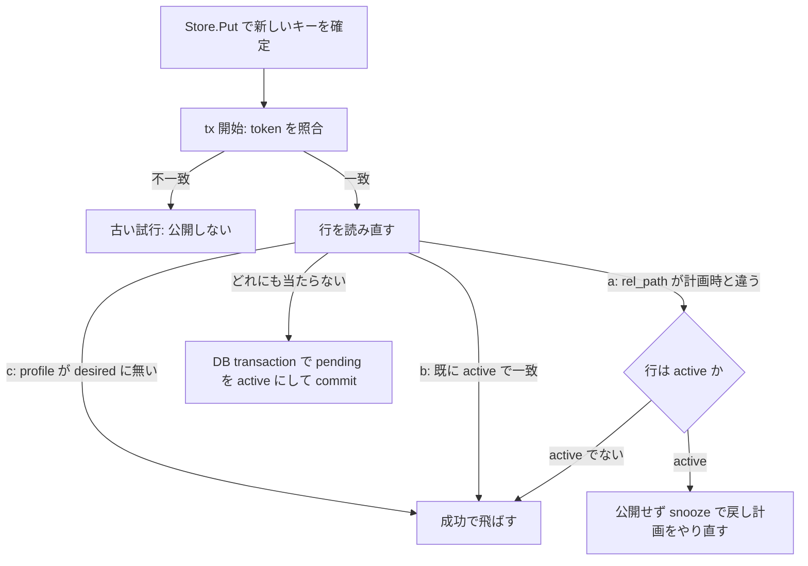

> [storage.md](../storage.md) §3 の一部。索引から辿る。

## 派生物の公開（encode）

エンコード成果物は世代ごとのキーに保存し、DB の commit で公開する。

encode は ffmpeg の前に DB で新世代の `pending` コピーを予約し、その世代のキーへ出力する。ffmpeg はローカル scratch に書く。完成したファイルの正確なサイズと SHA-256 を計算し、`Store.Put` に渡してから公開 transaction を実行する。transaction は attempt token と論理行を再確認し、コピーを `active` にして論理サイズ・チェックサムを更新する。Put または commit が失敗した場合はキーを配信せず、猶予後の reconcile が `pending` 行と孤立キーを回収する。

回収が Put 中または後続の公開処理中に pending 行を退役させた場合、公開側は処理終了時に、そのキーを持つコピー行が残っていないことを再確認して自分のキーを削除する。

キー世代は再利用しないので、失敗後の再試行も別のキーを使う。旧世代は `storage.transfer.overlap` が過ぎるまで残す。

FS 実装はキーと同じディレクトリに staging file を作る。サイズと SHA-256 を検証し、ファイル `fsync` と `Close` の成功後に no-replace hard link で公開する。最後に親ディレクトリを `fsync` する。S3 実装は multipart upload で checksum を検証し、条件付きで完了する。条件付き完了が 412 のときだけ、HEAD のサイズとアプリ保存 SHA-256 metadata で既存 object を照合し、同一内容なら成功、それ以外は失敗とする。

置き換えは新しい世代の行を足すだけで、旧世代のコピーには触れない。旧世代のキーは、署名付き URL で再生中の視聴者がいても 404 にならないよう、削除 reconcile が `storage.transfer.overlap` の後に消す。コピー行の世代は INSERT の後に変えず、現行のコピーを選ぶ述語は `active_media_asset_copies` と `preferred_active_media_asset_copy` だけに置く（[schema](../schema/recordings/media-assets.md)）。encode は ffmpeg の前に `pending` と世代を予約する。公開前に試行が止まっても、その世代は再利用せず、次の encode は新しい世代のキーを使う。Matroska のように同じ入力でも出力のバイト列が変わる形式で、既に upload 済みのキーを別の内容で上書きしないためである。

派生物置き場の操作失敗は、該当するジョブだけを失敗させる。worker は起動時にオブジェクト置き場へ接続しない（S3 の運用は [ストレージ運用](../operations/storage.md) の「S3 の置き場の運用要件」）。

encode の出力は原本と違って既にある行の `rel_path` を指す（プロファイルごとに 1 つ。カット版は世代番号で新しいパスになる）。締切後に River が同じ job ID を再試行した時、古い Work が ctx cancellation に従わなければ、同じ `(recording, profile)` の試行が一時的に並走しうる。そのため次の対策を置く。

- scratch は `(recording_id, profile, attempt_count)` ごとに作る。profile 名は固定長 SHA-256 digest にして basename の長さを抑える。長い profile 名でも作成できる。
- 掃除は同じ `(recording_id, profile)` の残骸だけを対象にする。各試行は自分の scratch directory に flock を持ち続け、掃除は lock が取れた（死んだ）directory だけを消す。
- 並走中の試行は残り、他の scope の encode が走っていても死んだ残骸は消える。
- 作成直後で lock 前の directory は、作成と掃除を短い排他区間で直列化して守る。
- 各試行は開始時に増えた attempt count を fencing token として公開時に照合する。古い token の試行は canonical を公開できない。
- ctx cancellation に従わない古い ffmpeg は CPU を使い続けうるため、k8s liveness がプロセスごと停止させる。
- 公開は **事前計画 → `Store.Put` → DB transaction で attempt token と論理状態を再確認し、pending を active にする**。削除済みでない別行が同じ `(store, rel_path)` を持てば DB の一意制約が拒み、既存キーは上書きされない。
- Store 実装は、内部の staging file や multipart upload を `List` に出さない。公開済みだが DB commit されなかったキーは `pending` 行を基準に reconcile が削除する。通常削除も派生物では `Store.Delete` を使い、original の file unlink と混同しない。
- encoded の `pending` のコピーを回収するときは字幕 sidecar を先に削除する。失敗したら本体と pending 行を残して、次の reconcile で再試行する。
- `fsstore` は staging file（`.rokuban-media-asset-`）を `List` に返さない。`Put` が止まって残った staging file は、削除 reconcile が FS の走査で孤児として観測し、mtime 猶予と aging の後に、走査した root 上で mtime を再確認して消す。fsstore 内部のファイルなので objstore のキーとしては扱わず、派生物の置き場が S3 でも FS 上で回収する。S3 の multipart upload は成功前に `List` に現れず、Put の失敗時に abort する。DB に `active` な行が無い canonical なキーは自動では消さない。

根拠

- 長い profile 名を扱う scratch directory: `TestNewEncodeScratchDirSupportsLongProfileNames`
- scratch cleanup の同じ record/profile 範囲: `TestRemoveStaleEncodeScratchScopesByRecordingAndProfile`
- 同じ scope の実行中 attempt を残す: `TestRemoveStaleEncodeScratchKeepsLiveAttemptOfSameScope`
- encode worker cleanup が active attempt を skip する: `TestEncodeWorker_ConcurrentScratchCleanupSkipsActiveAttempts`
- 別 scope の実行中 encode がいても stale scratch を掃除する: `TestRemoveStaleEncodeScratchIgnoresLiveEncodeOfOtherScope`
- scratch cleanup が作成 gate を待つ: `TestRemoveStaleEncodeScratchWaitsForScratchCreationGate`
- 新しい scratch directory の作成が gate を待つ: `TestNewEncodeScratchDirWaitsForScratchCreationGate`
- staged file の walk と削除: `walkMediaFiles`、`deleteOrphanFile`
- encoded pending の字幕削除失敗時に本体と行を残す: `TestFilesystemDerivedPendingReclaimKeepsMainUntilSubtitleRemovalSucceeds`
- Put 中に回収された派生物のキーを公開側が削除する: `TestObjectPublishCleansKeyWrittenAfterPendingCopyWasReclaimed`
- S3 切替後も FS の staging は FS 上で回収する: `TestDeleteReconcileWorker_FilesystemStagingOrphanIsRemovedWithoutAskingTheDerivedStore`
- 字幕の Put の失敗時に本体のキーを片付ける: `TestObjectPublishCleansMainKeyWhenCompanionPutFailsAfterReclaim`

### 公開時の tx 内の再確認

公開時の tx の中では、まず試行回数が自分の token と一致することを確かめ、続けて行を読み直す。計画時とパスが違う、既に同じ試行の内容で active になっている、または profile が desired に無いときは公開しない。ただし計画が古いだけで行が active のままなら、成功で飛ばさず、いったん戻して計画をやり直す。

この確認は、最初に `recording_encode_attempts.attempt_count` がこの試行の token と一致することを確かめ、続けて行を読み直して行う。次のどれかなら公開しない。

- (a) `rel_path` が計画時と違う
- (b) 既に active で（カット版は凍結区間も）この試行と一致する
- (c) profile が desired に無い

(b) が無いと、先発が公開した後に着いた同じ profile の後発が、新しい世代のキーを `active` にして論理行のサイズと SHA-256 を書き換え、先発のコピーを旧世代へ押しやる。各試行は別の世代のキーへ Put するので、既存のキーは上書きされず内容は壊れないが、不要な世代交代が起きる。未検証: この世代交代を起こすテストは無い。(a) が無いと、行が先の世代へ進んだ後に古い計画の実行が行を巻き戻す。

(b) は成功で飛ばす。(a) は自分の計画が古いことを意味し、他の誰かが済ませたことを意味する (b) とは別である。行が active のまま (a) だけが立つ（カット版で区間が違う）ときは、成功で飛ばすと新しいチャプター編集が気づかないうちに消える。公開せずに River の snooze で戻し、現在の keep で計画をやり直す。snooze は attempt を消費せず、失敗通知も出さない。行が active でない（ごみ箱など）ときは成功で飛ばす。

(c) は成功で飛ばす。ユーザーが外した版（[retention.md](retention.md) §6「凍結の 3 つ目の例外」）を、外す前に積まれた実行中・再試行待ちのジョブが公開して復活させるのを止める。ジョブの cancel では塞げない。desired は `FOR SHARE` で読み、版を外す tx の policy 行ロックと直列化する。
