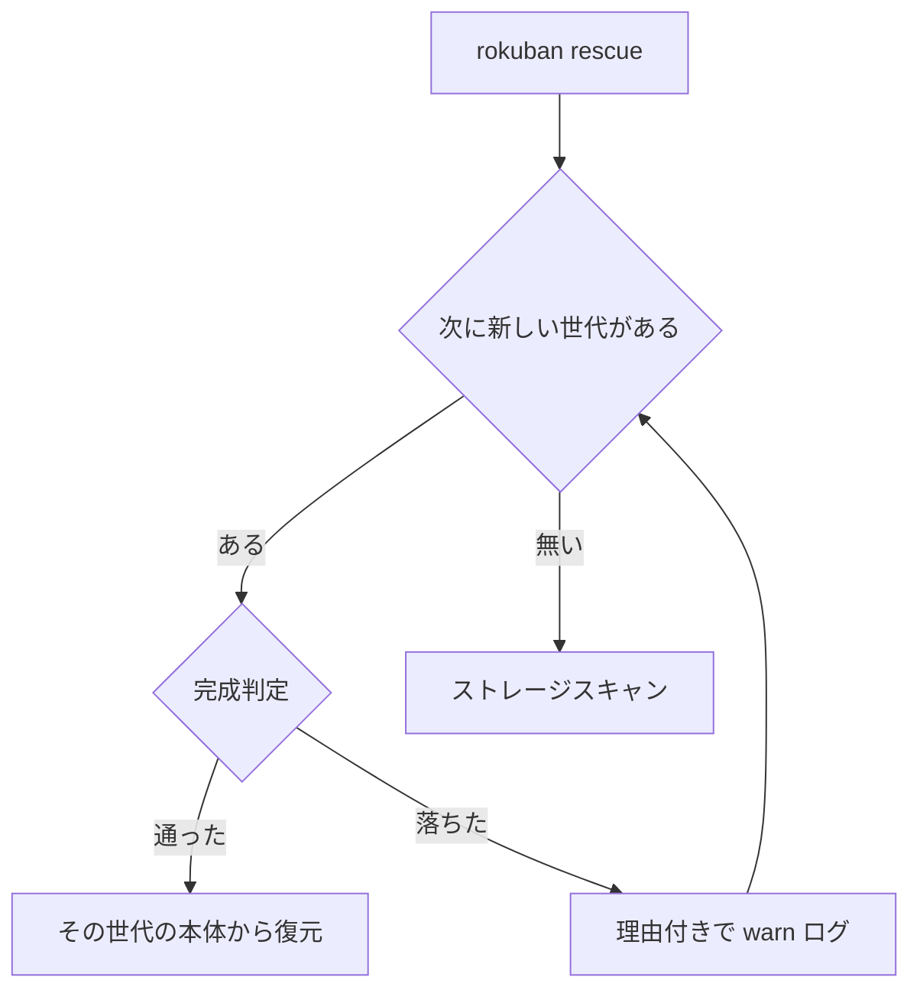

> [storage.md](../storage.md) §8 の一部。索引から辿る

## 8. catalog エクスポートと rescue（災害復旧）

災害復旧では、worker が日次でコアデータをメディアストレージ自身に書き出し、DB を失ったときに rescue がそこから復元する。catalog が読めなければ、ストレージを走査して録画を登録し直す。

### 保護対象の仕分け

保護対象は、ルール・録画履歴・計測記録など、再取得できないデータだけで、合計しても数 MB に収まる。EPG の射影は mirakc から再構築でき、ジョブキューは一時的なので入れない。

**保護対象は、ルール・シリーズ分類ルール・録画履歴・メディア資産・原本 TS の計測記録・ドロップ統計・ドロップ位置・tombstone・手動オーバーライド・ユーザーが置いたチャプター・視聴済みの印のみである。**

<details><summary>根拠</summary>

- 保護対象の表: `media_assets`（メディア資産）
- 保護対象のテーブル: `recordings` / `drop_stats` / `drop_positions` / `media_asset_ts_scans`

</details>

#### シリーズ分類ルール

シリーズ分類ルールはユーザーが書いた再取得できない設定なので、保護対象である。id を保って復元し、生成列は書かない。当たりの表は作り直せるので入れない。

rescue は、同じトランザクションの末尾で全件を再評価して閉じる。worker の定期再評価は待たない。トリガーが見るのは新規行と title の変更だけなので、DB に残っていた録画はこの再評価でしか追従しないからである。

<details><summary>根拠</summary>

- シリーズ分類ルールの表: `label_rules`
- 書かない生成列: `value_key` / `keyword_key`
- 入れない当たりの表: `label_rule_hits`

</details>

#### チャプターと視聴済みの印

チャプターの所有 2 表は保護対象である。ユーザーの修正は二度と再取得できない事実だからである（[スキーマ](../schema/recordings.md) §recording_chapter_ownership）。自動検出の結果は導出値なので含めない。所有の行が無い録画は自動層のままなので、何も復元しない。行の不在そのものが意味を持つからである（不変条件 10）。

視聴済みの印は、ユーザーが付けた世帯共有の事実なので export と rescue に含める。再生位置は一時的な利便状態なので catalog には含めず、復旧後は続きからを再作成する。

<details><summary>根拠</summary>

- チャプターの所有 2 表: `recording_chapter_ownership` / `recording_chapter_spans`
- 含めない自動検出の結果: `recording_cm_detections`
- 視聴済みの印: `recording_watched`
- 含めない再生位置: `recording_playback_positions`

</details>

#### 復元の書き込み順

書き込み順は、録画 → メディア資産 → チャプターの所有 2 表 → ドロップ統計 → ドロップ位置 → TS 計測記録である。区間の表は主キーを持たず、重なりを EXCLUDE が禁じている。そのため rescue の 2 回目は衝突を無視して受ける。素の INSERT だと、同じ区間が自分自身と衝突して、1 世代まるごと復元できなくなる。

TS 計測記録は、原本ごとに TS 計測時のサイズを記録する。古い catalog にこの配列が無い場合、ドロップ統計がある原本は計測済みとして復元し、サイズには当時のメディア資産のサイズを使う。ドロップ統計のない原本は未計測のままにし、復旧後の TS 計測ジョブが読み直す。

<details><summary>根拠</summary>

- 書き込み順: `recordings → media_assets → チャプターの所有 2 表 → drop_stats → drop_positions → media_asset_ts_scans`
- 2 回目の受け方: `ON CONFLICT DO NOTHING`
- 計測時のサイズの記録: `media_asset_ts_scans`
- 古い catalog での復元に使うサイズ: `media_assets.size_bytes`

</details>

### catalog エクスポート

worker の定期ジョブが、このコアデータを JSON でメディアストレージ自身の catalog 配下に書き出す。日次で書き、世代を保持する。メディアが生き残る障害では、catalog も一緒に生き残る。

エクスポートは pg_dump に依存しないアプリレベルの処理なので、公式イメージに postgres クライアントを同梱しなくてよい。出力は後述の rescue の入力形式を兼ねる。フル忠実度が欲しい場合の日次 pg_dump 構成例はドキュメントに記載する。これは推奨であって必須ではない。

<details><summary>根拠</summary>

- 書き出し先: `catalog/`
- 差し替えても公開点にならない名前: `latest`

</details>

### 世代の完成判定（rescue が読んでよい世代の定義）

rescue が読んでよいのは、完成宣言の manifest が最後まで読め、バージョンが読める範囲で、本体のサイズと sha256 が宣言と一致する世代だけである。ファイルが見えるだけでは何の宣言でもないので、公開点はストレージの中だけで完結させる。

DB 喪失時に使う catalog は、DB を公開点にできない。

通常のメディア資産は、DB 行の INSERT を公開点にできる（§3 ルール 3）。しかし catalog のファイルが見えることは、何の宣言でもない。書きかけ・停止途中・S3 の非アトミックな置き換えの途中が、同じ見え方をするからである。

#### 世代ディレクトリの形

1 世代は 1 ディレクトリで、ディレクトリ名は二度と再利用しない。本体と完成宣言の 2 ファイルを持ち、完成宣言は世代データを全部書き終えた後に、最後の一発書きで置く。

```
catalog/
  catalog-20260801T030000Z/     ← 世代ディレクトリ（この名前は二度と再利用しない）
    catalog.json                ← 本体
    manifest.json               ← 完成宣言。世代データを全部書き終えた後に最後の一発書きで置く
  catalog-20260802T030000Z/
    ...
```

#### 完成世代の条件

完成世代は、完成宣言が最後まで読め、バージョンが読める範囲で、世代名と本体の名前・サイズ・ハッシュが宣言と一致する世代である。1 つでも欠けたら不完全で、rescue は選ばない。条件は次の 5 つである。

1. `manifest.json` が存在し、JSON として最後まで parse できる
2. `manifestVersion` が、このバイナリの理解するバージョン以下である
3. `schemaVersion`（世代が載せている catalog document のバージョン）が、このバイナリの読めるバージョン以下である
4. `generation` が、世代ディレクトリ名と一致する
5. `document`（本体ファイル名）が期待する名前と一致し、本体ファイルが存在して、サイズと sha256 が両方一致する

1 世代が持つ本体ファイルは `catalog.json` の 1 本だけである。本体のパスは常に決まった名前から組み立て、manifest 内の値からパスを組み立てることはしない。この安全性は型で強制されていない。判定 5 の等値検査が両者を一致させているが、パスを組み立てる箇所ごとに、manifest の値を使わない規律を独立に守っている。

#### 公開点は manifest の書き終わり

公開点は、manifest を書き終えたことである。ストレージにアトミックな rename が無いので、rename は公開点に使えない。本体も manifest も、最初から最終名へ一発書きし（§3 ルール 1）、公開のプロトコルは、本体、fsync、manifest の順序だけである。

§2 の通り、S3 と FUSE にはアトミック rename が無く、Mountpoint には rename 自体が無い。そのため、latest を差し替えることも、一時名から最終名へ移すことも、公開点に使えない。

manifest を先に書いても、完成宣言にならない。先に置いた manifest は「これから書く予定」しか主張できず、途中停止と区別が付かないからである。

manifest 自身が途中で切れても、不完全として扱われる。途中まで書かれた JSON は閉じ括弧を欠いて parse に失敗する（判定 1）。たとえ parse できても、本体の sha256 検証（判定 5）を通らない限り完成扱いにならない。manifest 自身の checksum は自己参照になるので持たない。manifest の正しさは、本体の内容と宣言が一致するかで測る。

parse の成功だけでは足りない。JSON 文字列の中の 1 バイトが化けた本体は、parse に成功する。実測では、parse は通り、sha256 だけが不一致になる。だからサイズと sha256 の照合を判定に入れる。

<details><summary>根拠</summary>

- parse 成功だけでは完成と判定しないこと: `TestVerifyGeneration_RejectsSilentByteFlip`

</details>

#### バージョンの上げ方

catalog のバージョンは、列や JSON キーを移すだけでは上げず、落ちると取り返せない事実を移すときと、manifest 自体の形を変えるときだけ上げる。バージョンを上げると、古いバイナリでは rescue できなくなるからである。

`schemaVersion` は「読めない」を意味するので、列や JSON キーを移すだけでは上げない。判定 3 は、自分より新しいバージョンの世代を拒否する条件である。上げた瞬間から、新しいバイナリが書いたダンプは古いバイナリで rescue できなくなる。災害復旧で古いバイナリしか手元にない状況は作りたくない。同じ事実を別のキーや別の配列に移したときは、バージョンを据え置く。

代償は、新ダンプを旧バイナリで読む場合である。旧バイナリは知らないキーを気づかないうちに無視するので、移した事実が落ちる。だから、移してよいのは、落ちたときに安全なほうへ向かう事実だけである。例えば、即時削除の要求が落ちても、その録画はごみ箱に残って猶予超過で消える。要求より遅く消えるだけである。落ちると取り返せない事実（録画本体・アセット・tombstone）を新しいキーへ移すなら、バージョンを上げる。

同じ方針を `manifestVersion` にも適用する。manifest 自体の形（`document` / `sizeBytes` / `sha256` のキー）を変えたとき、旧バイナリが新形式を読むと、欠けたキーのせいで完成判定そのものが無条件に不完全になる。世代が丸ごと読めなくなるので、この変更は安全なほうへ向かうとは言えない。`schemaVersion` と同じ基準に従うと、`manifestVersion` は上げる側になる。

#### 世代名の連番

世代名は再利用しない。同じ秒に 2 回書くことになったら、ゼロ詰めの連番を足して別の世代を作る。

連番は `-02`、`-03` の形にする。既存の完成世代を上書きしに行かないので、書き直しの途中で前の完成世代も読めなくなる窓が無い。ゼロ詰めなのは、辞書順が「新しい順」の唯一の根拠だからである。`-2` と `-10` を並べると、10 本目が 2 本目より古い側に落ちる。

### 完成の確認（DB に触らずに見る）

DB に触らずに世代の完成を確かめるコマンドがある。上の判定基準をそのまま実行し、完成している世代の数、rescue が使う世代、落ちた世代とその理由を出す。完成世代が 1 つも無ければ、非ゼロで終了する。

確認に使うコマンドは `rokuban catalog verify` である。

**`rokuban rescue` を確認に使わない。** rescue は検証の後に必ず DB へ書き、live DB を catalog の内容で上書きするからである（[operations.md](../operations.md) §3）。

### rescue の世代選択とフォールバック

rescue は、新しい順に完成判定を掛けて、最初に通った世代から DB を復元する。最新世代が不完全か checksum 不一致なら、1 つ前の完成世代から復元する。完成世代が 1 つも無ければ、ストレージを走査して再構築する。

「最新に見えるもの」は選ばない。**選ぶのは、最新の検証済みの世代である。**



落ちた世代は、理由付きで warn ログに出す。気づかないうちに古い世代へ落ちることは無い。

#### 復元の前提

実行前に、ファイルやメディア資産を変更する worker を止め、rescue が終わるまで再開しない。復元の間は、公開・削除と共通のファイル排他を DB トランザクションの開始前から保持する。

止める対象は ingest / encode / thumbnail / seek tiles / delete_reconcile などである。catalog 復元は、全 asset の rel_path をソートして、公開・削除と共通の filesystem lock を DB トランザクションの開始前に取得し、コミットまで保持する。走査の in-place 登録も、ファイルの再確認からコミットまで同じ lock を保持する。DB 接続の切断だけでは排他が消えない。

スナップショット後にファイルが消えた asset は、履歴と統計を残して `deleted` として復元し、件数を CLI に表示する。走査後に消えたファイルは登録せず、その件数も表示する。

この排他は、ファイルと asset row の整合性を守る。古い catalog による録画・保持ポリシーなどの上書きを防ぐものではないので、復旧中に worker を止める運用要件は続く。共有ストレージでは、全参加プロセスから同じ lock namespace が見え、flock が相互に効く必要がある。

<details><summary>根拠</summary>

- catalog の実体無し asset を `deleted` として復元すること: `TestRescueCatalogMissingFiles`
- 走査後に消えたファイルを登録しないこと: `TestRescueScanCandidateRemoved`
- 削除と復元の排他を両経路で保つこと: `TestRescueDeletionSerialization`

</details>

### 不完全世代の保持と掃除

不完全世代の掃除は、エクスポートの成功パスの末尾でだけ走る。書きかけの世代を消しに行く後始末は持たず、後始末が走ることを正しさの前提にしない。失敗し続ける間は掃除が走らず、不完全世代は溜まり続ける。

完成世代は、新しい順に `keep` 件（既定 7）残す。更新から 7 日以内の不完全世代は保持する。並行 export の途中で、別 export の prune が消さないためである。7 日より古い不完全世代は、時刻順でそれより新しい完成世代があるときだけ削除する。新しい完成世代が無ければ残す。

掃除が走るのは、エクスポートが成功したときだけである。「次のエクスポートで掃除される」は、成功を前提にした条件付きの記述である。溜まっているのが仕様の範囲か障害かは、`rokuban catalog verify` の出力（落ちた世代の理由）で見分ける。

エクスポートが途中で失敗しても、書きかけの世代ディレクトリを消しに行かない。プロセスが落ちる形の停止では後始末は走らないので、後始末が走ることを正しさの前提にしない。走るときだけきれいになる、という条件では判定基準にならない。掃除は上のルールに一本化する。

不完全世代は容量を食う。しかし保護対象は数 MB 規模（本節冒頭）なので、進行中と区別できないものを消す危険と釣り合わない。

### rescue --- ストレージスキャンからの再構築

catalog が無いとき、rescue はストレージを走査し、前置を持つ既知の形式のファイルを現在位置のまま録画と asset として登録する。ファイル本体はコピーも変更もしない。番組情報は無い素の録画になり、同じパスは同じ録画に写るので、再実行しても増えない。

catalog があるときは、照合してフルメタデータ（番組情報・ドロップ統計・保持ポリシー）ごと復元する。

登録トランザクションは `internal/inplace` に置き、`rokuban import epgstation` も同じ in-place 登録機構を使う。DB 行のコミットが公開であるというストレージ契約は、通常の ingest と同じである。

#### 登録されるもの

前置を持つ TS と M2TS は原本として、MP4 / MKV / WebM はエンコード済みとして、現在位置のまま登録する。タイトルはファイル名から作る。

具体的には、`sites/{site}/` 前置を持つ TS と M2TS を `original` として登録する。MP4 / MKV / WebM は `encoded`（`profile = rescue-<拡張子>`）として登録する。

タイトルはファイル名から作り、`program_start_at` は初回 rescue 時の mtime とする。番組・サービス情報は、「metadata unavailable」と明示した素の録画になる。`program_start_at` は recording identity にも含まれる。ただし、再走査では rel_path から recording を再利用するので、後から mtime が変わっても別 recording は作られない。mtime を rel_path 由来の値へ置き換える案は採らない。既存 rescue 行の移行が必要で、表示時刻も失うからである。

`catalog/` 自身、未知拡張子、symlink は走査対象にしない。同じ相対パスは安定した合成番組 identity へ写すので、再実行しても録画と asset が増殖しない。

#### 前置の無いファイル

前置の無いファイルは site を決められないので、登録せず、ファイルごとに警告を 1 回出す。手動で登録するか、不要と確認して削除する。

走査対象の site は、`sites/{site}/` 前置から決める（[contract.md](contract.md) §rel_path の名前空間）。警告は Warn で出す。記録に載らないので、孤児として mtime 猶予（既定 7 日）とエイジング（既定 14 日）の後に報告する。移行後は、前置の無いファイルが存在しないことを前提にする。

前置の site がレジストリ（`mirakcs:`）に無ければ、typo やゴミディレクトリの疑いとして site ごとに Warn を出す。ただし復元は止めない。

### Postgres 運用

世帯スケールでは、catalog（と任意で日次 pg_dump）で十分である。WAL アーカイビングは過剰である。
