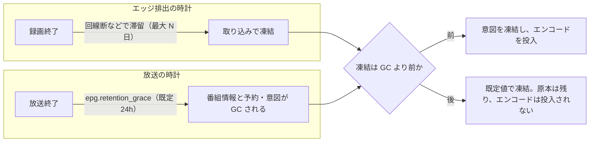

> [storage.md](../storage.md) §6 §7 の一部。索引から辿る

## 6. 原本 TS の保持ポリシー

生の放送データは MPEG-2（地デジで約 6〜7 GB/時、BS はさらに大きい）でストレージ効率が悪く、エンコード完了後に原本を削除したいという要件がある。EPGStation の「エンコード後に元ファイル削除」に相当する。ただし、エンコード完了時に削除する命令的な方式は採らない。**宣言的な保持ポリシー + レベルトリガー reconcile** で実現する。理由は「設計」の削除条件に書いた。

### 設計

原本は、凍結した desired を満たす派生物のコミットを reconcile が観測してから消す。対象は保持ポリシーが「エンコードしたら原本を消す」録画だけである。消す契機はエンコードの完了ではない。定期的に状態を見直すループが、条件を観測して消す。

#### 保持ポリシーの凍結

保持ポリシーと望ましい派生物の組は、取り込みが原本をコミットするトランザクションの中で、録画ごとに一度だけ凍結する。予約確定時でも録画開始時でもない。

ルール（または個別予約）が保持ポリシー `keepOriginal: always / until_encoded` を持つ。

実効値（ルールの base + 予約単位の overrides）は、2 列へスナップショットされる。対象は `recording_encode_policy.keep_original` と `recording_encode_policy.encode_profiles` である。これは「この録画の望ましい最終状態は『派生物のみ、原本なし』」という desired state になる。`recording_encode_policy` は `recordings` を `recording_id` で指す衛星表で、行の存在そのものが「凍結済み」を意味する（[スキーマ](../schema.md) §5 参照）。

導出元の `reservations` / `program_overrides` / `program_intents` は、放送終了後の猶予期間で GC される。一方、`recordings` は永続資産である（CLAUDE.md 不変条件 12「表は行の寿命で割る」）。毎回の再導出に頼ると、EPG から番組が消えて導出元が GC された時に desired が空になる。エンコード未完了の原本を削除できず、再エンコードも投入できなくなる。

凍結した行は `recordings` 行と同時に生まれ、同時に死ぬため、別表に置いても行の寿命は混ざらない。衛星表として分けることは「行の寿命が同じ」ことと矛盾しない（不変条件 13）。

ingest 完了後の override 変更は、その録画には反映されない。この境界を越えて変更するのは、録画単位の API を明示的に呼んだ場合だけである（[録画エンジン](../recording.md) §4.5）。

根拠

- ingest 完了 tx での凍結: `internal/worker/ingest.go` の `resolveAndSnapshotEncodePolicy`
- `recordings` と satellite row の寿命: 不変条件 12、13

#### 予約の引き方

凍結時の予約は、外から与えられた放送イベントキーで引く。導出器が作る予約 id では引かず、予約表への FK も使わない（不変条件 9 / [invariants.md](../invariants.md) §9）。

放送イベントキーは `(site, network_id, service_id, event_id)` である。導出器が作る予約 id は、予約が再実体化されるたびに変わりうる。

このキーは `recordings` が録画開始時から凍結して持つ。録画開始から ingest 完了まで数時間かかっても、予約行が GC や再実体化（EPG フリッカー、ルール編集、dedup）されて失われない。

実際には `program_snapshots` で `(network_id, service_id, event_id)` から `program_id` を引き、`reservations` をその id で結合する。`program_snapshots` は放送後 `epg.retention_grace`（既定 24h）で GC される短寿命の表である（[スキーマ](../schema.md) §3「射影にある間は更新、消えたら凍結」）。通常の ingest は録画終了直後（GC の猶予期間より十分前）に走る。滞留の設計は GC の猶予を越える遅延も許容する（下記「凍結が依存する寿命と、エッジの滞留の交点」）。

根拠

- reservation を event key で引く query: `GetReservationEncodePolicyByEvent`、`internal/db/queries/recording_policy.sql`
- 外部イベントキーを使い、導出された予約 id は使わないこと（不変条件 9）: [invariants.md](../invariants.md) §9

#### source とログの重さ

凍結時に予約を引けなかったときのログの重さは、録画作成時に焼いた由来で決める。予約か記録の意図があったのに引けなければ警告、予約が最初から無い日常的な失敗は情報にする。

`recordings.source` は録画作成時に一度だけ焼く snapshot であり、凍結時の JOIN 失敗の異常度を判定する軸になる。

- `source = 'rule'`: 作成時点で予約があり、`program_intents.action = 'record'` の行が無かった記録。この記録で JOIN に失敗したら「予約はあったのに引けなくなった」ため、`slog.Warn` に識別子（site/network_id/service_id/event_id）と recording_id を残す
- `source = 'manual'`: 作成時点で `action = 'record'` の意図があった記録。予約を引けない場合は `slog.Warn` にする
- `source = 'unattributed'`: 予約も意図も特定できなかった記録。手動起動などで予約が最初から無い日常的な JOIN 失敗は `slog.Info` にする

どの source でも、JOIN に失敗したまま何も残さずに return しない。識別子をログに残す。

根拠

- source を録画作成時に焼く実装: `DeriveRecordingSource`、`internal/reservation/source.go`

#### 削除条件

削除するのは、ポリシーが「エンコードしたら原本を消す」で、望ましい派生物がすべてコミット済みの原本だけである。TS 解析の記録が無いか、記録したサイズが現在の原本と違えば消さない。実行中のジョブの有無は問わず、出力が未コミットの間は派生物の条件が原本を守る。

retention reconcile ループ（worker の cleanup 系ジョブ）が定期的に走り、次をすべて満たす原本アセットを削除する。

1. ポリシーが `until_encoded`
2. desired な派生物（全エンコードプロファイル + サムネイル + シークプレビュー用タイル）が `media_assets` にコミット済みである。原本の `media_asset_ts_scans.scanned_size_bytes` が `media_assets.size_bytes` と一致することも求める

解析が恒久的に失敗する原本は保持され続ける。

命令的なジョブチェーン（最後のエンコードジョブが削除ジョブを投入）は採らない。複数プロファイル時の「全部終わったら」の fan-in・途中失敗・再実行で正しく動かなくなりやすいからである。レベルトリガーなら「観測された派生物の集合 >= 望ましい集合」を毎回評価するだけで、どこで落ちても収束する。

「原本を入力とする実行中・再試行中のジョブがない」という条件は持たない。encode ジョブは凍結済み `encode_profiles` に含まれるプロファイルにしか積まれず、サムネイルは常に desired なので、出力未コミットの間は上記の 2 つ目が原本を守る。出力コミット後のジョブは各ワーカー冒頭の冪等チェックが打ち切る。ただし原本を残したまま再実行するケースしか測っておらず、チェックが原本を開く前に走ることそのものは未検証。

desired を縮める経路があっても、この整理は保たれる。縮める経路はコミット済みの版を 1 本外すもの（§6「凍結の 3 つ目の例外」）だけで、外す API はその版の有効なエンコード結果が無ければ 404 を返す。外す前から上記の 2 つ目はその版で満たされているので、外しても成否は変わらない。外した版の積み残しのジョブは守られなくなるが、その出力は公開されない。コミット前の版を外せる経路ができれば、既に積まれたジョブが上記の 2 つ目の外に出てこの整理は成り立たなくなる。

上記の desired な派生物は凍結時点の `encode_profiles` であり、現在の `encode.profiles` 設定とは突き合わせない。プロファイルを改名・削除して現在の設定に存在しなくなったプロファイルを、まだエンコードしていない録画がある。この録画は `until_encoded` でも原本を保持し続ける。満たせない desired に対して原本を捨てないのが仕様で、設定の 1 行の編集で原本という不可逆な資産が削除可能になる事態を避けるためである。`rokuban_encode_reconcile_unsatisfiable` はプロファイル名別の該当録画数を出すが、`keep_original` を問わず数える（`always` の録画も含む）ため、この保持件数そのものとは一致しない。

揃っているかは encode と共有する view `unencoded_desired_profiles` で判定し、設定では絞らない。

根拠

- 現在サイズに一致する TS scan: `TestDeleteReconcileWorker_UntilEncoded_RequiresCurrentTSScan`
- 消えたプロファイルの原本保持: `TestUnknownDesiredProfile_PredicateAsymmetry`
- encode 完了後のジョブ再実行: `TestEncodeWorker_SuccessAndIdempotent`
- thumbnail 完了後のジョブ再実行: `TestThumbnailWorker_IdempotentRerun`
- 外せるのはコミット済みの版だけ: `RemoveRecordingEncodedAsset` の 404、`TestRemoveRecordingEncodedAsset_NotFound`
- 外した版のジョブは公開しない: `TestEncodeWorker_ProfileRemovedFromDesiredIsNotPublished`

#### 移行の残骸

3 値化より前に作られた手動由来の行は、2 経路が混ざったままで、遡って分類しない。区別する材料が残っていないからである。切り替え直後の未取り込みのぶんだけ、偽の警告が出る。

それらの行は警告側として扱われる。対象は `manual` の行（`source = 'manual'`）で、偽の警告は `slog.Warn` である。

### 凍結が依存する寿命と、エッジの滞留の交点

取り込みが遅れたとき、エンコード意図が守られる上限は、番組情報の保持猶予（既定 24 時間）で決まる。エッジのリングバッファの日数は、この上限に影響しない。猶予を超えるとエンコードは投入されなくなるが、原本は残るのでデータは失われない。滞留を何日も許す構成では、猶予をその日数以上に設定する。

凍結の JOIN 先（`program_snapshots` と、そこへの FK CASCADE で連なる `reservations` / `program_intents` / `program_overrides`）の行の寿命は、放送の時計で決まる。式は `start_at + duration_ms` + `epg.retention_grace` である。一方、その最後の読者である ingest がいつ走るかは、エッジの排出の時計で決まる。エッジのリングバッファは「回線断・クラウド側障害で未 ingest の record が N 日分溜まる」ことを前提にサイジングする。

録画中の record はすでに ingest が追従しているため、未 ingest 総量として滞留を数えるのは例外時の finished record に限る（[運用](../operations.md) §4「録画バッファのサイジング」）。2 つの時計の間には制約が書かれていない。交点は次の通り。encode 意図が生き残る滞留の上限は `epg.retention_grace`（既定 24h）で決まり、リングバッファの N 日は上限にならない。滞留を N 日まで許すつもりなら `epg.retention_grace >= N` にする。

#### GC 済みの予約に対する取り込み

番組情報の保持猶予を過ぎ、予約が GC された後に取り込みが走ると、エンコードの意図は空で凍結され、エンコードは投入されない。原本は残るのでデータは失われない。事後回復の手段は、プロファイルの追加 API だけで、定期的な不足分の補充は回復しない。

encode policy は既定値 `keep_original='always'` / `encode_profiles=[]` で凍結される。**原本は残るのでデータは失われず、エンコードだけが投入されない**。

落ちるのは encode 意図だけではない。復帰時に `recordings` 行を作る `internal/watcher` の `createRecording` も、同じ GC 済みの予約を引く。そのためルール由来の録画でも、予約と意図を失った時点の `source` は `unattributed` になる。`rule_id` は NULL になる。

`unattributed` の録画で凍結の JOIN に失敗したログは `slog.Info` になる。一方、録画作成時に `action = 'record'` があった録画は、後から予約と意図が GC されても永続した `source = 'manual'` を見て `slog.Warn` になる。この 2 段（GC → `unattributed` → Info）は、根拠欄の 2 テストの合成である（パッケージ境界を跨ぐので通しでは測っていない）。

事後回復は `POST /api/recordings/{id}/encode-profiles`（下記「凍結の例外: 事後追加」。追加のみ）だけである。`encode_reconcile`（desired−observed の定期パス。[ingest](../recording/ingest-followup.md) §5.5）はこのケースを回復しない。理由は `ListMissingEncodeProfiles` が desired を展開して不足を探すからである。そのため既定値（`encode_profiles = '{}'`）で凍結された録画は、そもそも候補に入らない。desired が空である以上「欠けている派生物」も無く、バックストップとしては正しい振る舞いだが、失われた意図は誰も取り戻さない。

根拠

- GC 済み snapshot の既定値: `TestIngestWorker_SnapshotGCedBeyondGrace_FreezesDefaults`
- 予約なしの既定値: `TestIngestWorker_NoReservation_LeavesEncodePolicyDefault`
- GC 済み予約で録画 source が unattributed になること: `TestRecordObservationsContract/record source/GC removes source reservation`
- unattributed source の JOIN 失敗を Info にすること: `TestIngestWorker_LogsInfoWhenUnattributedSourceReservationUnresolvable`
- manual source の JOIN 失敗を Warn にすること: `TestIngestWorker_LogsWarnWhenManualSourceReservationUnresolvable`

#### GC の連動と凍結の前倒し

未 ingest の record が指す番組情報を刈らない案と、凍結を録画開始時へ前倒す案は、どちらも採らない。どちらも watcher の観測に依存するので、断の最中に始まった録画を守れない。

GC 側を滞留と連動させる案は採らない。留め置きの根拠にできるのは `record_sync` 行であり、それは watcher が mirakc を観測して初めて作られる。`internal/watcher/watcher.go` の `processRecord` 入口の `AcquireRecordSync` が status を問わず作り、`Sweep` は進行中の record も列挙する。したがって、断が始まる前に一度でも観測された record にはアンカーがある。この分は連動案でも留め置ける（`status='recording'` の段階で観測されていれば足りる）。断の最中に始まった録画にはアンカーが無い。行ができるのは復帰後で、そのときには GC は済んでいる（`runGC` は ruler のサイトパスが失敗しても実行され、削除条件は時計の比較だけ）。

つまり、**分割の軸は、その record の観測が届いていたかである**。リンクが生きているかでは分けられない。数日の断ではその大半が未観測になるので、連動案は主要部分を塞げない。加えて `DeleteEndedProgramSnapshots`（この表から行を消す唯一の経路。`internal/db/queries/program_snapshots.sql`）が `record_sync` の状態に依存する。そのため ingest が恒久的に完了しない record が、スナップショットと予約を無期限にピン留めする漏れができる。

同じ理由で、凍結を録画開始時へ前倒す案も採らない。`recordings` 行の生成も watcher の観測に依存するので、断の最中に始まった録画ではクラウドから見た「録画開始時」が「復帰時」になる。加えて[録画エンジン](../recording.md) §4.5 の「録画開始後の変更でも ingest 完了までは効く」を失う。`epg.retention_grace` を上げることは、この 2 案が塞げる範囲と塞げない未観測ぶんの両方を 1 つの数で覆う。

#### 猶予を上げるコスト

猶予を上げれば済むわけではないので、既定は上げない。コストは、滞留を N 日許す構成にだけ課す。予約や番組の行が長く残り、同じキーが EPG 射影の窓も延ばして、放送済み番組が全サービスぶん残る。

1 つ目は、`reservations` / `program_snapshots` / `program_intents` / `program_overrides` の行が「予約された番組数 × N 日」ぶん長く残ることである。時間窓で絞らずこれらを読む経路がある（`ListCapacityDemand` / `ListCapacityDemandAllSites`）。

2 つ目は、**同じキーが EPG 射影のローリングウィンドウも駆動すること**である。`cfg.Epg.RetentionGrace` は ruler の GC と EPG 射影の `PruneEpgPrograms`（`internal/worker/epg.go`）の両方に渡される（`cmd/rokuban/server.go`）。そのため N 日にすると、`epg_programs` に予約の有無に関わらず全サービスの放送済み番組が N 日ぶん残る。ルール照合（`internal/rulequery` の `MatchProgramIDsForRule`）は時間で絞らないので、その放送済み番組も拾う。

終了済み番組の予約に対して reconciler の `programEnded` 分岐と `recordNeverScheduled` が `never_scheduled_events` に欠測行を作る窓が、24h から N 日に広がる。行がどれだけ増えるかは未検証（この節の他の記述と違い、測っていない）。`never_scheduled_events` 自身の寿命も N に追従する。ruler の GC 閾値は `retention_grace + 30日` なので、この窓の行は N + 30 日で刈られる（無限には残らない）。

滞留を見張るメトリクスと閾値は[運用](../operations.md) §4 にある。

#### 障害の種類による違い

「クラウド側障害」と「回線断」を同じ結論で括らない。上の結果が決定論的に成り立つのは、GC は動き続けたが ingest が猶予を跨いで遅れた場合だけである。

ruler ごと止まる障害（worker 全停止・DB 到達不能）では、断のあいだ GC も進まない。復帰時は sweep + ingest と `ruler_pass` の競争になり、ingest が先に走れば意図は守られる。どちらになるかはジョブの実行順に依存する（未検証）。

### 書き込みの冪等性・型変換・安全側クランプ

凍結する値が制約に違反すると、取り込みのトランザクションごと失敗して録画そのものを失う。そのため、エンコードプロファイルが空なのに原本を消す設定になっていたら、「原本を常に残す」に直してから書く。

冪等性について。`FreezeRecordingEncodePolicy` は `ON CONFLICT` を持たない素の INSERT で、既存の派生物の有無を見て分岐しない。これは「この tx は録画ごとに 1 回しか実行されない」という別の不変（`internal/worker/ingest.go` の `Work` が転送開始前に原本 media_asset の有無で冪等性チェックする）に依っている。一部のエンコードが既に完了しているからといって、desired を空に戻す分岐を作らない。

`EncodeProfiles` の nil について。`reservation.Options.EncodeProfiles`（`*[]string`）は nil=未指定 / `&[]string{}`=明示的な「エンコードなし」を区別する。しかし `recording_encode_policy.encode_profiles` は NOT NULL text[] で「未指定」という第三の状態を表現できないため、凍結時は両者を等しく `'{}'` にまとめる。区別が必要な場面（override の差分表示等）は `program_overrides.overrides` 自身に当たればよく、このスナップショットの役目ではない。

クランプについて。ルールと override はそれぞれ自分の表の中では、`keepOriginal='until_encoded'` に `encodeProfiles` が空という組み合わせを禁止する CHECK を満たしている。それでも `EffectiveOptions` のマージ結果としてこのドリフトが生成されうる。`recording_encode_policy` にも同じ組み合わせを禁止する CHECK（下記「条件 2 の『全プロファイル完備』」参照）がある。実効値をそのまま書くと、この INSERT は CHECK 違反でロールバックする。

原本 media_asset の INSERT と同一 tx なので、そのロールバックは録画そのものの消失に直結する（不変条件 3「コミット = DB 行」）。原本を失うリスクを負ってまで守る価値のある不変ではないので、書く直前に `always` へ直す。実効的な `encodeProfiles` が空で `keepOriginal` が `until_encoded` なら、`always` にしてから書く。ユーザーの意図（override の値そのもの）は `program_overrides` 側に残るので失われない。失われるのはこの録画のスナップショットにおける効力だけで、次にルールがプロファイルを持てば別の録画では正しく `until_encoded` になる。

### 安全性

放送データが 0 コピーになる瞬間は構造的に存在せず、唯一のコピーを消すパスも無い。エッジの録画は取り込みのコミット後に、原本はエンコードの検証後に消すので、常に 1 コピー以上が残る。

エッジの record 削除は ingest コミット後である（[録画エンジン](../recording.md) 参照）。エンコードが恒久的に失敗すれば、条件 2 が満たされず原本は自然に保持され続ける（+ アラート対象）。

条件 2 の「全プロファイル完備」は、`encode_profiles` が空でないことも要求する。API はエンコードプロファイル未指定のルールで `until_encoded` を選択不可にしている（下記「UI / 運用」）。だがそれを回避して、`until_encoded` かつ `encode_profiles = '{}'` の組が `recording_encode_policy` に焼かれることがある。この場合「全称量化された条件が空集合に対して自明に真になる」ため、対策なしでは即座に原本が消える。

`cardinality(encode_profiles) > 0` を要求するガードがある（同じ条件を `recording_encode_policy` テーブル自身の CHECK にも持つ）。このガードは、削除 reconcile が until_encoded 腕を消費する箇所ごとに手で複製しない。代わりに名前付き述語 `until_encoded_deletable_originals`（§7 参照）の定義 1 箇所に置く。これにより、入力側の検証が抜けても、この述語を参照するすべての経路（入口・前パスの拾い直し・否定形の判定）に構造的に適用される。

削除プロトコルも冪等である。アセット行を deleting にマーク → unlink → deleted にマークの順で、どこで落ちても reconcile が拾い直す。公開前を示す予約名の残骸は孤児回収が拾う。

メタデータは tombstone として残す。ドロップスキャン結果・録画品質は原本削除後も UI で見られる（「ドロップがあったから再放送を待つ」判断は削除後にこそ必要）。原本のサイズだけは API が省略し、その省略自体が「原本削除済み」を表す。

### UI / 運用

原本を消す設定にすると、再エンコードはできなくなる。既定は原本を常に残す安全側で、ストレージ効率は利用者が選んだときだけ得られる。

既定は `keepOriginal: always` である。原本削除後は再エンコード不可になるため、ルール設定で明示する。エンコードプロファイル未指定のルールでは、原本が唯一の視聴可能物なので `until_encoded` を選択不可にする。視聴は常に派生物側（MPEG-2 TS はブラウザ直接再生に不向き）なので、原本削除で失うのは再エンコードの自由度だけである。H.265 で 1/4〜1/10 になるため、これが実質のストレージ戦略になる。

#### カット版だけを選ぶ構成

原本を消す設定でカット版だけを選ぶと、カット版の完成後に原本が消える。CM 入りの版が残らないので、チャプターを直せず、カット版も作り直せない。

`live.enabled: true` では原本 HLS で確認できるため、cut だけのプロファイルを選べる。ただし、`keepOriginal: until_encoded` で cut だけを選ぶと、カット版の完成後に原本が削除される。CM 入りの版が残らないため、チャプターを直せず、カット版も作り直せない。

確認前に `live.enabled` を無効にすると、原本が残っていても「チャプターの確認待ち」から進めない。live を戻すか、`POST /api/recordings/{id}/encode-profiles` で cut でないプロファイルを追加すると復旧できる。

### 凍結の例外: 事後追加と保持ポリシー変更

凍結は取り込み完了時に一度だけ焼き込む。ただし、利用者の操作によるエンコードプロファイルの追加は、凍結の例外として認める。原本を残すかどうかも、録画単位で後から上書きできる。

`recording_encode_policy.encode_profiles` は ingest 完了時に一度だけ焼き込まれる凍結値だが、ユーザー起点の追加方向の書き換えだけは凍結の例外として認める。予約が無い録画（mirakc に直接起こされた手動録画等）は、`encode_profiles = '{}'` のまま永久に凍結されてエンコードを依頼する手段が無かった。この問題と、録画完了後に「もう 1 つプロファイルを足したい」という要求に応える。

この API による `keep_original` の上書きは、事後の `encode_profiles` 追加に続く凍結の 2 つ目の例外である。凍結の基本設計（ingest 完了時に desired を焼き込むこと）と、物理削除を reconcile に委ねる境界は変えない。この例外を経ても「ingest 完了時点で確定した最終状態」という設計そのものは変わらない。凍結後の変更は、`encode_profiles` の事後追加と、この API による `keep_original` の明示的な上書きと、下記の版の削除に限る。

#### 事後追加の API

事後追加の API は、追加のみを受け付け、全置換の手段は用意しない。原本が有効でない録画には 409 を返す。未凍結の録画でも、原本が有効なら追加できる。

`POST /api/recordings/{id}/encode-profiles` の実装は `internal/api/recordings.go` の `AddRecordingEncodeProfiles` である。書き込みは `AppendRecordingEncodeProfiles`（`internal/db/queries/recordings.sql`）が行う。union + dedup にしか書けない。全置換にすると、ユーザーが誤って既存のプロファイル指定を消すミスにつながるため、その経路自体を用意しない。

原本が active でなければ追加できない。`GetActiveOriginalMediaAsset` が `ErrNoRows` の録画には 409 を返す。該当するのは、原本削除済みか `state = 'deleting'` か、そもそも ingest が完了しておらず `kind='original'` の行自体が無い場合である。`state = 'deleting'` は unlink 待ちの状態を指す。一覧の射影は `state <> 'deleted'` なので、UI 上は「原本あり」に見える。ここで明示的に検査し、後段の reconcile が何もしない場合に 204 を返さない。

`recording_encode_policy` に行が無い（未凍結）録画でも、原本が active なら追加できる。`internal/inplace.Register`（災害復旧。カタログを 1 世代も持たない状態からのストレージ再スキャン）が作る原本は、`resolveAndSnapshotEncodePolicy` を経由しない。この関数は `internal/worker/ingest.go` にある。そのため `recording_encode_policy` 行が無いまま、原本だけが active な録画が存在しうる。

`AppendRecordingEncodeProfiles` は `INSERT ... ON CONFLICT (recording_id) DO UPDATE` で書く。行が無ければ「原本が active = 凍結済みとみなす」を適用して、`keep_original = 'always'`（安全側の既定値）で新規に凍結する。行があれば `encode_profiles` だけ追記する。行の有無をここで判定してエラーにする経路は持たない。原本が active でなければ、手前の `GetActiveOriginalMediaAsset` の 409 検査で既に止まっていて、この INSERT に到達する時点で「原本 active」は保証されている。

実行経路について。store が `encode_profiles` の更新を commit した後、api は対象録画を指定した `encode_reconcile` をヒントとして投入する。投入に失敗しても成功応答は変えず、定期 reconcile が DB の desired から不足分を拾う。対象限定パスと定期パスは同じ候補 query を使い、不足分の判定を二重に持たない。ごみ箱の録画も desired は更新できるが、候補 query が除外する。復元すれば定期パスが反映する。

#### 保持ポリシーの上書き

原本を残すかどうかは、録画単位で後から上書きできる。上書きしても物理削除はせず、削除 reconcile が条件を観測して消すので、最大で定期パスの間隔（既定 15 分）だけ遅れる。

`PATCH /api/recordings/{id}/encode-policy` は `keep_original` だけを上書きし、`encode_profiles` には触れない。この API は新しい `recording_encode_policy` 行を凍結しない。`SetRecordingKeepOriginal` は UPDATE のみ（INSERT アームを持たない）で書く。未凍結の録画は既に `always` と同じ扱いなので、`always` への変更は 0 行のまま 204（no-op）、`until_encoded` への変更は 0 行のまま 409 にする。

「desired プロファイルが 1 つ以上あるか」の判定は、事前に読み取って行わない。この UPDATE 自身の WHERE（`cardinality(encode_profiles) > 0`）が、適用の瞬間に再評価する。`always` 方向では原本の状態を検査しないので、原本が `deleting` の間でも次の reconcile パスで条件が再評価され、ファイルが残っていれば `active` に戻せる。

保持ポリシーの変更は物理削除しない。River のヒントジョブも投入せず、削除 reconcile のレベルトリガーに任せる。定期パスは既定 15 分間隔なので、条件を満たす原本の削除には最大 15 分かかる。これは追加された desired を直ちに encode queue へ反映する事後追加 API とは意図的に非対称である。

この表の api 側の書き手は、ingest と同じくユーザーが宣言した desired state を書く。観測を複数ループで更新する脊椎表ではないため、`recording_encode_policy` は分割しない。

### 凍結の 3 つ目の例外: 版を 1 本ずつ減らす

容量が厳しいとき、利用者はエンコードした版を 1 つずつ外して消せる。全置換の API は作らない。

プロファイル A と B でエンコードした録画から A だけを消して B を残したいときに使う。`DELETE /api/recordings/{id}/encoded/{profile}` はユーザー起点で `encode_profiles` から 1 つを外す。同じ tx で衛星表 `encoded_asset_removal_requests` に要求行を入れる。全置換の API は引き続き作らない。

「desired に無い encoded は消す」という導出だけで動かさない。rescue や `inplace.Register` を経て desired と実ファイルがずれた録画があると、そのエンコード結果を気づかないうちに一括削除する述語になる。ずれが実在するかは未検証。要求行という明示の主張を条件に入れる（不変条件 10）。

ごみ箱は経由しない。容量を空けるための操作で、何か 1 つは見られる状態を API が保証するので、猶予で守るものが無い。

0 コピー検査は、外した後の状態で行う。同じ録画の A と B を同時に外す 2 本の tx は、互いの削除前の状態を見ると両方通る。policy 行をロックして直列化し、検査は名前付き述語 `removed_encoded_assets`（§7）に任せる。

版を外しても、原本の削除は連鎖しない。`until_encoded` は全プロファイル揃いが条件なので、揃っている 1 本を外しても成否は変わらない。例外は `encode_profiles` が空になる場合で、CHECK のため同じ tx で `always` にする（ingest のクランプと同じ向き）。

外した後の desired にも、事後追加と同じ cut の選択規則を当てる。live が無効でカット版だけが残ると、確認に使う再生物が無くなり、カット版を作れない。違反なら 400 で何も書かない。事後追加は同じ文で要求行を消す。外した版のファイルが消える前に足し直せば、その版は残る。

外した版は削除 reconcile が unlink するまで active のままだが、API は `encodedAssets` に出さない。再生中の画面が再取得で再生元を選び直せるようにするためである。要求行は catalog に含めない。通常は削除 reconcile の次のパスで版と一緒に消える。最後の版として残った場合は、足し直すか録画を完全削除するまで残る。rescue で失っても、版が残る結果になる。

## 7. 削除エンジン

物理削除は 1 本の reconcile ループに統一し、削除してよいかの判定は名前付きの述語に集める。ごみ箱の論理削除、孤児の報告と回収、実体無しの検出も、このループの周りに置く。

### 物理削除は 1 本の reconcile ループに統一

物理削除に至る経路は、手動削除・原本の保持ポリシー・外したエンコード版・孤児の回収のどれも、1 つの削除 reconcile に揃える。一括削除のサーキットブレーカーは、ループ全体に 1 つ置く。

| ソース | 猶予 | 意図 |
|---|---|---|
| 手動削除（ごみ箱） | `deleted_at` + 30 日（設定可） | 人為ミスへの備え |
| 原本の保持ポリシー（`until_encoded`） | なし（派生物完備が条件） | ポリシー削除 |
| ユーザーが外したエンコード版 | なし（他の版が残ることが条件） | 容量を空ける操作 |
| 公開前と分かる孤児 | mtime 猶予 + エイジング | temp / staging の回収 |
| canonical 名の孤児 | エイジング後に報告 | 公開済みファイルの保持と調査 |

原本の保持ポリシーによる削除は、ごみ箱を経由しない。原本はサイズが支配的で、経由させるとストレージ節約が猶予期間ぶん遅延する。安全条件は派生物完備で既に保証している。外したエンコード版の削除も、ごみ箱を経由しない（§6「凍結の 3 つ目の例外」）。公開前と分かる孤児は、予約名の temp / staging を回収する。canonical 名の孤児は、DB 喪失後も公開済みファイルを保持して調査するために、報告だけにする。

一括削除サーキットブレーカーの閾値は、件数 / ライブラリ比率 / 総バイト数である（例: 5% or 100 GB）。孤児回収を含む物理削除が閾値を超えたら停止してアラートを出す。報告だけの canonical orphan は削除数に含めない。

ループのコードは、変わる理由ごとに 3 つのファイルへ分ける。候補の選定は保持ポリシーで、削除の実行はストレージの方式で、ストレージの監査はファイル配置の規則で変わる。監査は選定より先に呼ぶ。公開前と分かる孤児の候補は、監査が走査結果から出すためである。

孤児と実体無しの監査は、1 パスに 1 回の走査結果を共有する。監査ごとに走査すると、片方だけが見た窓で誤判定する。各責務が読み書きする表とファイル操作は、各ファイルの冒頭のコメントに書く。

#### ingest の temp と公開前ファイル

ingest の temp は、record ごとに固有の名前を持つ。孤児候補になるのは、プロセス死や rename 後の DB 失敗で残った temp と canonical file である。予約名の temp は mtime 猶予と aging の後に回収し、canonical 名は aging 後に報告する。

ingest は canonical file と同じディレクトリに、record 固有の `.rokuban-ingest-{site}-{record_id}` temp を作る。同じ record の再試行はその temp を replay して末尾から続ける。中身の不一致または record の cancel / fail だけで temp を消す。

名前だけでは公開済みか判定できないため、canonical file は自動削除しない。catalog 無しの rescue 走査はこの temp 接頭辞を明示的に除外するので、一時バイトを original として登録しない。temp の物理削除時は ingest と同じ flock を非 blocking で取得し、replay や追記中の temp は次の reconcile pass へ延期する。ロック取得後に inode と mtime を再確認してから unlink するので、同名パスの差し替えで別の temp を削除しない。

NFS で open 中 unlink による `.nfsXXXX` が見えた場合は、canonical orphan として aging 後に報告する。自動削除や rescue の昇格には進まない。

thumbnail と seek tiles の公開前 staged file は `.rokuban-media-asset-` 接頭辞を持つ。active row が無い間は孤児候補であり、mtime 猶予とエイジングの後に回収する。回収時は lock を取らず、unlink 直前に mtime を再確認する。catalog 無し rescue は接頭辞で明示的に除外し、staged bytes を原本へ昇格させない。

### 削除可否の述語に名前を与える

削除してよいかを決める条件は、スキーマ側に名前付きの述語として 1 箇所に置き、消費するクエリはそれを参照する。手で複製した条件の一部にだけガードが入るドリフトを防ぐためである。

「このアセットは消してよいか」を決める腕は、ごみ箱腕（猶予超過 or 今すぐ purge）・until_encoded 腕（派生物完備）・外した版の腕の 3 つである。これを消費するのは `internal/db/queries/delete_reconcile.sql` の入口（腕ごとに 1 つ）・前パスの拾い直し・否定形 2 つである。以前は 2 腕を 5 クエリに手で複製しており、`cardinality(encode_profiles) > 0` のガードが複製の 1 つ（入口）にしか入らずドリフトした。削除可否の腕はスキーマ側に名前を与え、消費するクエリはそこへの参照にする。共有する TS 計測済み条件も別の述語にまとめる。

- until_encoded 腕: set-returning SQL 関数 `until_encoded_deletable_originals(desired_store text)` にする。派生物の desired の置き場の規則は config にあり、SQL からは引けない。そのため、ごみ箱腕の `trash_deletable_recordings(grace_cutoff)` と同じく、判断のたびに引数で渡す。
  - 返す列は `asset_id`・`recording_id`・`rel_path`・`size_bytes`・`state` である。
  - コピー表には `media_asset_copies (media_asset_id, store) WHERE state = 'active'` の部分索引を張る。索引が無いと、候補ごとにコピー表を全走査する。50% の合成データ（コピー 9.7 万行）では、`LIMIT 5000` の 6 回目以降が 20,226.0 ms で、部分索引があると 52.3 ms だった。
  - 本体は、profile ごとの `NOT EXISTS` の中で encoded とコピーを JOIN する形にする。`unencoded_desired_profiles` を参照する形と、profile 数を数えて比べる形は、`ListUnqualifiedDeletingAssets` の 100% が約 40 倍長かった。
  - 条件 2 の「派生物」にシークプレビュー用タイル（`kind = 'seek_tiles'`）を含める。**含めないとタイルを作る前に原本が消え、タイルを二度と作れない**（原本が唯一の入力である）。タイル生成が恒久的に失敗し続ける録画は原本が保持され続ける。poster は長さが取れなくても 1 枚で続行するが、タイルは続行しないので、恒久的な失敗は poster より起きやすい。代表的な形（最後のタイルが映像の終端を指す）は、抜き出し位置を終端の手前へ寄せ、それでも取れなければ直前のタイルで埋めて対処してある。未解決: 映像の無い入力（音声だけの録画やデータ放送）はタイルを作れず、原本が保持され続ける。データ放送に対応するときに扱う
- TS の計測済み判定: view `current_ts_scanned_originals` にする。計測記録のサイズと原本の現在サイズが一致する条件も共通述語にする。候補選択・API 表示・削除可否が別々に条件を持つと、サイズ変更後に再計測と削除可否が食い違う。述語に `state` は含めず、ごみ箱の drop summary を保ち、active 限定が必要な呼び出し側でだけ絞る
- ごみ箱腕: `grace_cutoff` がパラメータなので view には畳めず、set-returning SQL 関数 `trash_deletable_recordings(grace_cutoff)` にする
- 外した版の腕: パラメータを取らないので view `removed_encoded_assets` にする。条件は要求行があり、profile が `encode_profiles` に無く、他の版が残ることである。他の版とは active な原本か、要求行の無い active な encoded を指す。足し直しで desired に戻った版は、要求行が残っていても消さない。他の版を条件に含めるのは、削除 reconcile が列挙した until_encoded 原本を、述語を再評価せずに unlink するからである。API が原本ありを見て通した直後に原本が消えても、最後の版は消えず `encodedAssets` に戻る。API の 0 コピー検査と `encodedAssets` の射影も同じ view を引く

TS の計測済み判定は、主キー `media_asset_id` で引くスカラー副問い合わせで書く。JOIN して `s.scanned_size_bytes = a.size_bytes` と書くと、PostgreSQL は異なる表の列どうしの等号を独立と見なし、1 行に絞られると見積もる。計測済みの集合が入れ子ループの内側で Materialize され、候補 × 計測済みで二乗になる。副問い合わせなら候補ごとに索引を 1 回引くだけで済む。相関 `EXISTS` の中に等号を移しても直らない（`until_encoded` が 50% の合成データで約 2,900 ms）。集合は JOIN と同じで、計測記録の無い原本は NULL との比較で不一致になる。

TS の計測済み判定と until_encoded 腕の測定条件、計画、結果は [削除述語の性能測定](retention/predicate-performance.md) にある。

原本を入力にする処理の終端は別の述語に切り出さず、`until_encoded_deletable_originals` に直接書く。削除側が参照する述語はこの 1 つなので、解析を足すときの変更箇所も 1 か所である。また、終端を別の述語にまとめると名前が「すべて終端に達した」と主張するが、CM 検出ではその主張が事実より強くなる（次段落）。

ここでの「終端」は、削除側が待つのをやめる条件である。処理が今後動かないという意味ではない。CM 検出は現在世代の最終失敗で待ちを終えるが、その後のロゴ学習で再び desired になることがある。`stage = 'adopt'` の扱いも含め、CM 検出の終端は [cut-cm.md](cut-cm.md) §7 にある。

`cardinality(encode_profiles) > 0` は削除述語に残す。削除述語は、`cm_detect = false` なら CM 検出を待たないが、`encode_profiles` が空なら原本を消さない。`until_encoded` と空の `encode_profiles` の組は `recording_encode_policy` の CHECK 制約が禁じており、述語のガードはこれを二重に防ぐ。

否定形（`ListUnqualifiedDeletingAssets` / `RevertMediaAssetToActive`）は、これらの述語への `NOT EXISTS` で書く。手で「同条件を再掲」するコメントを揃える義務が無くなる。

#### カット版と CM 検出の扱い

本文は [cut-cm.md](cut-cm.md) に分けてある（節番号 §7 のまま）。

### 不変条件の修正

従来の「DB にないファイル = 孤児 = 削除対象」は、暗黙に「DB は常にファイルより新しい」を仮定しており、**DB リストアはこの仮定を成り立たなくする唯一の正規操作**。契約を「孤児に見えることは削除の必要条件であって十分条件ではない」に修正する。

### ごみ箱 = 論理削除。「場所」ではなく「状態」

UI の削除は削除日時を立てるだけの論理削除で、ファイルには触れない。復元は削除日時と即時削除の要求行を消すだけで、ファイル操作は無い。

- UI の削除は `deleted_at` を立てるだけ（録画単位。原本 + 派生物 + サムネイルのアセットグループごと）
- ごみ箱ビューは `deleted_at IS NOT NULL` の一覧である。**復元は `deleted_at` を消し、即時削除の要求行（`recording_purge_requests`）を消すだけ**（ファイル操作ゼロ・即時）。「今すぐ完全削除」も個別 / 一括で可能。即時要求は `recordings` の列に置かず、衛星表に置く。理由は [スキーマ](../schema.md) §5 の「ごみ箱」にある
- 物理的な隔離ディレクトリへの移動はしない（S3 API には rename が無く、コピー + 削除になるので数十 GB の移動は実コピーが走る。論理削除なら I/O ゼロで同じ猶予が得られる）
- 物理削除後も tombstone は残る。ドロップ統計・録画履歴は消えず、ごみ箱を空にしても再放送重複排除は影響を受けない
- 将来オプション: ごみ箱サイズの UI 表示 + 空き容量逼迫時に猶予期間前でも古い順に purge する容量トリガー。初期実装は期間ベースのみ

#### 完全削除の完了を表す列

完全削除が完了したという不可逆な事実は、専用の列に 1 度だけ立てる。毎パス導出する案は採らない。アセットを一度も持たない録画では、導出した条件が削除前から真になり、「消した」と「元から無い」を区別できないからである。

`recordings.purged_at` がその列である。削除 reconcile がパス末尾で、条件を満たす録画に一度だけ立てる。条件は「ごみ箱条件を満たし、かつ物理削除が終わっていない `media_assets` が 1 行も残っていない」ことである。

tombstone は残り続けるが、ごみ箱一覧（`GET /api/recordings?trash=true`）は `purged_at IS NULL` も要求する。purge が完了した録画は、ごみ箱一覧には出ない。「`media_assets` に未削除行が 0」を毎パス導出する案は採らない。アセットを一度も持ったことがない録画では、この条件が purge 前から真になる。「消した」と「元から無い」を区別できないためである（CLAUDE.md 不変条件 9）。

#### 復元と物理削除の競合

復元は物理削除の状態に触れないので、復元したのに次のパスで消える窓ができうる。そこで拾い直しの時点で、削除してよい条件を再評価し、条件を外れた行は消さない。ファイルが残っていれば有効に戻し、既に無ければ削除済みを確定する。

`media_assets.state = 'deleting'` は、unlink 待ちの間しか続かない一時状態である。復元は `media_assets` に一切触れない（`recordings.deleted_at` を消して即時削除の要求行を消すだけ）。そのため unlink が失敗して `deleting` のまま次パスに持ち越されると、「復元したのに次パスで消える」窓ができうる。前パスの `deleting` 行を拾い直す経路（`ListMediaAssetsPendingDelete`）は、無条件に unlink へ進まない。

trash 猶予超過 / until_encoded 派生物完備の判定（上記「削除可否の述語に名前を与える」の 2 つの名前付き述語）を、適用の瞬間に再評価する。該当しなくなった行は `ListUnqualifiedDeletingAssets`（この 2 述語への `NOT EXISTS`）で候補として挙げる。`resolveUnqualifiedDeletingAsset` がファイルの現存を `stat` で確認したうえで、まだ存在すれば `active` に戻す。

既に無ければ（unlink 成功後 `MarkMediaAssetDeleted` のコミット前にプロセスが落ちていた場合）、`active` には戻さず `deleted` を確定する。ここで無条件に `active` へ戻すと、「`active` なのにファイルが無い行」を revert 経路自身が作ってしまう。これは復元 API 側で `deleting → active` を即時に書き換える方式（却下案）を採らなかった理由そのものである。

#### 復元と即時削除要求の競合

復元は 2 表の更新で、トランザクション内の 2 文で流す。1 文のデータ変更 CTE は採らない。1 文にすると全体が 1 つのスナップショットを共有し、要求行を消し損ねるからである。要求行を入れる経路は、必ず対象の録画行を先にロックする。

復元は「`deleted_at` を消す」と「即時削除の要求行を DELETE する」の 2 表更新である。1 文の CTE にすると、アーム全体が 1 つのスナップショットを共有する。そのため、行ロックで UPDATE アームが待たされている間に commit された要求行が DELETE アームから見えず、「復元は成功したのに要求行だけ残る」が観測される。

残った要求行は、上の「ごみ箱腕」が `deleted_at IS NOT NULL` を要求するのでその場では何も起こさない。ただし、次の普通の論理削除で猶予をバイパスして即時 purge の対象になる（ユーザーは即時削除を要求していない）。2 文なら DELETE が UPDATE の後に新しいスナップショットを取るので要求行が見える。窓を閉じているのは、要求行を入れる経路が先に対象の `recordings` 行をロックすることである。2 文に割っただけでは閉じない。DELETE が 0 行だったとき、ロックは何も残らない（READ COMMITTED に述語ロックは無い）。

そのため「DELETE の後・COMMIT の前」に要求行が commit されれば同じ害が出る。個別 purge は `recordings` の UPDATE がそのロックを兼ねている。上の「一括」を素直に書くと、`recordings` をロックしないので窓が開き直る。この表に行を入れる経路は、必ず対象の `recordings` 行を先にロックする。素直な書き方とは `INSERT INTO recording_purge_requests SELECT id FROM recordings WHERE deleted_at IS NOT NULL` である。

### 孤児の報告と回収

mtime が 7 日以内のファイルは孤児候補にせず、14 日連続で孤児であり続けた公開前の temp / staging だけを回収する。canonical 名のファイルは報告するだけで、自動では削除しない。

1. mtime 猶予: mtime が 7 日以内のファイルは孤児候補にしない。正常系の録画、ingest、エンコードは数時間で完結する。バックアップが 1 日古い程度のリストアはこの猶予で候補から外れる
2. 孤児エイジング: 候補は `orphan_files` に `first_seen` を記録する。14 日連続で孤児であり続けた予約名の temp / staging だけを回収する。canonical 名は `rokuban_orphan_files_unresolved` と Warn ログで報告し、手動調査まで残す
3. サーキットブレーカー: 1 パスに削除するファイル数が閾値を超えたら物理削除を止める。canonical orphan は物理削除しないため、この判定に含めない

DB リストア後も canonical file は自動削除しない。自動回収するのは名前が公開前を示すファイルに限る。

### 既存不変条件の再確認

放送データのコピーが常に 1 つ以上ある、という不変条件は、DB 喪失時も維持される。cleanup は mirakc の basedir に絶対に触れない。

エッジ record の削除は ingest の DB コミット後である。コミット直後に DB を失ってもファイルはアーカイブに存在し、安全弁が守り、rescue が再登録する。エッジ側の削除は ingest の検証済み削除だけである。
